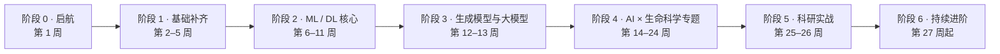

# 🧬 面向生命科学的人工智能 · 系统学习路线

**AI for Life Sciences：一条 26 周的系统学习路线 + 精选免费资源 + 每天更新的学习笔记**

<!-- PROGRESS:START -->
 

📈 每日笔记已更新 **11** 天 · 核心课程进度 11 / 182 · 当前阶段：阶段 1「基础补齐」
<!-- PROGRESS:END -->

从 Python 和数学基础出发，经过机器学习、深度学习、生成模型与大模型，再深入基因组、蛋白质、药物发现、单细胞、生物医学影像、科研智能体六个方向，最后完成一个可开源的毕业项目。所有推荐资源都**免费**，建库时做过核实：GitHub 仓库逐个确认存在，其他链接以官方页面为准并经网络搜索核实。

**适合谁**：想系统掌握 AI 方法的生命科学 / 计算生物学研究者，以及想进入生命科学领域的 AI / 计算机背景学习者。

## 🗺️ 路线总览

| 阶段 | 周次 | 学什么 | 产出 |
|---|---|---|---|
| 0 · 启航 | 1 | 领域全景图、学习方法、开发环境 | 学习仓库 + 第一个 Notebook |
| 1 · 基础补齐 | 2–5 | Python 科学计算、线代 / 微积分 / 概率统计、生命科学与生信速成 | NumPy 手写 PCA、表达数据分析 |
| 2 · ML / DL 核心 | 6–11 | 经典机器学习、神经网络与 PyTorch、CNN、Transformer、GNN 与几何深度学习 | 6 个周项目 |
| 3 · 生成模型与大模型 | 12–13 | VAE、扩散、流匹配、LLM、生物“基础模型” | 2D 流匹配、读论文助手 |
| 4 · AI × 生命科学 | 14–24 | 基因组 · 蛋白质（语言模型 / 结构 / 设计）· 药物发现 · 单细胞与虚拟细胞 · 影像 · 智能体 | 11 个专题项目 |
| 5 · 科研实战 | 25–26 | 科研严谨性、毕业项目、写作与开源 | 毕业项目仓库 + 技术报告 |
| 6 · 持续进阶 | 27 起 | 每天精读一篇近期论文或一个新工具 | — |

👉 详细路线、自评表和两条入口路线（生物背景 / 计算背景）见 **[ROADMAP.md](ROADMAP.md)**；逐日安排见 **[SYLLABUS.md](SYLLABUS.md)**。

## 📰 最新每日笔记

<!-- LATEST:START -->
| 日期 | Day | 主题 |
|---|---|---|
| 2026-11-14 | [Day 011](daily/2026-11/day011-2026-11-14.md) | 可视化：matplotlib / seaborn |
| 2026-11-13 | [Day 010](daily/2026-11/day010-2026-11-13.md) | pandas：表格数据处理 |
| 2026-11-12 | [Day 009](daily/2026-11/day009-2026-11-12.md) | NumPy：向量化与广播 |
| 2026-11-11 | [Day 008](daily/2026-11/day008-2026-11-11.md) | Python 核心语法速览 |
| 2026-11-10 | [Day 007](daily/2026-11/day007-2026-11-10.md) | 🔁 周复盘 ①：第一个生物 AI Notebook |
| 2026-11-09 | [Day 006](daily/2026-11/day006-2026-11-09.md) | 如何读 AI × 生物论文、追踪文献 |
| 2026-11-08 | [Day 005](daily/2026-11/day005-2026-11-08.md) | Linux 命令行与生信文件操作 |
<!-- LATEST:END -->

全部笔记见 [daily/](daily/README.md)。

## 🚀 如何使用

1. **先自评**：读 [ROADMAP.md](ROADMAP.md)，用自评表判断哪些内容可以快速浏览。
2. **跟着每日笔记走**：每篇包含目标、核心概念、精确到章节的免费资源、可运行的练习、自测题和前沿动态。平日约 1.5 小时。
3. **每周做项目**：每周第 7 天是“周复盘 + 小项目”，见 [projects/](projects/README.md)。
4. **记录进度**：点右上角 **Fork** 复制一份到自己账号，在副本里勾选打卡框、写笔记；点 **Watch** 可以收到每日更新通知。

## 📚 资源库

| 方向 | 方向 |
|---|---|
| [01 编程与数学基础](resources/01-programming-math.md) | [08 单细胞与多组学](resources/08-single-cell-omics.md) |
| [02 生命科学与生物信息学](resources/02-life-science-bioinformatics.md) | [09 生物医学影像](resources/09-bioimaging.md) |
| [03 机器学习与深度学习](resources/03-machine-learning-deep-learning.md) | [10 LLM 与智能体](resources/10-llm-agents.md) |
| [04 AI × 生命科学综合课程](resources/04-ai-for-life-sciences-courses.md) | [11 数据、基准与竞赛](resources/11-data-benchmarks-competitions.md) |
| [05 基因组学](resources/05-genomics.md) | [12 工具与算力](resources/12-tools-compute.md) |
| [06 蛋白质](resources/06-proteins.md) | [13 前沿追踪与社区](resources/13-frontier-community.md) |
| [07 小分子与药物发现](resources/07-drug-discovery.md) | [14 中文资源汇总](resources/14-chinese-resources.md) 🇨🇳 |

**几门最值得先收藏的核心资源**：[《动手学深度学习》](https://zh.d2l.ai/) · [Understanding Deep Learning](https://udlbook.github.io/udlbook/) · [MIT 6.874 生命科学中的深度学习](https://mit6874.github.io/) · [dmol.pub](https://dmol.pub/) · [MIT 6.S184 流匹配与扩散模型](https://diffusion.csail.mit.edu/) · [Single-cell Best Practices](https://www.sc-best-practices.org/) · [EMBL-EBI AlphaFold 课程](https://www.ebi.ac.uk/training/online/courses/alphafold/) · [TeachOpenCADD](https://projects.volkamerlab.org/teachopencadd/)

## 🔭 前沿速递

每日笔记里的“今日前沿”按月汇总在 [frontier/](frontier/README.md)。

## 🤖 每日更新机制

本仓库每天北京时间早上由 Claude Code 定时任务按 [SYLLABUS.md](SYLLABUS.md) 自动写一篇新笔记，同时更新索引和前沿速递。写作规范和流程见 [CLAUDE.md](CLAUDE.md)。每次更新都会运行 [scripts/validate.py](scripts/validate.py) 检查链接和索引；外部资源在引用前通过网络搜索核实。更新记录见 [CHANGELOG.md](CHANGELOG.md)。

发现错误、失效链接，或想推荐好资源，欢迎提 [Issue](https://github.com/Wegene38/ai-for-life-sciences/issues)。

## 👤 作者

**[Wegene38](https://github.com/Wegene38)**

本仓库只做整理与讲解；收录的外部课程、书籍、代码与论文版权归原作者所有，请遵守各自的许可协议。
