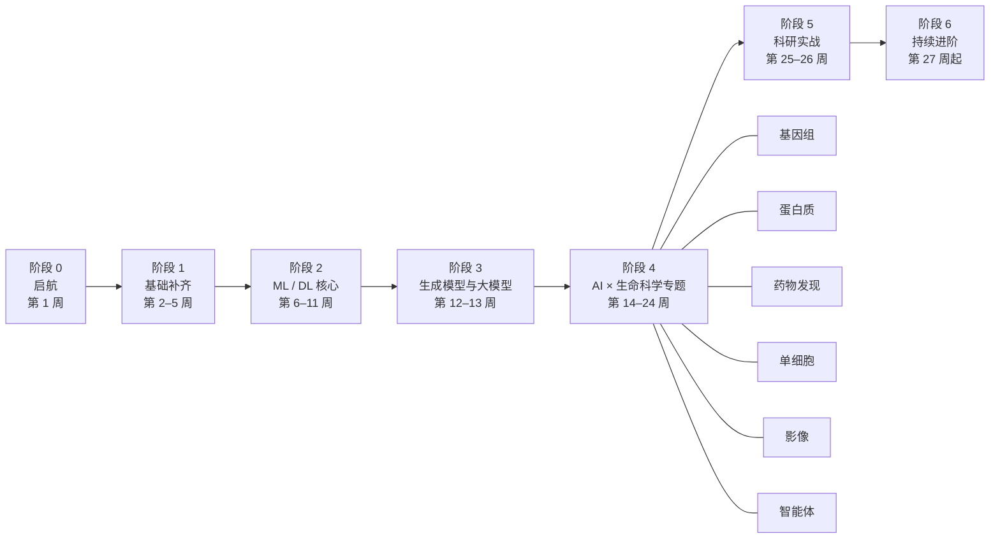

# 🗺️ 学习路线图

这份路线用 26 周（约半年）带你从基础走到能独立做“AI × 生命科学”的小型研究项目。每天的具体安排见 [SYLLABUS.md](SYLLABUS.md)，所有资源链接见 [resources/](resources/README.md)。

## 0. 学完之后你能做什么

- 读懂 AlphaFold、ESM、Enformer / AlphaGenome、scGPT、RFdiffusion 这类代表性论文的方法部分，说清它们的输入、输出、训练目标和局限。
- 用 PyTorch 从零实现并训练 MLP、CNN、Transformer、GNN 和简单的扩散 / 流匹配模型。
- 在基因组、蛋白质、小分子、单细胞、影像中至少两个方向上，熟练使用主流开源工具完成分析任务。
- 用合理的数据划分、基线和统计检验评估模型，避免数据泄漏和“基准过拟合”。
- 完成一个可复现、开源的毕业项目，形成个人作品集。

## 1. 先做自评

给每项打分：0 = 没接触过，1 = 学过但不熟，2 = 能独立使用。

| 领域 | 自评要点 | 如果 ≥ 2 分 |
|---|---|---|
| Python | 写函数和类、用 NumPy / pandas 处理表格、画图 | 第 2 周只做周复盘项目 |
| 工程习惯 | Git、命令行、conda 环境、Jupyter | 第 1 周 Day 003–005 快速浏览 |
| 线性代数 | 矩阵乘法的几何意义、特征分解、SVD、PCA | 第 3 周只做 Day 020–021 |
| 概率统计 | 常见分布、MLE、假设检验、FDR、交叉熵 | 第 4 周只做 Day 026–028 |
| 分子与细胞生物学 | 中心法则、基因调控、蛋白结构层级、测序原理 | 第 5 周 Day 029–032 快速浏览 |
| 生物信息学 | 序列比对、常用数据库与文件格式 | 第 5 周只做 Day 034–035 |
| 机器学习 | 正则化、交叉验证、树模型、聚类、评估指标 | 第 6–7 周只做 Day 040、046 和周复盘 |
| 深度学习 | 反向传播、PyTorch 训练循环、CNN、Transformer | 第 8–10 周挑生物相关的 Day（059–063、068–070） |

> 建议把自评结果写进自己 fork 的仓库或学习笔记里，第 13 周和第 26 周各重新评一次。

## 2. 两条入口路线

**路线 A：生物 / 医学背景（包括计算生物学）**——生物和数据分析有基础，主要补 AI 与工程。
- 第 1–5 周：重点放在 Python 工程化（第 2 周）和数学（第 3–4 周），第 5 周快速浏览。
- 第 6–13 周是重中之重：每个周复盘项目都要亲手写完，不要只看视频。
- 第 14–24 周：先挑自己研究相关的方向深入，其他方向至少完成“概念 + 一个练习”。

**路线 B：计算机 / 数学背景**——ML 有基础，主要补生物学与领域知识。
- 第 2–4 周快速浏览，把时间留给第 5 周，并加学 [MIT 7.00x](https://www.edx.org/learn/biology/massachusetts-institute-of-technology-introduction-to-biology-the-secret-of-life) 或 [OpenStax Biology 2e](https://openstax.org/details/books/biology-2e)。
- 第 6–13 周重点看各周里和生物相关的那几天（如 Day 040 生物数据泄漏、059 DNA CNN、073 分子图）。
- 第 14–24 周：每个专题先花一天补该方向的生物背景（PDB-101、sc-best-practices 引言等）。

## 3. 时间安排

| 节奏 | 每天 | 每周 | 26 周合计 |
|---|---|---|---|
| 标准 | 平日 1.5 小时，周复盘 2–3 小时 | 约 11 小时 | 约 290 小时 |
| 轻量 | 平日 45 分钟，只做核心资源和练习 | 约 6 小时 | 约 50 周学完 |
| 冲刺 | 平日 3 小时，加做选学资源 | 约 20 小时 | 可压缩到 4 个月 |

落后了不用焦虑：每日笔记会持续更新，按自己的节奏往下走即可。

## 4. 各阶段详解

### 阶段 0 · 启航（第 1 周）
- **目标**：建立领域全景图，搭好开发环境，确定个人路线。
- **⭐ 核心资源**：[deep-review 综述](https://greenelab.github.io/deep-review/)、[AlphaFold DB](https://alphafold.ebi.ac.uk/)、[The Missing Semester](https://missing.csail.mit.edu/)（[中文版](https://missing-semester-cn.github.io/)）、[Software Carpentry](https://swcarpentry.github.io/shell-novice/)。
- **产出**：自己的学习笔记仓库；第一个能跑的 Notebook（序列 → 结构 → 置信度曲线）。
- **检查点**：能说出 AI 在生命科学中的三类核心问题（预测、理解、设计）以及各自的代表模型。

### 阶段 1 · 基础补齐（第 2–5 周）
- **目标**：Python 科学计算熟练；掌握 ML 所需的线代、微积分、概率统计；补齐分子生物学与生信常识。
- **⭐ 核心资源**：[PDSH](https://jakevdp.github.io/PythonDataScienceHandbook/)、[3Blue1Brown](https://www.3blue1brown.com/topics/linear-algebra)、[MML](https://mml-book.github.io/)、[Stat 110](https://stat110.hsites.harvard.edu/)、[MSMB](https://www.huber.embl.de/msmb/)、[北大《生物信息学：导论与方法》](https://www.coursera.org/learn/sheng-wu-xin-xi-xue)、[Rosalind](https://rosalind.info/)。
- **选学**：[MIT 18.06](https://ocw.mit.edu/courses/18-06-linear-algebra-spring-2010/)、[Probabilistic Machine Learning](https://probml.github.io/pml-book/)、[MIT 7.00x](https://www.edx.org/learn/biology/massachusetts-institute-of-technology-introduction-to-biology-the-secret-of-life)。
- **产出**：只用 NumPy 实现的 PCA 与线性回归；一个公开表达数据集的分析 Notebook；5 道以上 Rosalind 题。
- **检查点**：能解释 SVD 与 PCA 的关系、交叉熵与 KL 散度的关系、RNA-seq 计数为什么常用负二项分布、FDR 校正在做什么。

### 阶段 2 · 机器学习与深度学习核心（第 6–11 周）
- **目标**：掌握经典机器学习与深度学习的原理和工程实践，重点是生物数据上的正确用法。
- **⭐ 核心资源**：[ISLP](https://www.statlearning.com/)、[《动手学深度学习》](https://zh.d2l.ai/)、[UDL](https://udlbook.github.io/udlbook/)、[李宏毅机器学习](https://speech.ee.ntu.edu.tw/~hylee/ml/2021-spring.php)、[Karpathy Zero to Hero](https://karpathy.ai/zero-to-hero.html)、[CS224W](https://web.stanford.edu/class/cs224w/)、[Geometric Deep Learning](https://geometricdeeplearning.com/)。
- **选学**：[fast.ai](https://course.fast.ai/)、[Stanford CS229](https://cs229.stanford.edu/)、[CS231n](https://cs231n.stanford.edu/)、[Neuromatch Deep Learning](https://deeplearning.neuromatch.io/)。
- **产出**：6 个周复盘项目（表达谱分类、ML 小比赛、MLP 性质预测、CNN 结合位点预测、Transformer 蛋白分类、GNN 分子性质预测）。
- **检查点**：不看资料写出 PyTorch 训练循环；解释为什么生物数据要按同源性 / 骨架 / 时间划分；解释注意力机制和消息传递的计算过程；说清“等变”的含义。

### 阶段 3 · 生成模型与大模型（第 12–13 周）
- **目标**：理解 VAE、扩散与流匹配，这是蛋白质与分子设计的数学基础；理解 LLM 和“基础模型”的能力与局限。
- **⭐ 核心资源**：[MIT 6.S184 Flow Matching and Diffusion Models](https://diffusion.csail.mit.edu/)（讲义 [arXiv:2506.02070](https://arxiv.org/abs/2506.02070)）、[李宏毅机器学习 2025](https://speech.ee.ntu.edu.tw/~hylee/ml/2025-spring.php)、[Hugging Face LLM Course](https://huggingface.co/learn/llm-course)。
- **选学**：[Stanford CS236](https://deepgenerativemodels.github.io/)、[Flow Matching Guide and Code](https://arxiv.org/abs/2412.06264)。
- **产出**：从零实现的 2D 流匹配；一个“检索 + LLM”的读论文助手。
- **检查点**：推导扩散模型的训练目标；解释流匹配与扩散的联系；说出至少三个生物基础模型“看起来强、实际不如基线”的原因。

### 阶段 4 · AI × 生命科学专题（第 14–24 周）

| 周次 | 专题 | ⭐ 核心资源 | 周复盘产出 |
|---|---|---|---|
| 14–15 | 基因组学：调控序列模型、长程模型、DNA 语言模型 | [MIT 6.874](https://mit6874.github.io/)、[CS273B](https://github.com/kundajelab/cs273b)、[gReLU](https://github.com/Genentech/gReLU)、[AlphaGenome](https://github.com/google-deepmind/alphagenome)、[Evo 2](https://github.com/ArcInstitute/evo2) | 序列 → 功能模型 + 变异效应打分 |
| 16 | 蛋白质 I：语言模型与表示 | [ESM](https://github.com/facebookresearch/esm)、[ProteinGym](https://proteingym.org/) | ESM-2 零样本突变扫描 |
| 17 | 蛋白质 II：结构预测 | [EMBL-EBI AlphaFold 课程](https://www.ebi.ac.uk/training/online/courses/alphafold/)、[ColabFold](https://github.com/sokrypton/ColabFold)、[Boltz](https://github.com/jwohlwend/boltz) | 复合物预测与批判性评估 |
| 18 | 蛋白质 III：设计 | [AI 蛋白设计路线课（10 讲）](https://miangoaren.github.io/teaching/proteins)、[ProteinMPNN](https://github.com/dauparas/ProteinMPNN)、[RFdiffusion](https://github.com/RosettaCommons/RFdiffusion) | 小型设计管线 |
| 19–20 | 小分子与药物发现 | [TeachOpenCADD](https://projects.volkamerlab.org/teachopencadd/)、[dmol.pub](https://dmol.pub/)、[TDC](https://tdcommons.ai/)、[Pat Walters 教程](https://github.com/PatWalters/practical_cheminformatics_tutorials) | 性质预测对比 + 虚拟筛选管线 |
| 21–22 | 单细胞与多组学、虚拟细胞 | [sc-best-practices](https://www.sc-best-practices.org/)、[scvi-tools](https://docs.scvi-tools.org/)、[scGPT](https://github.com/bowang-lab/scGPT)、[State](https://github.com/ArcInstitute/state) | 单细胞全流程 + 扰动预测基线 |
| 23 | 生物医学影像 | [BioImage Analysis Notebooks](https://haesleinhuepf.github.io/BioImageAnalysisNotebooks/)、[DL@MBL](https://github.com/dl-janelia/DL-MBL-2024)、[Cellpose](https://www.cellpose.org/) | 细胞分割 + 形态聚类 |
| 24 | LLM、智能体与 AI 科学家 | [Biomni](https://github.com/snap-stanford/Biomni)、[PaperQA](https://github.com/Future-House/paper-qa)、[HF Agents Course](https://huggingface.co/learn/agents-course) | 小型科研智能体 |

- **检查点**：每个专题结束时，能用一页纸讲清该方向的核心问题、代表方法、常用数据与基准、主要局限，并说出一个你认为值得做的研究问题。

### 阶段 5 · 科研实战（第 25–26 周）
- **目标**：独立完成一个小型研究项目：选题、基线、迭代、解读、写作、开源。
- **资源**：[projects/README.md](projects/README.md) 中的选题清单与项目模板；[Ten simple rules for reproducible computational research](https://doi.org/10.1371/journal.pcbi.1003285)。
- **产出**：一个开源的毕业项目仓库 + 一篇技术报告或博客。

### 阶段 6 · 持续进阶（第 27 周起）
每天精读一篇近期论文或一个新工具，按周轮换方向；同时关注 [frontier/](frontier/README.md) 的前沿速递。

## 5. 学习方法

1. **先跑通，再深入**：每个新模型先在 Colab 上跑通官方示例，再回头读论文细节。
2. **主动输出**：每天用 3–5 句话写下“今天学到了什么、还有什么不懂”。讲不清楚的地方就是没真正懂（费曼学习法）。
3. **主动回忆与间隔重复**：先做自测题再看答案；周复盘时重做本周的自测题。
4. **复现优先**：读到重要论文，尽量复现其中一张图或一个表。
5. **怀疑基准**：始终问“和简单基线比如何？数据划分有没有泄漏？”
6. **避免“教程地狱”**：每周至少有一个项目是自己从空白 Notebook 写起的。

## 6. 结业后的方向选择

| 如果你对……最感兴趣 | 下一步深入 |
|---|---|
| 蛋白质结构与设计 | [AI 蛋白设计路线课](https://miangoaren.github.io/teaching/proteins)、[ColabDesign](https://github.com/sokrypton/ColabDesign)、[ML4PE 讲座](https://www.ml4proteinengineering.com/)、[foundry（RFdiffusion3）](https://github.com/RosettaCommons/foundry) |
| 基因组与基因调控 | [MIT 6.874](https://mit6874.github.io/)、[gReLU](https://github.com/Genentech/gReLU)、[AlphaGenome](https://github.com/google-deepmind/alphagenome)、[Evo 2](https://github.com/ArcInstitute/evo2) |
| 药物发现 | [TeachOpenCADD](https://projects.volkamerlab.org/teachopencadd/)、[Polaris](https://polarishub.io/)、[Boltz](https://github.com/jwohlwend/boltz) |
| 单细胞与虚拟细胞 | [sc-best-practices](https://www.sc-best-practices.org/)、[Virtual Cell Challenge](https://virtualcellchallenge.org/)、[CELLxGENE Census](https://chanzuckerberg.github.io/cellxgene-census/) |
| 影像 | [DL@MBL](https://github.com/dl-janelia/DL-MBL-2024)、[bioimage.io](https://bioimage.io/)、[MONAI](https://github.com/Project-MONAI/tutorials) |
| 智能体与自动化科研 | [Biomni](https://github.com/snap-stanford/Biomni)、[PaperQA](https://github.com/Future-House/paper-qa)、[LAB-Bench](https://github.com/Future-House/LAB-Bench) |
