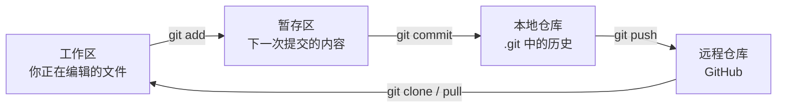

# Day 004 · Git 与 GitHub：建立自己的学习仓库

> 📅 2026-11-07（周六）· 阶段 0「启航」· 第 1 周 · ⏱️ 约 90 分钟
>
> [📅 课程表](../../SYLLABUS.md) · [🗺️ 路线图](../../ROADMAP.md) · 上一篇：[Day 003](../2026-11/day003-2026-11-06.md) · 下一篇：[Day 005](../2026-11/day005-2026-11-08.md)

## 🎯 今日目标

1. 理解 Git 的工作方式：工作区、暂存区、提交（commit）、分支（branch）、远程仓库。
2. 熟练使用日常命令：`init`、`status`、`add`、`commit`、`log`、`switch`、`merge`、`push`、`pull`，会写 `.gitignore`。
3. 在 GitHub 上建好自己的学习仓库并完成第一次推送；学会把 commit 哈希记进实验结果。

## 📖 核心概念

### 1. 科研为什么离不开版本控制

`analysis_final_v3_真的最终版.ipynb` 式的文件名管理，迟早会让你说不清哪个版本画出了论文里的那张图。Git 能回答三个问题：**改了什么、谁改的、为什么改**，并且随时能回到过去任何一个状态。

对计算研究来说，Git 还是可复现性的基础：把 commit 哈希和结果一起保存，就能精确说出“这个数字是哪一版代码算出来的”。GitHub 则同时是备份、协作平台和作品集。生物 AI 领域的模型和教程几乎都发布在 GitHub 上，本课程资源库收录的 70 多个仓库就是例子。

### 2. Git 的核心模型



- **提交（commit）是整个项目在某一刻的快照**，记录了作者、时间、说明，以及指向上一个提交的指针，用一串哈希（如 `c1bcfb6`）唯一标识。所有提交连起来就是项目的历史。
- **暂存区**让你挑选哪些改动进入下一次提交。比如只提交修好的 bug，不提交还在调试的代码。
- **分支只是一个指向某次提交的可移动指针**，创建几乎没有成本。想试一种新的归一化方法、换一个模型，就开一个新分支：成功了合并回 `main`，失败了直接丢掉，主线不受影响。
- **合并冲突（merge conflict）**：两个分支修改了同一文件的同一处，Git 无法自动决定保留哪个版本，就在文件里用 `<<<<<<<`、`=======`、`>>>>>>>` 标出两个版本，由你手动选择后再提交。

### 3. GitHub：远程仓库与协作

- `clone`：把远程仓库完整复制到本地；`push`：把本地提交推送上去；`pull`：拉取远程的新提交并合并到本地。
- **fork**：把别人的仓库复制一份到自己账号下。**pull request（PR）**：请原作者把你的改动合并进去，给开源工具修 bug、补文档都是这样提交的。
- **认证**：从 2021 年起，GitHub 不再接受用账号密码执行 git 操作。推荐用 GitHub CLI 的 `gh auth login` 登录，也可以用个人访问令牌（personal access token）或 SSH 密钥。

### 4. 什么东西不该放进 Git

| 不要提交 | 原因 | 应该放在哪里 |
|---|---|---|
| 原始测序数据、大型表达矩阵 | 体积大；GitHub 对超过 50 MB 的文件发出警告，超过 100 MB 的直接拒绝 | GEO / SRA 等公共数据库、Zenodo、机构存储；仓库里只放下载脚本 |
| 模型权重、训练检查点 | 体积大、更新频繁 | Hugging Face Hub、Zenodo、Git LFS |
| 密钥、令牌、密码 | 一旦推送，历史记录里就永远留有副本 | 环境变量或 `.env` 文件（并加入 `.gitignore`） |
| 患者数据等敏感信息 | 隐私与伦理要求 | 有访问控制的平台 |

如果不小心推送了密钥，在新提交里删掉文件是不够的，历史里仍然能找到它。**第一时间去服务商那里作废这个密钥并换新的**。

### 5. 好习惯

- 小步提交，一个提交只做一件事；说明写清楚“做了什么、为什么”。
- 推送前先看 `git status` 和 `git diff`，确认没有夹带大文件或密钥。
- Notebook 文件里保存了运行输出，diff 会很乱。可以用 [nbstripout](https://github.com/kynan/nbstripout) 在提交时自动清掉输出，或用 [Jupytext](https://github.com/mwouts/jupytext) 把 Notebook 同步成 `.py` 文件。
- 把 commit 哈希写进结果文件（见练习第 3 步），这样每个数字、每张图都能追溯到产生它的代码。

### 6. 用 Git 记录这门课

- **建议**：新建一个自己的学习仓库 `ai4ls-notes`，每天一个笔记文件加练习代码，每个周项目一个文件夹。半年后它就是你的作品集。
- **只想在本仓库的笔记上打勾**：Fork 本仓库，在自己的副本里修改。本仓库每天更新后，在你的 fork 页面点 **Sync fork** 同步即可。

## 📚 今日资源

| # | 资源 | 学什么 | 建议时长 |
|---|---|---|---|
| 1 | [Software Carpentry：Version Control with Git](https://swcarpentry.github.io/git-novice/) | 第 1–7 节：为什么要版本控制 → 配置 Git → 建仓库 → 跟踪修改 → 查看历史 → 忽略文件 → 连接 GitHub。边读边在终端里敲 | 40 分钟 |
| 2 | [Missing Semester 2026：Version Control and Git](https://missing.csail.mit.edu/2026/version-control/) | MIT 2026 年新版课程，从“快照、对象、引用”讲 Git 的数据模型。理解了数据模型，命令就不用死记。2020 版有[中文翻译](https://missing-semester-cn.github.io/2020/version-control/) | 30 分钟 |
| 3 | [Perez-Riverol et al. 2016, *Ten Simple Rules for Taking Advantage of Git and GitHub*](https://doi.org/10.1371/journal.pcbi.1004947) | PLOS Computational Biology 开放获取，写给科研人员的 GitHub 用法：跟踪项目、协作、让代码可以被引用 | 15 分钟 |
| 4 | [《Pro Git》中文版](https://git-scm.com/book/zh/v2) | 官方免费书，当作查阅手册：第 2 章“Git 基础”、第 3 章“Git 分支” | 按需查阅 |

## 🛠️ 动手练习

**第 1 步：在本地建一个学习仓库。** 打开终端（Windows 用户可用 Git Bash），依次运行：

```bash
# 第一次使用 Git：设置名字和邮箱（每台电脑只需设置一次）
git config --global user.name "你的名字"
git config --global user.email "你的邮箱"
git config --global init.defaultBranch main

# 新建仓库，写第一篇笔记
mkdir ai4ls-notes && cd ai4ls-notes
git init
echo "# 我的 AI × 生命科学学习笔记" > README.md
mkdir -p notes data
echo "Day 004：学会了 git add / commit / push" > notes/day004.md
printf 'data/\n*.fastq.gz\n*.ckpt\n.ipynb_checkpoints/\n__pycache__/\n.env\n' > .gitignore

git status                     # data/ 不会出现在列表里，因为它被 .gitignore 忽略了
git add README.md notes/ .gitignore
git commit -m "初始化学习仓库：README、第一篇笔记和 .gitignore"

# 在分支上做实验，再合并回 main
git switch -c try-new-plot
echo "- 尝试了新的画图方式" >> notes/day004.md
git commit -am "记录画图实验"
git switch main
git merge try-new-plot
git log --oneline --graph
```

期望输出（哈希会不同）：

```
* c1bcfb6 记录画图实验
* 993079f 初始化学习仓库：README、第一篇笔记和 .gitignore
```

**第 2 步：推送到 GitHub。** 在 GitHub 网页上新建一个名为 `ai4ls-notes` 的空仓库（不要勾选添加 README），然后：

```bash
gh auth login        # 用 GitHub CLI 登录一次（需先安装 GitHub CLI）；也可以改用个人访问令牌或 SSH 密钥
git remote add origin https://github.com/<你的用户名>/ai4ls-notes.git
git push -u origin main
```

刷新 GitHub 页面，能看到 README 和 `notes/` 文件夹就成功了。

**第 3 步：把 commit 哈希记进结果。** 在仓库目录里运行下面的 Python 代码。以后每次保存实验结果，都带上产生它的代码版本：

```python
import json, subprocess, datetime

def git_commit():
    """返回当前代码的 commit 哈希；已跟踪的文件有未提交改动时，加上 -dirty 标记。"""
    run = lambda *cmd: subprocess.run(cmd, capture_output=True, text=True, check=True).stdout.strip()
    sha = run("git", "rev-parse", "--short", "HEAD")
    dirty = run("git", "status", "--porcelain", "--untracked-files=no")
    return sha + ("-dirty" if dirty else "")

result = {
    "model": "random_forest",
    "auc": 0.87,                 # 示例数值：换成你真实的评估结果
    "commit": git_commit(),
    "time": datetime.datetime.now().isoformat(timespec="seconds"),
}
with open("results.json", "w", encoding="utf-8") as f:
    json.dump(result, f, ensure_ascii=False, indent=2)
print(result)
```

期望输出类似 `{'model': 'random_forest', 'auc': 0.87, 'commit': 'c1bcfb6', 'time': '...'}`。先改动一下 `notes/day004.md` 但不提交，再运行一次，`commit` 会变成 `c1bcfb6-dirty`，提醒你这个结果来自未提交的代码。

**进阶：亲手制造并解决一次合并冲突。**

```bash
git switch -c branch-a
# 把 notes/day004.md 的第一行改成“Day 004：今天学了 Git（分支 A 的写法）”，然后：
git commit -am "A 修改第一行"
git switch main
# 把同一行改成“Day 004：Git 入门（main 的写法）”，然后：
git commit -am "main 修改第一行"
git merge branch-a          # 会提示 CONFLICT
```

打开 `notes/day004.md`，会看到用 `<<<<<<< HEAD`、`=======`、`>>>>>>> branch-a` 标出的两个版本。删掉标记、留下你想要的内容，然后 `git add notes/day004.md` 加 `git commit` 完成合并。最后用 `git log --oneline --graph` 看看分叉又汇合的历史。

## ✅ 自测题

1. 工作区、暂存区、本地仓库、远程仓库分别是什么？`git add`、`git commit`、`git push` 各把改动从哪里移到哪里？
2. 为什么不应该把 FASTQ 原始数据或训练好的模型权重直接提交到 Git？应该放在哪里？
3. 不小心把 API 密钥提交并推送到了 GitHub，再提交一次把文件删掉，够不够？应该怎么做？
4. 什么情况下会发生合并冲突？怎样解决？
5. 为什么要把 commit 哈希记进实验结果？`-dirty` 标记提醒了什么？

<details>
<summary>参考答案</summary>

1. 工作区是你正在编辑的文件；暂存区是挑选好、准备放进下一次提交的改动；本地仓库是 `.git` 里保存的全部提交历史；远程仓库是 GitHub 上的副本。`git add` 把改动从工作区放进暂存区，`git commit` 把暂存区的内容记成本地仓库里的一个新提交，`git push` 把本地的新提交上传到远程仓库。
2. 这些文件体积大（GitHub 对超过 50 MB 的文件警告，超过 100 MB 的拒绝），会让仓库变得臃肿、克隆很慢，而且往往有专门的存放位置。原始数据放 GEO、SRA 等公共数据库或 Zenodo，模型权重放 Hugging Face Hub、Zenodo 或 Git LFS；仓库里只放下载脚本和说明。
3. 不够。历史提交里仍然保存着密钥，任何人都能翻到。应该立刻去服务商那里作废这个密钥、换一个新的；之后把密钥放进环境变量或 `.env` 文件，并把 `.env` 加进 `.gitignore`。
4. 两个分支修改了同一文件的同一处，合并时 Git 无法自动判断保留哪个，就会冲突。解决方法：打开文件，找到 `<<<<<<<`、`=======`、`>>>>>>>` 标出的两个版本，编辑成想要的最终内容并删掉标记，再 `git add` 和 `git commit`。
5. 这样每个结果都能精确追溯到产生它的代码版本，复现或排查问题时可以直接回到那个提交。`-dirty` 表示运行时有已跟踪的文件改了还没提交，也就是说结果对应的代码并没有完整记录在任何一个提交里，应该先提交再正式跑实验。

</details>

## 🔭 今日前沿

- **EnzyREx：从反应出发找酶（Genome Biology，11 月 3 日）**：Hirota、Yamada 等人提出的深度学习框架，由两个模型组成：EnzymeCNN 先判断一个蛋白是不是酶，EnzymeCLIP 再学习酶与化学反应之间的对应关系，用来为“已知存在、但不知道由哪个酶催化”的孤儿反应（orphan reaction）寻找候选酶。论文报告，在 1,255 个与微生物组相关的孤儿反应中，它为 897 个提出了候选蛋白。代码以 MIT 许可在 GitHub 开源，模型权重放在 Zenodo，正好对应今天讲的“代码进 Git、大文件放别处”。EnzymeCLIP 借鉴的是 CLIP 式对比学习，后面学表示学习时会再遇到。来源：[论文](https://link.springer.com/article/10.1186/s13059-026-04312-7) · [GitHub](https://github.com/yamada-lab/EnzyREx)

## 📝 学习打卡

- [ ] 读完 Software Carpentry 第 1–7 节，边读边敲命令
- [ ] 建好 `ai4ls-notes` 仓库并推送到 GitHub
- [ ] 跑通第 3 步，看到 `-dirty` 标记
- [ ] 进阶：制造并解决一次合并冲突
- 今日笔记 / 疑问：
