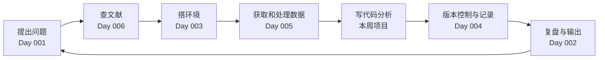

# Day 007 · 🔁 周复盘 ①：第一个生物 AI Notebook

> 📅 2026-11-10（周二）· 阶段 0「启航」· 第 1 周 · ⏱️ 约 2–3 小时
>
> [📅 课程表](../../SYLLABUS.md) · [🗺️ 路线图](../../ROADMAP.md) · 上一篇：[Day 006](../2026-11/day006-2026-11-09.md) · 下一篇：[Day 008](../2026-11/day008-2026-11-11.md)

## 🎯 今日目标

1. 把第 1 周六天的内容串成一张知识地图，看清它们怎样组成一条完整的科研工作流。
2. 完成本周小项目：从 UniProt 和 AlphaFold DB 获取两个蛋白的序列与预测结构，统计并比较 pLDDT 置信度，用 3D 着色展示，最后推送到自己的学习仓库。
3. 重做本周最重要的 5 道自测题，再完成 1 道综合题。

## 📖 核心概念

### 1. 本周知识地图

- [Day 001 全景图](../2026-11/day001-2026-11-04.md)：用“模态 × 任务”给任何一篇论文定位；AI 在生命科学里做四类事：预测、理解、设计、自动化。
- [Day 002 自评与学习方法](../2026-11/day002-2026-11-05.md)：用“能不能做到”给自己打分；主动回忆和间隔重复是研究证据最强的学习方法。今天的自测题就是一次主动回忆。
- [Day 003 开发环境](../2026-11/day003-2026-11-06.md)：Colab / Kaggle 提供免费 GPU，本地用 conda 管理环境；Notebook 分享前一定要“重启并全部运行”。
- [Day 004 Git 与 GitHub](../2026-11/day004-2026-11-07.md)：每个结果都要能追溯到一次提交；大文件和密钥不进仓库。
- [Day 005 命令行](../2026-11/day005-2026-11-08.md)：用管道快速处理 FASTA、FASTQ、GTF；GTF 和 BED 的起点坐标差 1。
- [Day 006 读论文](../2026-11/day006-2026-11-09.md)：三遍阅读法、拆解论文的 8 个问题、先问“有没有简单基线”。

### 2. 它们怎么连起来



这个循环会贯穿整门课：每个周项目都会从头到尾走一遍，只是“写代码分析”这一步会越来越复杂，从今天的画图逐步变成训练和评估模型。

### 3. 本周项目的新知识：读懂 AlphaFold 的置信度

**pLDDT**（predicted local distance difference test）是 AlphaFold 给**每个残基**的局部置信度，范围 0–100。AlphaFold DB 把它存在结构文件的 B-factor 列里，Day 001 已经用过。通常按四档解读：

| pLDDT | 含义 |
|---|---|
| ≥ 90 | 置信度很高，连侧链位置一般也可靠 |
| 70–90 | 置信度较高，主链走向一般正确 |
| 50–70 | 置信度低，要谨慎解读 |
| < 50 | 置信度很低，常见于天然无序区（intrinsically disordered region） |

pLDDT 很低不一定是“预测失败”：这些区域在溶液中很可能本来就没有固定结构，常常要结合伴侣分子才折叠。但它们的坐标不能当作真实结构来解读。

**PAE**（predicted aligned error，预测对齐误差）回答的是另一个问题：以残基 i 为参照对齐时，残基 j 的位置可能偏离多少。它是一个“残基 × 残基”的矩阵，最适合判断**结构域之间的相对位置**是否可信：两个结构域各自的 pLDDT 都很高，但它们之间的 PAE 很大，就说明它们的相对朝向不可信。

本周项目比较两个蛋白。人血红蛋白 β 链（HBB）是紧凑的珠蛋白折叠，置信度应该几乎全程很高。p53 中间的 DNA 结合结构域（约第 94–292 位）折叠良好，而 N 端和 C 端含有大段天然无序区，你会看到很典型的“两头低、中间高”。

**一个实用提醒**：AlphaFold DB 已升级到 v6 版本，预测接口也做过一次不兼容的修改，例如 `entryId` 改名为 `modelEntityId`，接口不再提供 PAE 图片。写代码时，结构文件的地址要从接口返回的 `pdbUrl` 字段读取，不要自己拼 `..._v4.pdb` 这样的文件名，否则数据库一升级代码就会失效。详见 [EBI 的接口变更说明](https://www.ebi.ac.uk/pdbe/news/breaking-changes-afdb-predictions-api)。

## 📚 今日资源

| # | 资源 | 学什么 | 建议时长 |
|---|---|---|---|
| 1 | [AlphaFold DB FAQ](https://alphafold.ebi.ac.uk/faq) | pLDDT 和 PAE 的官方解释，以及使用预测结构的注意事项 | 20 分钟 |
| 2 | [AlphaFold DB API 文档](https://alphafold.ebi.ac.uk/api-docs) + [接口变更说明](https://www.ebi.ac.uk/pdbe/news/breaking-changes-afdb-predictions-api) | 看懂 prediction 接口返回哪些字段，哪些字段改了名或被移除 | 15 分钟 |
| 3 | [UniProt REST API 帮助](https://www.uniprot.org/help/api) | 按编号下载 FASTA（`https://rest.uniprot.org/uniprotkb/<编号>.fasta`），以及按条件批量检索 | 15 分钟 |
| 4 | [EMBL-EBI《AlphaFold: A practical guide》](https://www.ebi.ac.uk/training/online/courses/alphafold/) | 选看课程中讲如何用置信度评估预测结构的部分 | 30 分钟 |

## 🛠️ 动手练习

### 本周项目：第一个生物 AI Notebook

- **目标**：输入 UniProt 编号，自动完成“下载序列 → 获取预测结构 → 统计 pLDDT → 画图 → 3D 着色 → 保存结果”，并比较两个蛋白。
- **数据**：人血红蛋白 β 链 [P68871](https://www.uniprot.org/uniprotkb/P68871)（147 个氨基酸）和人 p53 [P04637](https://www.uniprot.org/uniprotkb/P04637)（393 个氨基酸）。
- **环境**：Colab，先运行 `!pip install biopython py3Dmol`。

**第 1 步：下载、统计、画图、保存。**

```python
import io
import json
import requests
import matplotlib.pyplot as plt
from Bio import SeqIO
from Bio.PDB import PDBParser

def fetch_sequence(uid):
    """从 UniProt REST API 下载蛋白序列。"""
    resp = requests.get(f"https://rest.uniprot.org/uniprotkb/{uid}.fasta", timeout=30)
    resp.raise_for_status()
    return SeqIO.read(io.StringIO(resp.text), "fasta")

def fetch_af_model(uid):
    """从 AlphaFold DB 获取预测结构（PDB 文本）。文件地址取自接口返回的 pdbUrl，不要手写文件名。"""
    resp = requests.get(f"https://alphafold.ebi.ac.uk/api/prediction/{uid}", timeout=30)
    resp.raise_for_status()
    data = resp.json()
    entry = data[0] if isinstance(data, list) else data
    pdb = requests.get(entry["pdbUrl"], timeout=60)
    pdb.raise_for_status()
    return pdb.text

def plddt_per_residue(pdb_text, uid):
    """AlphaFold 把每个残基的 pLDDT 存在 B-factor 列，这里取 Cα 原子的值。"""
    structure = PDBParser(QUIET=True).get_structure(uid, io.StringIO(pdb_text))
    return [res["CA"].get_bfactor() for res in structure.get_residues() if "CA" in res]

BANDS = [("very high (>=90)", 90, 101), ("confident (70-90)", 70, 90),
         ("low (50-70)", 50, 70), ("very low (<50)", 0, 50)]

def band_fractions(plddt):
    """各置信度区间的残基比例。"""
    return {name: round(sum(lo <= x < hi for x in plddt) / len(plddt), 3) for name, lo, hi in BANDS}

results, models = {}, {}
fig, ax = plt.subplots(figsize=(9, 3.5))
for uid in ["P68871", "P04637"]:          # 人血红蛋白 β 链、人 p53
    record = fetch_sequence(uid)
    models[uid] = fetch_af_model(uid)
    plddt = plddt_per_residue(models[uid], uid)
    if len(plddt) != len(record.seq):
        print(f"注意：{uid} 的结构有 {len(plddt)} 个残基，序列长 {len(record.seq)}，可能是序列版本不同")
    results[uid] = {
        "description": record.description,
        "length": len(record.seq),
        "mean_plddt": round(sum(plddt) / len(plddt), 1),
        "bands": band_fractions(plddt),
    }
    ax.plot(range(1, len(plddt) + 1), plddt, label=uid)
for y in (90, 70, 50):
    ax.axhline(y, ls="--", lw=0.8, c="gray")
ax.set(xlabel="Residue index", ylabel="pLDDT", ylim=(0, 100), title="AlphaFold per-residue confidence")
ax.legend()
plt.tight_layout()
plt.savefig("plddt.png", dpi=150)
plt.show()

with open("results.json", "w", encoding="utf-8") as f:
    json.dump(results, f, ensure_ascii=False, indent=2)
print(json.dumps(results, ensure_ascii=False, indent=2))
```

**第 2 步：按置信度给 3D 结构着色。** 在下一个单元格运行（红色表示低置信度，蓝色表示高置信度）：

```python
import py3Dmol

view = py3Dmol.view(width=600, height=400)
view.addModel(models["P04637"], "pdb")
view.setStyle({"cartoon": {"colorscheme": {"prop": "b", "gradient": "roygb", "min": 50, "max": 90}}})
view.zoomTo()
view.show()
```

**第 3 步：解读。** 在 Notebook 末尾用 3–5 句话写下：两条曲线有什么不同？p53 的低置信度区段对应蛋白的哪些部分？这些区域的坐标能不能用来分析结合位点？

**第 4 步：整理并推送。** 选“重启并全部运行”，确认没有报错；下载 `.ipynb`、`plddt.png`、`results.json`，放进学习仓库 `ai4ls-notes` 的 `projects/week01/` 目录，写一个简短的 README 说明怎么运行，然后提交并推送（Day 004）。

**期望结果**：`results.json` 里 HBB 的长度是 147，p53 是 393。HBB 几乎全程处于高置信度。p53 的 N 端和 C 端有大段低于 50，中间的 DNA 结合结构域在 70 以上，3D 视图里能看到中间一团蓝色的折叠核心，两端是伸出去的红色“飘带”。

**自查清单**

- [ ] “重启并全部运行”后没有报错
- [ ] 图有标题、坐标轴标签、图例和 90 / 70 / 50 三条阈值线
- [ ] `results.json` 中两个蛋白的长度与 UniProt 一致
- [ ] 能用 3 句话解释两条曲线的差异
- [ ] 项目已推送到 GitHub，README 写明如何运行

**进阶**：

1. 把 `uid` 换成你研究中关心的蛋白，看看它有没有无序区。
2. 查一下 API 文档里 PAE 数据文件对应的字段（以文档为准），下载 p53 的 PAE 数据，用 `plt.imshow` 画成热图，看看 DNA 结合结构域内部和它与两端之间的 PAE 有什么不同。

## ✅ 自测题

先不看笔记作答，再展开答案核对。

1. （Day 001）AI 在生命科学中解决的三类核心问题是什么？各举一个例子。
2. （Day 003）为什么分享 Notebook 之前要“重启并全部运行”？
3. （Day 004）不小心把 API 密钥推送到了 GitHub，应该怎么办？
4. （Day 005）GTF 里写作 `chr1 … 1000 1200` 的外显子，换成 BED 应该怎么写？
5. （Day 006）三遍阅读法的第一遍结束时，要能回答哪“五个 C”？
6. **综合题**：如果要把本周项目写进论文的方法部分，需要记录哪些信息，别人才能复现你的结果？

<details>
<summary>参考答案</summary>

1. 预测（如从序列预测蛋白结构）、理解（如从训练好的 DNA 模型中读出转录因子基序）、设计（如生成能结合特定靶点的新蛋白）。自动化（智能体）是正在兴起的第四类。
2. Notebook 可以乱序执行，内存里可能残留已删除单元格定义的变量。只有从头按顺序跑通，才能证明别人打开后也能得到相同结果。
3. 立刻到服务商那里作废这个密钥并换新的。只在新提交里删掉文件不够，历史记录里仍然能找到它。以后把密钥放进环境变量或 `.env` 文件，并把 `.env` 加入 `.gitignore`。
4. `chr1	999	1200`。GTF 坐标从 1 开始、两端都包含在内；BED 起点从 0 开始、终点不包含在内，所以起点减 1，终点不变。
5. 类别（Category）、背景（Context）、正确性（Correctness）、贡献（Contributions）、清晰度（Clarity）。
6. 至少要记录：蛋白的 UniProt 编号；AlphaFold DB 的版本（如 v6）、对应的 UniProt 版本和下载日期；使用的置信度阈值（90 / 70 / 50）和统计方法（取 Cα 原子的 pLDDT）；代码所在仓库和 commit 哈希；软件环境（Python 和 Biopython 等包的版本，最好附上 `environment.yml`）。数据库会持续更新，不记录版本和日期，别人重跑时可能得到不同的结构。

</details>

## 🔭 今日前沿

- **CheMeleon：用“分子描述符”预训练的性质预测基础模型（MIT，11 月 6 日报道）**：MIT 团队的 CheMeleon 不用实验标签做预训练，而是让 Chemprop 的消息传递网络学习预测约 100 万个 PubChem 分子的 Mordred 描述符。这些描述符可以直接计算，没有实验噪声。预训练之后再到小数据集上微调，适合实验数据很少的性质预测任务。代码以 MIT 许可开源，装好 Chemprop 2.2 或更新版本后，加上 `--from-foundation CheMeleon` 参数即可微调。第 19 周学分子性质预测时会用到 Chemprop。来源：[MIT News](https://news.mit.edu/2026/how-to-predict-molecule-behavior-with-scant-data-1106) · [GitHub](https://github.com/JacksonBurns/chemeleon) · [论文（arXiv:2506.15792）](https://arxiv.org/abs/2506.15792)

## 📝 学习打卡

- [ ] 重读本周 6 篇笔记的“核心概念”，画出自己的知识地图
- [ ] 完成本周项目并逐条通过自查清单
- [ ] 项目已推送到学习仓库
- [ ] 完成 6 道自测题，把答错的题加入 Anki
- [ ] 用 Day 002 的标准重新给“Python”和“工程习惯”两项打分
- 本周小结（3–5 句）：
