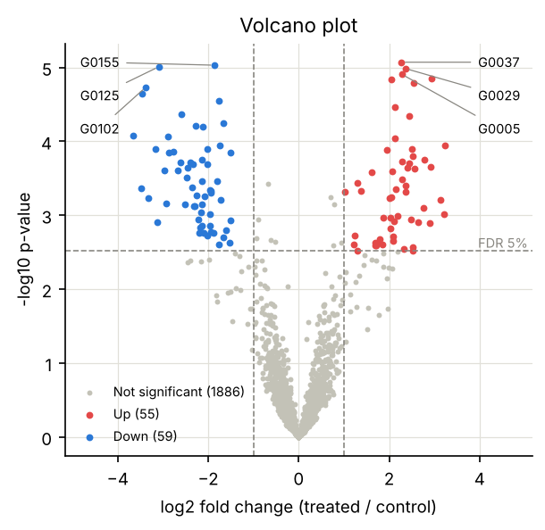
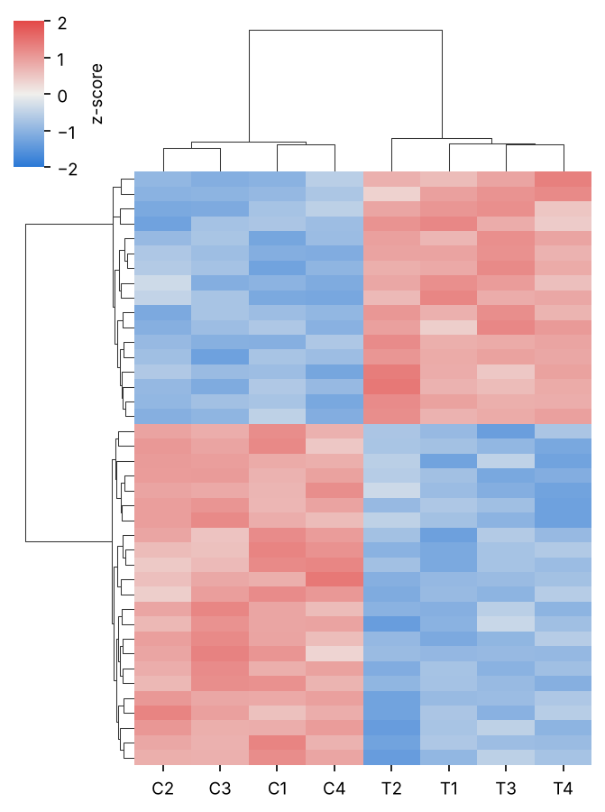
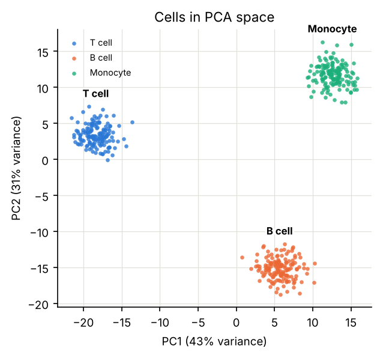
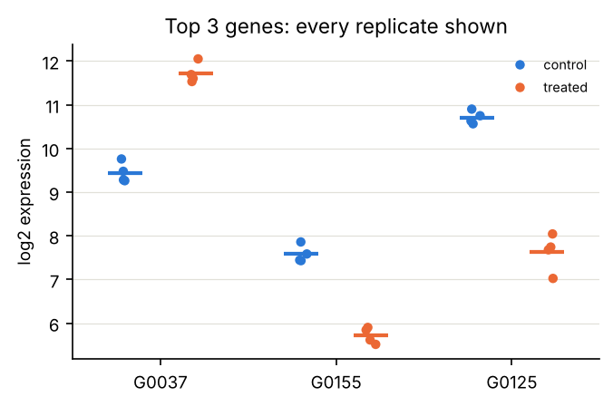

# Day 011 · 可视化：matplotlib / seaborn

> 📅 2026-11-14（周六）· 阶段 1「基础补齐」· 第 2 周 · ⏱️ 约 90 分钟
>
> [📅 课程表](../../SYLLABUS.md) · [🗺️ 路线图](../../ROADMAP.md) · 上一篇：[Day 010](../2026-11/day010-2026-11-13.md) · 下一篇：（明天更新）

## 🎯 今日目标

1. 学会“先选图形、再选颜色”：根据要表达的内容挑选图形，再按类别、数值大小、正负方向三种任务分配颜色。
2. 用 matplotlib 的面向对象接口和 seaborn，画出规范的火山图、聚类热图、降维散点图和小样本点图。
3. 掌握投稿级图片的基本规范：尺寸、字号、矢量格式、色盲友好、不只靠颜色传达信息。

## 📖 核心概念

### 1. 先选图形，再选颜色

很多糟糕的图都是先挑颜色、再凑图形。正确的顺序是先问：**这张图要回答什么问题？**

| 要表达的内容 | 推荐图形 | 生信例子 |
|---|---|---|
| 小样本的组间比较 | 点图 + 均值或中位数 | 每组 3–6 个生物学重复 |
| 分布 | 直方图、核密度图、小提琴图 | 读长分布、表达量分布 |
| 两个变量的关系 | 散点图 | 两个样本的表达相关性 |
| 差异分析全貌 | 火山图（效应大小 × 显著性） | DESeq2 / limma 的结果 |
| 矩阵 | 聚类热图 | 差异基因 × 样本 |
| 降维结果 | 按类别着色的散点图 | PCA、UMAP |
| 随时间或剂量的变化 | 折线图 | 时间序列表达 |

### 2. 颜色按“任务”分配

| 任务 | 怎么配色 | 例子 |
|---|---|---|
| 区分**类别** | 几种明显不同的颜色，顺序固定，最好不超过 8 种；更多类别合并成“其他”或拆成多个小图 | 细胞类型、实验分组 |
| 表示**大小** | 单一色相，由浅到深 | 表达量、计数 |
| 表示**方向** | 两种相对的颜色（如蓝 / 红），中点用中性的灰白色，上下限对称 | z-score、log2 倍数变化 |
| 突出**重点** | 重点上色，其余一律灰色 | 火山图中的显著基因 |

两条硬规则：

- **不要用彩虹色图（如 `jet`）**：它的亮度不是单调变化的，会在数据里“画出”并不存在的边界，色盲读者也很难分辨。表示大小用单色渐变；有意义的中心（0）就用发散色图。
- **不要只靠颜色传达信息**：在欧洲人群中，约 8% 的男性和 0.5% 的女性有色觉异常，最常见的是红绿色弱。关键信息要同时用文字标签、形状或位置区分。今天练习里的配色都用色盲模拟检查过；其中青绿色在白底上对比度偏低，所以图中直接标注了类别名。

### 3. 少即是多

- 去掉多余的上、右边框；网格用浅色实线，让它退到数据后面。表示阈值的线才用虚线，因为虚线会被读成“界限”。
- 只标注最关键的几个点（如每侧最显著的 3 个基因），而不是给每个点都写数字。
- 坐标轴写清含义和单位；两个以上的类别要有图例。
- 一张图只说一件事；**不要用两个 y 轴**，两条刻度怎么对齐都是任意的，很容易制造出并不存在的相关性。

### 4. 展示数据，而不只是汇总

柱状图加误差线会把分布藏起来：分布完全不同的几组数据，可能画出一模一样的柱子。样本量小（比如每组 4 个重复）时，**把每个点都画出来**，再叠加均值或中位数。误差线必须说明是标准差（SD）、标准误（SEM）还是 95% 置信区间。

### 5. matplotlib 与 seaborn 的正确用法

- 用**面向对象接口**：`fig, ax = plt.subplots()`，之后所有设置都在 `ax` 上完成。画多面板图时尤其清楚。
- 用 `plt.rcParams` 一次性设定字号、网格、边框，全文风格保持一致。
- seaborn 建立在 matplotlib 之上，最擅长“长表 + 统计图”：Day 010 的长表可以直接交给它，按列名指定 x、y 和着色。它返回的 `ax` 还能继续用 matplotlib 微调。

### 6. 投稿级图片的规范

- **尺寸按最终版面设定**：以 Nature 系列为例，单栏宽 89 mm（约 3.5 英寸），双栏宽 183 mm（约 7.2 英寸）。其他期刊以投稿须知为准。`figsize` 直接设成最终尺寸，就不会出现缩小后字太小的问题。
- **字号**：最终尺寸下不小于 7 pt。
- **格式**：散点图、折线图等用 PDF 或 SVG 矢量格式，放大不失真，也方便后期编辑；显微照片等位图用 PNG 或 TIFF，分辨率至少 300 dpi。
- 保留生成每张图的代码，并记下 commit 哈希（Day 004）。

## 📚 今日资源

| # | 资源 | 学什么 | 建议时长 |
|---|---|---|---|
| 1 | [PDSH 第 4 章：Visualization with Matplotlib](https://jakevdp.github.io/PythonDataScienceHandbook/04.00-introduction-to-matplotlib.html) | 4.1–4.2（折线、散点）、4.5（直方图）、4.6–4.7（图例、颜色条，含 jet 的问题）、4.8（多面板）、4.9（文字与标注）、4.14（seaborn） | 40 分钟 |
| 2 | [seaborn 教程](https://seaborn.pydata.org/tutorial/function_overview.html) | 绘图函数总览，以及 [Choosing color palettes](https://seaborn.pydata.org/tutorial/color_palettes.html) 一节 | 20 分钟 |
| 3 | [matplotlib：Choosing Colormaps](https://matplotlib.org/stable/users/explain/colors/colormaps.html) | 顺序、发散、定性三类色图的区别 | 10 分钟 |
| 4 | [Rougier et al. 2014, *Ten Simple Rules for Better Figures*](https://doi.org/10.1371/journal.pcbi.1003833) | PLOS Computational Biology 开放获取：了解读者、讲清信息、不要相信默认设置 | 15 分钟 |

选读：Weissgerber et al. 2015，[*Beyond Bar and Line Graphs: Time for a New Data Presentation Paradigm*](https://doi.org/10.1371/journal.pbio.1002128)（PLOS Biology），用实例说明柱状图为什么会误导。

## 🛠️ 动手练习

在 Colab 里运行下面的完整脚本（需要 seaborn 0.13 及以上、SciPy 1.11 及以上；报错时先运行 `!pip install -U seaborn scipy`）。脚本模拟了一个差异表达实验：2000 个基因，对照与处理各 4 个重复，其中 80 个基因上调、80 个下调；另外模拟了 3 种细胞的表达谱。运行后生成 4 张图：

```python
import numpy as np
import pandas as pd
import matplotlib.pyplot as plt
import matplotlib.patheffects as pe
import seaborn as sns
from matplotlib.colors import LinearSegmentedColormap
from scipy import stats

# ---------- 统一的配色与风格（配色已通过色盲安全检查）----------
BLUE, ORANGE, AQUA, RED = "#2a78d6", "#eb6834", "#1baf7a", "#e34948"
GRAY, INK_MUTED = "#c3c2b7", "#898781"
DIVERGING = LinearSegmentedColormap.from_list("blue_gray_red", [BLUE, "#f0efec", RED])  # 两极 + 中性灰中点
plt.rcParams.update({
    "figure.dpi": 120, "savefig.dpi": 300, "savefig.bbox": "tight", "font.size": 9,
    "axes.spines.top": False, "axes.spines.right": False,
    "axes.grid": True, "grid.color": "#e1e0d9", "grid.linewidth": 0.6,   # 浅色实线网格
    "axes.axisbelow": True,
})

# ---------- 模拟一个差异表达实验：2000 个基因，对照与处理各 4 个重复 ----------
rng = np.random.default_rng(7)
n_genes, n_rep = 2000, 4
true_lfc = np.zeros(n_genes)
true_lfc[:80] = rng.normal(2.0, 0.5, 80)          # 80 个上调
true_lfc[80:160] = rng.normal(-2.0, 0.5, 80)      # 80 个下调
base = rng.normal(8, 2, n_genes)                  # log2 表达水平
ctrl = base[:, None] + rng.normal(0, 0.5, (n_genes, n_rep))
trt = (base + true_lfc)[:, None] + rng.normal(0, 0.5, (n_genes, n_rep))
genes = [f"G{i:04d}" for i in range(1, n_genes + 1)]
expr = pd.DataFrame(np.hstack([ctrl, trt]), index=genes,
                    columns=[f"C{i}" for i in range(1, n_rep + 1)] + [f"T{i}" for i in range(1, n_rep + 1)])
_, p = stats.ttest_ind(trt, ctrl, axis=1)
de = pd.DataFrame({"gene": genes, "log2fc": trt.mean(axis=1) - ctrl.mean(axis=1), "p": p})
de["padj"] = stats.false_discovery_control(de["p"])     # Benjamini–Hochberg 校正（Day 025 会细讲）

# ---------- 图 1：火山图 ----------
up = (de["padj"] < 0.05) & (de["log2fc"] > 1)
down = (de["padj"] < 0.05) & (de["log2fc"] < -1)
ns = ~(up | down)
y = -np.log10(de["p"])
fig, ax = plt.subplots(figsize=(4.5, 4))
ax.scatter(de.loc[ns, "log2fc"], y[ns], s=8, c=GRAY, linewidths=0, label=f"Not significant ({ns.sum()})")
ax.scatter(de.loc[up, "log2fc"], y[up], s=14, c=RED, linewidths=0, label=f"Up ({up.sum()})")
ax.scatter(de.loc[down, "log2fc"], y[down], s=14, c=BLUE, linewidths=0, label=f"Down ({down.sum()})")
for x in (-1, 1):
    ax.axvline(x, color=INK_MUTED, lw=0.8, ls="--")                       # 阈值线用虚线，网格用实线
ax.axhline(-np.log10(de.loc[de["padj"] < 0.05, "p"].max()), color=INK_MUTED, lw=0.8, ls="--")
xmax = de["log2fc"].abs().max() + 0.3
for mask, sign in [(up, 1), (down, -1)]:                                  # 每侧只标注最显著的 3 个基因
    for k, (_, r) in enumerate(de[mask].nsmallest(3, "p").iterrows()):
        ax.annotate(r["gene"], xy=(r["log2fc"], -np.log10(r["p"])),
                    xytext=(sign * xmax, y.max() - 0.45 * k), ha="left" if sign > 0 else "right",
                    va="center", fontsize=7, arrowprops=dict(arrowstyle="-", color=INK_MUTED, lw=0.6))
ax.text(xmax + 1.1, -np.log10(de.loc[de["padj"] < 0.05, "p"].max()), "FDR 5%", fontsize=7,
        color=INK_MUTED, ha="right", va="bottom")
ax.set_xlim(-xmax - 1.2, xmax + 1.2)
ax.set(xlabel="log2 fold change (treated / control)", ylabel="-log10 p-value", title="Volcano plot")
ax.legend(frameon=False, fontsize=7, loc="lower left")
fig.savefig("volcano.png")
fig.savefig("volcano.pdf")                                                # 矢量格式，投稿用

# ---------- 图 2：聚类热图（按基因做 z-score）----------
top = de.nsmallest(40, "p")["gene"]
z = expr.loc[top]
z = z.sub(z.mean(axis=1), axis=0).div(z.std(axis=1), axis=0)            # 每个基因（行）单独标准化
g = sns.clustermap(z, cmap=DIVERGING, center=0, vmin=-2, vmax=2, figsize=(4.5, 6),
                   yticklabels=False, cbar_kws={"label": "z-score"})
g.savefig("heatmap.png")

# ---------- 图 3：PCA 散点图（3 种细胞类型）----------
cell_colors = {"T cell": BLUE, "B cell": ORANGE, "Monocyte": AQUA}
n_per = 150
centers = rng.normal(0, 3, (3, 50))
cells = np.vstack([c + rng.normal(0, 1.5, (n_per, 50)) for c in centers])
labels = np.repeat(list(cell_colors), n_per)
X = cells - cells.mean(axis=0)
U, S, Vt = np.linalg.svd(X, full_matrices=False)
pcs = U[:, :2] * S[:2]
var = S**2 / (S**2).sum()
fig, ax = plt.subplots(figsize=(4.5, 4))
for name, color in cell_colors.items():
    m = labels == name
    ax.scatter(pcs[m, 0], pcs[m, 1], s=10, c=color, alpha=0.8, linewidths=0, label=name)
    ax.text(np.median(pcs[m, 0]), pcs[m, 1].max() + 1.0, name, fontsize=8, ha="center", va="bottom",
            weight="bold", path_effects=[pe.withStroke(linewidth=3, foreground="white")])  # 直接标注类别名
ax.set(xlabel=f"PC1 ({var[0]:.0%} variance)", ylabel=f"PC2 ({var[1]:.0%} variance)", title="Cells in PCA space")
ax.legend(frameon=False, fontsize=7)
fig.savefig("pca.png")

# ---------- 图 4：长表 + seaborn：显示每个数据点 ----------
long = (expr.loc[top[:3]].reset_index(names="gene")
            .melt(id_vars="gene", var_name="sample", value_name="log2_expr"))
long["condition"] = np.where(long["sample"].str.startswith("C"), "control", "treated")
fig, ax = plt.subplots(figsize=(5, 3))
sns.stripplot(data=long, x="gene", y="log2_expr", hue="condition", palette=[BLUE, ORANGE],
              dodge=True, jitter=0.08, size=5, ax=ax)                                  # 每个重复都画出来
sns.pointplot(data=long, x="gene", y="log2_expr", hue="condition", palette=[BLUE, ORANGE],
              dodge=0.4, errorbar=None, markers="_", markersize=18, linestyle="none",
              legend=False, ax=ax)                                                      # 短横线表示均值
ax.set(xlabel="", ylabel="log2 expression", title="Top 3 genes: every replicate shown")
ax.legend(frameon=False, fontsize=7, title=None)
fig.savefig("dotplot.png")

print(f"上调 {up.sum()} 个，下调 {down.sum()} 个，不显著 {ns.sum()} 个")
print("PC1、PC2 解释的方差：", f"{var[0]:.1%}", f"{var[1]:.1%}")
```

期望输出：`上调 55 个，下调 59 个，不显著 1886 个` 和 `PC1、PC2 解释的方差： 43.1% 31.1%`。生成的 4 张图应该和下面一致：

| 火山图 | 聚类热图 |
|---|---|
|  |  |
| **PCA 散点图** | **小样本点图** |
|  |  |

**读图练习**：埋下了 160 个差异基因，为什么只检出 114 个（55 个上调、59 个下调）？提示：每组只有 4 个重复，还要对 2000 次检验做多重检验校正；看看火山图里那些落在 FDR 线下方、但 |log2FC| 很大的灰点。

**进阶**：

1. 把图 1、3、4 拼成一张多面板图：`fig, axes = plt.subplots(1, 3, figsize=(7.2, 2.6))`（双栏宽度），在每个子图左上角用 `ax.text(-0.15, 1.05, "A", transform=ax.transAxes, weight="bold")` 加上面板标签，保存为 PDF，检查字号是否不小于 7 pt。
2. 把热图的 `cmap=DIVERGING` 换成 `cmap="jet"`，对比两张图：哪张更容易让人误以为数据里存在明显的分界？

## ✅ 自测题

1. 什么时候该用发散色图？为什么它的中点要用中性色、上下限要对称？
2. 为什么不推荐用 `jet` 这类彩虹色图？
3. 每组只有 4 个重复时，为什么推荐“点图 + 均值”，而不是柱状图加误差线？
4. 火山图的横轴和纵轴分别代表什么？为什么只标注少数几个基因？
5. 投稿时，散点图和显微照片分别应该保存成什么格式？为什么？

<details>
<summary>参考答案</summary>

1. 数据有一个有意义的中心、要区分正负两个方向时，例如 z-score（以 0 为中心）或 log2 倍数变化（0 表示不变）。中点用中性色，读者才会把它理解为“没有变化”；上下限对称（如 `vmin=-2, vmax=2`），同样大小的正负偏离才会显示成同样深的颜色，否则一侧会被夸大。
2. 彩虹色图的亮度不随数值单调变化，眼睛会在颜色突变处看到并不存在的“边界”，也无法凭颜色判断数值大小的顺序；红绿交替的部分，色盲读者几乎无法分辨。
3. 样本量很小时，柱状图加误差线只给出两个汇总数字，分布完全不同的数据（比如有一个离群点，或者分成两簇）可以画出一样的柱子。把每个点画出来，读者能直接看到数据的离散程度和离群值，判断结论是否可靠。
4. 横轴是 log2 倍数变化（效应大小），纵轴是 −log10 p 值（显著性，越高越显著）。图里有成千上万个点，全部标注会互相遮挡、没人能读；只标注最显著、最关心的少数几个，信息最清楚，完整列表放在补充表格里。
5. 散点图、折线图等用 PDF 或 SVG 矢量格式：它们由点、线、文字组成，矢量格式可以无限放大不失真，也方便修改字体和颜色。显微照片本身是像素构成的位图，用 PNG 或 TIFF 保存，分辨率至少 300 dpi；不要用 JPEG，它的有损压缩会引入伪影。

</details>

## 🔭 今日前沿

- **DeepRNAi：预测 siRNA 的靶向与脱靶活性（bioRxiv，11 月 13 日）**：siRNA 设计的两大难题，一是能否有效敲低目标基因，二是会不会误伤其他转录本。这篇预印本提出了同时预测这两点的深度学习模型，并公开了一个训练与基准数据集：来自 240 条 siRNA 的约 184 万个 siRNA–转录本配对。公开的数据集对整个领域可能比模型本身更有价值，因为它让不同方法可以在同一标准下比较（Day 090 会讲基准）。来源：[bioRxiv](https://www.biorxiv.org/content/10.64898/2026.11.12.766311v1)
- **BioBasicsBench：考察 AI 智能体解读湿实验数据的能力（OpenAI，11 月 6 日）**：OpenAI 与酶设计公司 Ligo 合作发布了这个基准，包含 100 个任务，检验 AI 智能体能否从常规湿实验的原始结果中得出正确结论。文中的模型得分是厂商自己测的，有待独立验证。它和第 24 周要学的 LAB-Bench 属于同一类工作。来源：[OpenAI](https://openai.com/index/measuring-how-ai-agents-handle-wet-lab-science/)

## 📝 学习打卡

- [ ] 读完 PDSH 第 4 章的指定小节和 Ten Simple Rules for Better Figures
- [ ] 跑通完整脚本，4 张图与示例一致
- [ ] 想通“为什么只检出 114 个差异基因”
- [ ] 进阶：拼一张双栏宽度的多面板 PDF 图
- [ ] 进阶：对比 `jet` 与发散色图
- 今日笔记 / 疑问：
