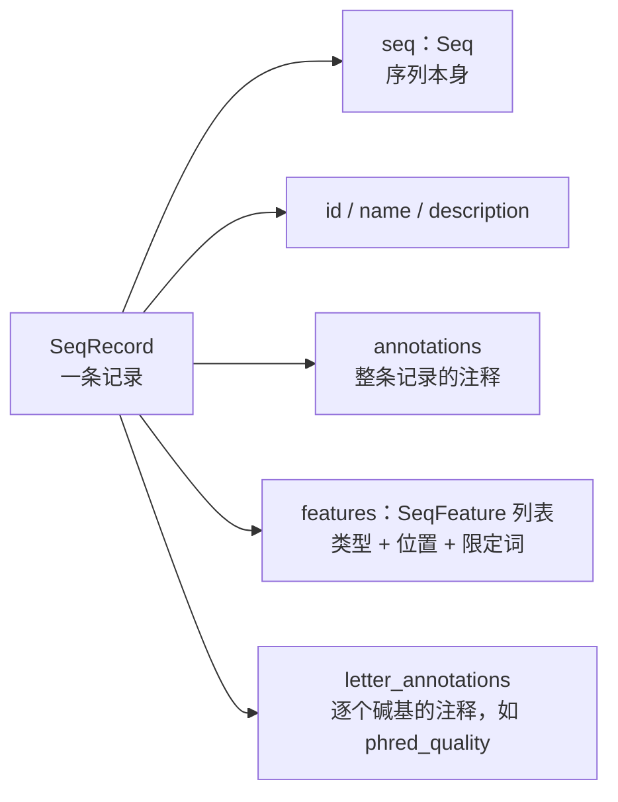

# Day 012 · Biopython 与生物文件格式

> 📅 2026-11-15（周日）· 阶段 1「基础补齐」· 第 2 周 · ⏱️ 约 90 分钟
>
> [📅 课程表](../../SYLLABUS.md) · [🗺️ 路线图](../../ROADMAP.md) · 上一篇：[Day 011](../2026-11/day011-2026-11-14.md) · 下一篇：[Day 013](../2026-11/day013-2026-11-16.md)

## 🎯 今日目标

1. 说清 FASTA、FASTQ、GenBank、PDB / mmCIF 四种格式各存什么，坐标和质量值怎么表示，最容易在哪里出错。
2. 用 Biopython 的 `Seq`、`SeqRecord`、`SeqFeature` 和 `SeqIO` 读写序列文件：正确提取负链上跨外显子的编码序列，并对 FASTQ 读段做修剪和过滤。
3. 用 `Bio.PDB` 解析 mmCIF 结构，区分蛋白、配体和水，找出小分子周围的结合口袋；知道从 NCBI 下载数据要守哪些规矩。

## 📖 核心概念

### 1. 为什么要认真对待文件格式

几乎所有生物 AI 项目都从读文件开始：蛋白质语言模型读 FASTA，测序质控读 FASTQ，基因注释来自 GenBank，AlphaFold 输出 PDB / mmCIF 结构文件。格式解析出错往往**不会报错**：负链基因被当成正链读、忘了去掉内含子、质量值解码错、把水分子当成残基……模型照样能训练，只是学到的东西是错的。

### 2. 四种最常见的格式

| 格式 | 存什么 | 一条记录的样子 | 常见的坑 |
|---|---|---|---|
| FASTA | 序列 | `>` 开头的标题行 + 一行或多行序列 | 标题行没有统一规范；Biopython 把第一个空格前的部分当作 ID |
| FASTQ | 测序读段 + 每个碱基的质量值 | 固定 4 行：`@标题`、序列、`+`、质量字符串 | 质量行也可能以 `@` 开头；历史上有过几种质量值编码 |
| GenBank | 序列 + 注释（基因、CDS、物种、文献等） | 头部信息、`FEATURES` 特征表、`ORIGIN` 序列，以 `//` 结束 | 坐标从 1 开始、两端都包含；负链、跨外显子的特征写成 `complement(join(...))` |
| PDB / mmCIF | 三维结构：每个原子的坐标 | PDB 是固定列宽的文本行；mmCIF 是“字段名 + 表格” | 旧 PDB 格式装不下大结构；同一文件里混有水、配体和多个模型 |

**FASTQ 的质量值**：每个碱基有一个 Phred 质量值（Phred quality score）$Q = -10\log_{10} P_{\text{error}}$：Q20 表示错误率 1%，Q30 表示 0.1%。为了让一个字符代表一个数字，文件里写的是 ASCII 码为 $Q + 33$ 的字符：`I` 的 ASCII 码是 73，对应 Q40；`#` 是 35，对应 Q2。早期 Solexa / Illumina 仪器用过偏移量为 64 的变体，如今的数据基本都是偏移量 33 的 Sanger 标准，在 Biopython 中格式名就是 `"fastq"`。

**坐标系统**：GenBank 里的 `6..21` 指第 6 到第 21 个碱基（1 起始，两端包含），Biopython 读入后换成 Python 习惯的 `[5:21]`（0 起始，左闭右开）。BED 文件也是 0 起始、左闭右开，GFF 和 VCF 则是 1 起始。在工具之间转换时，最常见的 bug 就是差 1（off-by-one）。

### 3. Biopython 的三个核心对象



- **`Seq`**：可以像字符串一样切片、拼接，还多了生物学方法：`reverse_complement()`、`transcribe()`、`translate()`（可以指定密码子表，例如细菌用 `table=11`）。
- **`SeqRecord`**：`Seq` 加上 ID、描述和各种注释。切片 SeqRecord 时，逐碱基的质量值和落在范围内的特征会一起切出来，修剪读段因此很方便。
- **`SeqFeature`**：一个注释特征，包括类型（`"CDS"`、`"gene"` 等）、位置（`SimpleLocation`；跨外显子时是由几段组成的 `CompoundLocation`）和限定词（`qualifiers`，一个值为列表的字典）。`feature.extract(record.seq)` 会自动按外显子拼接，负链特征还会自动取反向互补。

### 4. SeqIO：一套接口读写几十种格式

| 函数 | 什么时候用 |
|---|---|
| `SeqIO.parse(文件, 格式)` | 逐条读取，返回迭代器，几乎不占内存；最常用 |
| `SeqIO.read(文件, 格式)` | 文件里**恰好一条**记录时用，否则报错 |
| `SeqIO.to_dict(...)` | 全部读进内存，按 ID 查找；只适合小文件 |
| `SeqIO.index(文件, 格式)` | 内存里只记每条记录在文件中的位置，适合按 ID 随机读取大文件 |
| `SeqIO.write(...)` / `SeqIO.convert(...)` | 写出文件 / 直接转换格式 |

格式名必须明确写出（`"fasta"`、`"fastq"`、`"genbank"` 等），Biopython 不会替你猜。

### 5. Bio.PDB：结构的五层层级

结构按 **SMCRA** 层级组织：Structure → Model → Chain → Residue → Atom。X 射线晶体结构通常只有 1 个模型，NMR 结构通常有十几到几十个。每个残基的 ID 是一个三元组（hetero 标记, 序号, 插入码）：标准氨基酸是 `(' ', 1944, ' ')`，水是 `('W', 序号, ' ')`，配体等其他“异质残基”（文件中的 HETATM 记录）则是 `('H_配体代码', 序号, ' ')`。两个 `Atom` 对象相减，得到的就是它们的距离（单位 Å）。

两条实用提醒：

- **新代码优先用 mmCIF**。旧 PDB 格式按固定列宽存储，超过 62 条链或 99,999 个原子的大结构（如核糖体）、多字符链名和 5 个字符的配体代码都写不进去，这些条目只有 mmCIF 文件。wwPDB 还宣布，计划从 2027 年 7 月起停止发放四字符的 PDB ID，此后的新条目只用 12 个字符的扩展 ID（如 `pdb_1000axyz`），并且只以 mmCIF 格式发布（见 [RCSB 说明](https://rcsb.org/docs/general-help/structures-without-legacy-pdb-format-files)）。
- **B 因子那一列存的不一定是 B 因子**。AlphaFold DB 的结构文件在这一列存的是 pLDDT（Day 007）。换用其他预测工具时，先查文档确认这一列存的是什么。

### 6. Entrez：守规矩地从 NCBI 下载数据

`Bio.Entrez` 封装了 NCBI 的 E-utilities 接口。NCBI 的规定是：设置 `Entrez.email`（滥用时 NCBI 会先发邮件联系你，再考虑封禁）；没有 API key 时每秒最多 3 次请求，有 key 时最多 10 次（Biopython 会自动限速）；超过 100 次的批量请求要放在周末或美国非高峰时段。需要大量数据（例如整个基因组）时，改用 NCBI Datasets 或 FTP 批量下载。

### 7. 局限

Biopython 以纯 Python 为主，优点是全面、稳定、文档好，但处理上亿条读段会很慢。正式的测序质控用 fastp、seqkit 等专用工具，比对文件（BAM）用 pysam，大规模结构处理可以考虑 gemmi 或 Biotite。Biopython 最适合探索数据、写预处理脚本，以及为 AI 模型准备中小规模的训练数据。

## 📚 今日资源

| # | 资源 | 学什么 | 建议时长 |
|---|---|---|---|
| 1 | [Biopython Tutorial & Cookbook](https://biopython.org/docs/latest/Tutorial/) | [Sequence objects](https://biopython.org/docs/latest/Tutorial/chapter_seq_objects.html) 全章（切片、反向互补、翻译）；[Sequence annotation objects](https://biopython.org/docs/latest/Tutorial/chapter_seq_annot.html) 的“The SeqRecord object”“Feature, location and position objects”“Slicing a SeqRecord”三节；[Sequence Input/Output](https://biopython.org/docs/latest/Tutorial/chapter_seqio.html) 的“Parsing or Reading Sequences”“Sequence files as Dictionaries”“Writing Sequence Files”三节 | 40 分钟 |
| 2 | 同一教程的 [Going 3D: The PDB module](https://biopython.org/docs/latest/Tutorial/chapter_pdb.html) 与 [Accessing NCBI's Entrez databases](https://biopython.org/docs/latest/Tutorial/chapter_entrez.html) | PDB 一章读“Structure representation”“Hetero residues”“Navigating through a Structure object”和“Measuring distances”；Entrez 一章读“Entrez Guidelines”和“EFetch”两节 | 25 分钟 |
| 3 | [NCBI：Sample GenBank Record](https://www.ncbi.nlm.nih.gov/genbank/samplerecord/) | 对照示例记录 U49845，逐项看懂 LOCUS、FEATURES、ORIGIN 等字段的含义 | 10 分钟 |
| 4 | [PDB-101：Guide to Understanding PDB Data](https://pdb101.rcsb.org/learn/guide-to-understanding-pdb-data/pdb-overview) | “PDB Overview”“Beginner's Guide to PDBx/mmCIF”“Dealing with Coordinates”三节 | 15 分钟 |

选读：Cock et al. 2010，[*The Sanger FASTQ file format for sequences with quality scores, and the Solexa/Illumina FASTQ variants*](https://doi.org/10.1093/nar/gkp1137)（Nucleic Acids Research，开放获取），其中的表格对比了几种 FASTQ 变体的质量值编码。

## 🛠️ 动手练习

在 Colab 里依次运行下面 5 段代码。第 1–3 段只用代码里的小例子，不需要下载数据；第 4 段从 PDB 下载一个结构；第 5 段可选，从 NCBI 下载一条 GenBank 记录。先安装 Biopython（Colab 默认没有）：

```python
!pip install -q biopython
```

**练习 1 · Seq：会做生物学运算的序列**

```python
import io
from pathlib import Path
from collections import Counter

import Bio
from Bio import SeqIO
from Bio.Seq import Seq
from Bio.SeqRecord import SeqRecord
from Bio.SeqFeature import SeqFeature, SimpleLocation
from Bio.SeqUtils import gc_fraction

print("Biopython", Bio.__version__)

hbb = Seq("ATGGTGCATCTGACTCCTGAGGAGAAGTCTGCCGTTACTGCC")  # 编码 β-珠蛋白（HBB）前 14 个氨基酸的 DNA
print(hbb.translate())                    # 翻译成蛋白
print(hbb.reverse_complement()[:12])      # 反向互补（只看前 12 nt）
print(f"GC = {gc_fraction(hbb):.1%}")
sickle = hbb[:19] + "T" + hbb[20:]         # c.20A>T：第 7 个密码子 GAG 变成 GTG
print(hbb[18:21], "->", sickle[18:21], ":", sickle.translate())
```

期望输出（版本号可能更新）：

```text
Biopython 1.88
MVHLTPEEKSAVTA
GGCAGTAACGGC
GC = 54.8%
GAG -> GTG : MVHLTPVEKSAVTA
```

一个碱基的替换把谷氨酸（E）变成了缬氨酸（V），这就是镰状细胞贫血的致病突变。按 HGVS 规范从起始 Met 开始数，它是 p.Glu7Val；传统编号不计 Met，所以文献里常写作 E6V。

**练习 2 · GenBank：负链上、跨两个外显子的 CDS**

```python
# 一段 55 bp 的虚构片段：基因在负链上，外显子边界是虚构的
seq = Seq("ACTGGTTACTTCTCCTCAGGACTGAAAGATACTTACGTCAGATGCACCATATGCC")
# Python 坐标：0 起始、左闭右开。负链基因按转录方向列出外显子，所以坐标大的外显子 1 写在前面
cds_loc = SimpleLocation(36, 50, strand=-1) + SimpleLocation(5, 21, strand=-1)
record = SeqRecord(
    seq, id="TOY001.1", name="TOY001",
    description="toy fragment with a spliced gene on the minus strand",
    annotations={"molecule_type": "DNA"},        # 写 GenBank 文件时必须提供
    features=[SeqFeature(cds_loc, type="CDS",
                         qualifiers={"gene": ["toyA"], "translation": ["MVHLTPEEK"]})],
)
SeqIO.write(record, "toy.gb", "genbank")
print(Path("toy.gb").read_text())                 # 看看坐标写进文件后变成了什么

rec = SeqIO.read("toy.gb", "genbank")             # 文件里恰好一条记录，用 read
cds = next(f for f in rec.features if f.type == "CDS")
print("location:", cds.location, "| strand:", cds.location.strand)
coding = cds.extract(rec.seq)                     # 自动按外显子拼接，并取反向互补
print("CDS:", coding, "->", coding.translate(to_stop=True))
print("same as /translation:", coding.translate(to_stop=True) == cds.qualifiers["translation"][0])
naive = rec.seq[5:50].reverse_complement()        # 错误示范：直接切片，忘了去掉内含子
print("naive:", naive.translate())
```

期望输出：

```text
LOCUS       TOY001                    55 bp    DNA              UNK 01-JAN-1980
DEFINITION  toy fragment with a spliced gene on the minus strand.
ACCESSION   TOY001
VERSION     TOY001.1
KEYWORDS    .
SOURCE      .
  ORGANISM  .
            .
FEATURES             Location/Qualifiers
     CDS             complement(join(6..21,37..50))
                     /gene="toyA"
                     /translation="MVHLTPEEK"
ORIGIN
        1 actggttact tctcctcagg actgaaagat acttacgtca gatgcaccat atgcc
//

location: join{[36:50](-), [5:21](-)} | strand: -1
CDS: ATGGTGCATCTGACTCCTGAGGAGAAGTAA -> MVHLTPEEK
same as /translation: True
naive: MVHLT*VSFSPEEK*
```

注意三点：Python 里的 `[5:21]` 写进文件变成了 `6..21`；`complement(join(...))` 读回来后，`extract` 自动完成了拼接和反向互补；`UNK 01-JAN-1980` 是因为我们没有设置分类和日期，Biopython 填了默认值。错误示范在第 6 个密码子就终止了：外显子 1 末尾的 `AC` 接上内含子开头的 `GTAAGT`，读出 `ACG TAA`，内含子引入了一个终止密码子。

**练习 3 · FASTQ：质量值、修剪与过滤**

```python
FASTQ = """@read1
ACGTTGCAAGGCTTACGATC
+
IIIIIIIIIIIIIIIIIIII
@read2
TTGACCGTAGCATGCAAGTC
+
IIIIIIIIIIIIIII55+##
@read3
GGCATCGATCGGATTACGCA
+
5555555+++++++######
@read4
CAGTTGACCATGGTACCAGT
+
@@@@@@@@@@@@@@@@@?55
"""
n_at = sum(line.startswith("@") for line in FASTQ.splitlines())
n_rec = sum(1 for _ in SeqIO.parse(io.StringIO(FASTQ), "fastq"))
print("lines starting with @:", n_at, "| records:", n_rec)   # 质量行也可能以 @ 开头！
print("ord('I') - 33 =", ord("I") - 33, "| ord('#') - 33 =", ord("#") - 33)

def mean_q(r):
    q = r.letter_annotations["phred_quality"]     # 每个碱基的 Phred 质量值（整数列表）
    return sum(q) / len(q) if q else 0.0

def trim_3prime(r, min_q=20):
    """从 3' 端逐个切掉质量值低于 min_q 的碱基。"""
    q = r.letter_annotations["phred_quality"]
    end = len(q)
    while end > 0 and q[end - 1] < min_q:
        end -= 1
    return r[:end]                                 # 切片 SeqRecord：序列和质量值一起切

kept = []
for r in SeqIO.parse(io.StringIO(FASTQ), "fastq"):
    t = trim_3prime(r)
    ok = len(t) >= 15 and mean_q(t) >= 25
    print(f"{r.id}: len {len(r)} -> {len(t)}, mean Q {mean_q(r):.1f} -> {mean_q(t):.1f}, {'keep' if ok else 'drop'}")
    if ok:
        kept.append(t)
print("wrote", SeqIO.write(kept, "clean.fastq", "fastq"), "reads")
print(kept[1].format("fastq"))                     # 修剪后的 read2：质量字符串也变短了
```

期望输出：

```text
lines starting with @: 5 | records: 4
ord('I') - 33 = 40 | ord('#') - 33 = 2
read1: len 20 -> 20, mean Q 40.0 -> 40.0, keep
read2: len 20 -> 17, mean Q 32.7 -> 37.6, keep
read3: len 20 -> 7, mean Q 11.1 -> 20.0, drop
read4: len 20 -> 20, mean Q 29.9 -> 29.9, keep
wrote 3 reads
@read2
TTGACCGTAGCATGCAA
+
IIIIIIIIIIIIIII55
```

read4 的质量行以 `@`（Q31）开头，所以“数以 @ 开头的行”会多数出一条记录。read2 末尾的 `+##`（Q10、Q2、Q2）被切掉；read3 修剪后只剩 7 nt，被过滤掉。真实数据请用 fastp 等专用工具，原理是一样的。

**练习 4 · 结构：找出小分子的结合口袋**

[4CUP](https://www.rcsb.org/structure/4CUP) 是人 BAZ2B 蛋白的溴结构域（bromodomain，识别乙酰化赖氨酸的结构域）与一个小分子片段的晶体结构。片段是分子量很小的化合物（这里是 154 Da 的 4-氟苯甲酰胺肟，配体代码 ZYB），常作为药物发现的起点。

```python
from Bio.PDB import PDBList, MMCIFParser, NeighborSearch, PPBuilder
from Bio.PDB.MMCIF2Dict import MMCIF2Dict

path = PDBList(verbose=False).retrieve_pdb_file("4CUP", pdir="pdb", file_format="mmCif")  # 返回 pdb/4cup.cif
info = MMCIF2Dict(path)                            # mmCIF 的全部字段；每个值都是字符串列表
print(info["_exptl.method"][0], "| resolution:", info["_refine.ls_d_res_high"][0], "Å")

structure = MMCIFParser(QUIET=True).get_structure("4CUP", path)
model = structure[0]                               # Structure → Model
print("models:", len(structure), "| chains:", [c.id for c in model])
for chain in model:                                # Chain → Residue：按残基 ID 的第一个字段分类
    kinds = Counter("protein" if r.id[0] == " " else "water" if r.id[0] == "W" else "hetero"
                    for r in chain)
    print("chain", chain.id, dict(kinds))
ligands = [r for r in model.get_residues() if r.id[0].startswith("H_")]
for r in ligands:
    print("hetero:", r.get_resname(), r.id, len(r), "atoms")
for pp in PPBuilder().build_peptides(model):
    print("peptide", pp[0].id[1], "-", pp[-1].id[1], ":", pp.get_sequence()[:20], "...", len(pp), "aa")

# 结合口袋：离配体任一重原子 4 Å 以内的蛋白残基
lig = next(r for r in ligands if r.get_resname() == "ZYB")
ns = NeighborSearch([a for a in model.get_atoms() if a.get_parent().id[0] == " "])
site = {}
for la in (a for a in lig if a.element != "H"):    # 只用重原子
    for pa in ns.search(la.coord, 4.0):
        res = pa.get_parent()
        d = la - pa                                # 两个 Atom 相减 = 距离（Å）
        key = (res.id[1], res.get_resname())
        if d < site.get(key, (99,))[0]:
            site[key] = (d, la.get_id(), pa.get_id())
print(len(site), "residues within 4 Å of ZYB:")
for (num, name), (d, a1, a2) in sorted(site.items()):
    print(f"  {name}{num}: {d:.2f} Å ({a1}-{a2})")
```

期望输出：

```text
X-RAY DIFFRACTION | resolution: 1.880 Å
models: 1 | chains: ['A']
chain A {'protein': 115, 'hetero': 4, 'water': 146}
hetero: ZYB ('H_ZYB', 2971, ' ') 18 atoms
hetero: MOH ('H_MOH', 2972, ' ') 2 atoms
hetero: MOH ('H_MOH', 2973, ' ') 2 atoms
hetero: MOH ('H_MOH', 2974, ' ') 2 atoms
peptide 1856 - 1970 : SMSVKKPKRDDSKDLALCSM ... 115 aa
5 residues within 4 Å of ZYB:
  VAL1893: 3.78 Å (F-CG2)
  VAL1898: 3.61 Å (F-CG1)
  PHE1943: 3.78 Å (C1-CD2)
  ASN1944: 3.33 Å (C-OD1)
  ILE1950: 3.69 Å (C-CD1)
```

链 A 里有 115 个氨基酸残基、146 个水分子，以及 4 个异质残基：1 个片段分子 ZYB 和 3 个甲醇分子（MOH）。ZYB 的 18 个原子里有 7 个是氢，而蛋白部分没有氢原子，所以统计接触时只用重原子，免得结果受到“有没有氢”的影响。以上输出是在本地用同一结构的 mmCIF 文件（取自 Biopython 测试集）实际运行得到的；PDB 偶尔会修订旧条目的文件，如果你的数字略有出入，以下载到的文件为准。

**练习 5（可选）· 用 Entrez 下载 HBB 的 mRNA 记录**

```python
from Bio import Entrez

Entrez.email = "your.name@example.com"   # ⚠️ 换成你自己的真实邮箱，不要随便编一个
with Entrez.efetch(db="nucleotide", id="NM_000518", rettype="gb", retmode="text") as stream:
    hbb_rec = SeqIO.read(stream, "genbank")
cds = next(f for f in hbb_rec.features if f.type == "CDS")
protein = cds.extract(hbb_rec.seq).translate(to_stop=True)
print(hbb_rec.id, len(hbb_rec), "bp | CDS:", cds.location)
print(len(protein), protein[:10], protein == cds.qualifiers["translation"][0])
```

期望结果：第一行是带版本号的记录编号（如 `NM_000518.x`，版本号会随 RefSeq 更新而变化）、序列长度和 CDS 位置；第二行是 `147 MVHLTPEEKS True`，即你自己翻译出的 147 个氨基酸与记录中注释的蛋白序列完全一致。拿到任何新的 GenBank 记录，都可以用这个办法检查自己的解析是否正确。

**进阶**：

1. **导出结合口袋**：把 ZYB 和它周围 4 Å 内的 5 个残基单独存成 `4CUP_pocket.cif`。提示：写一个 `Bio.PDB.Select` 的子类，重写 `accept_residue(self, residue)`，口袋残基或配体返回 `True`；再用 `MMCIFIO` 的 `set_structure()` 和 `save("4CUP_pocket.cif", 你的Select())` 保存。重新读入后应该只剩 6 个残基。很多基于结构的 AI 模型（如预测结合亲和力的模型）都要先做这样的口袋提取。
2. **预测结构对比实验结构**：用 Day 007 的代码下载 HBB（UniProt P68871）的 AlphaFold 模型，用 `PDBParser` 读入，统计 pLDDT 低于 70 的残基数；再下载人脱氧血红蛋白的晶体结构 4HHB，用 `Superimposer` 把 AlphaFold 模型叠合到它的 β 链（链 B）上，计算 Cα 原子的 RMSD。动手前先打印两边前几个残基的名称和编号：UniProt 序列从起始 Met 开始编号，而血红蛋白结构通常沿用不计 Met 的传统编号，两边可能差 1，这和 E6V 与 p.Glu7Val 的差别是同一个原因。

## ✅ 自测题

1. FASTQ 中某个碱基的质量字符是 `5`，它的 Phred 质量值和错误率分别是多少？为什么不能靠“行首是不是 `@`”来拆分 FASTQ 记录？
2. GenBank 中的 `complement(join(6..21,37..50))` 在 Biopython 里是什么样的位置对象？为什么要用 `feature.extract(seq)`，而不是自己切片？
3. `SeqIO.parse`、`SeqIO.read`、`SeqIO.to_dict` 和 `SeqIO.index` 分别适合什么场景？
4. Bio.PDB 的 SMCRA 层级是什么？残基 ID `('H_ZYB', 2971, ' ')` 的三个字段分别代表什么？水分子的 ID 有什么不同？
5. 为什么新代码应该优先读写 mmCIF，而不是旧的 PDB 格式？

<details>
<summary>参考答案</summary>

1. `5` 的 ASCII 码是 53，减去 33 得到 Q20，错误率为 $10^{-20/10} = 1\%$。质量行里的字符可以是 `@`（ASCII 64，对应 Q31），所以以 `@` 开头的行不一定是标题行。应该每 4 行作为一条记录来解析，或者直接用 `SeqIO.parse`。
2. 它是一个由两段 `SimpleLocation` 组成的 `CompoundLocation`：`[36:50](-)` 和 `[5:21](-)`，坐标已经换成 0 起始、左闭右开，并按转录方向排列。`extract` 会按正确的顺序拼接外显子、去掉内含子，并对负链取反向互补；自己切片很容易忘掉其中一步。练习 2 的错误示范就因为保留了内含子，提前出现了终止密码子。
3. `parse`：逐条遍历任意大小的文件，内存占用小，最常用。`read`：文件里恰好一条记录（如一个 GenBank 条目）时用，记录数不是 1 就报错。`to_dict`：小文件，全部读进内存后按 ID 随机访问。`index`：大文件需要按 ID 随机访问时用，内存里只保存每条记录在文件中的位置，用到哪条才读哪条。
4. Structure → Model → Chain → Residue → Atom。三个字段依次是 hetero 标记（`H_` 加配体代码，表示这是配体等异质残基）、残基序号（2971）和插入码（空格表示没有）。水分子的 hetero 标记是 `'W'`，标准氨基酸是空格 `' '`。
5. 旧 PDB 格式按固定列宽存储，原子数（99,999）、链数（62）、链名和配体代码的长度都有上限，大型复合物和使用新式编号的条目根本没有 PDB 格式文件。mmCIF 是 PDB 档案库的标准格式，没有这些限制；停止发放四字符 PDB ID 之后（计划 2027 年 7 月），新条目将只以 mmCIF 格式发布。

</details>

## 🔭 今日前沿

- **用多种 AI 结构预测器生成无序蛋白的原子级构象系综（bioRxiv，11 月 10 日）**：无序蛋白没有单一的稳定结构，AlphaFold 等模型在这些区域给出的 pLDDT 通常很低（Day 007），单个预测结构的坐标并不可信。bAIes 方法（Schnapka et al. 2025，[bioRxiv](https://doi.org/10.1101/2025.06.18.660298)）换了个思路：不直接用预测出的坐标，而是把模型预测的残基间距离分布当作约束，结合物理化学先验生成一组构象。这篇新预印本比较了 AlphaFold2、AlphaFold3、Boltz-1、Boltz-2、ESMFold 和 ESMFold2 六种预测器作为距离来源，作者报告结果对预测器的选择并不敏感。来源：[bioRxiv](https://www.biorxiv.org/content/10.64898/2026.11.10.765624v1)
- **用深度突变扫描数据检验药物–靶点亲和力模型（bioRxiv，11 月初）**：作者用 MET 激酶结构域的深度突变扫描（deep mutational scanning）数据，检验突变效应模型和亲和力预测模型能否预测“突变如何改变抑制剂结合”。结果显示，深度学习亲和力模型低估了突变引起的亲和力变化；作者认为原因是这些模型依赖共折叠（co-folding）结构预测给出的结构先验，而这种先验几乎不随单个突变改变。用 AI 预测耐药突变时，这是一个值得记住的盲区。来源：[bioRxiv](https://www.biorxiv.org/content/10.64898/2026.11.01.763444v1)

## 📝 学习打卡

- [ ] 读完 Biopython 教程的指定章节、NCBI 示例记录和 PDB-101 指南
- [ ] 跑通练习 1–4，输出与示例一致
- [ ] 想通练习 2 的错误示范为什么在第 6 个密码子终止
- [ ] 可选：用 Entrez 下载 NM_000518，确认自己翻译的蛋白与注释一致
- [ ] 进阶：导出 4CUP 的结合口袋；对比 AlphaFold 模型与 4HHB 晶体结构
- 今日笔记 / 疑问：
