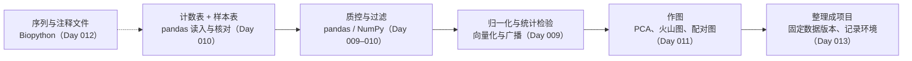
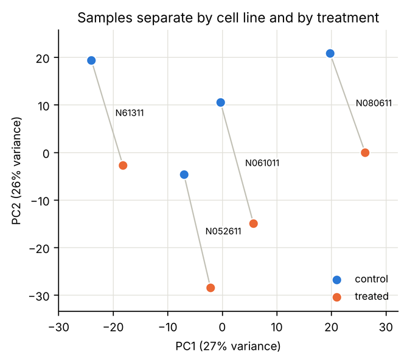
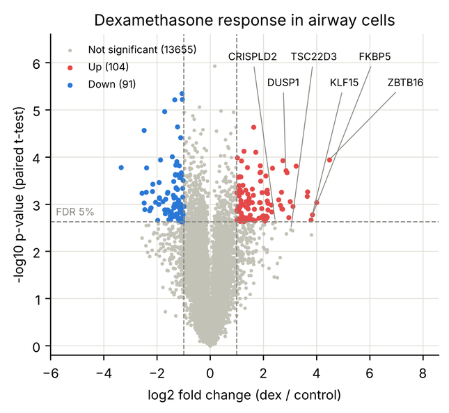
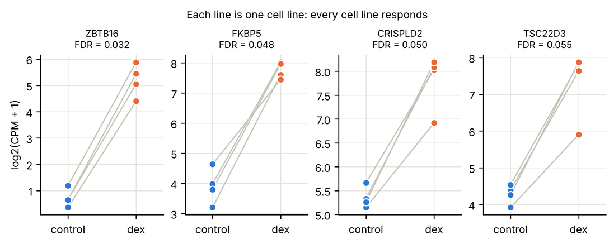

# Day 014 · 🔁 周复盘 ②：分析一个公开表达数据集

> 📅 2026-11-17（周二）· 阶段 1「基础补齐」· 第 2 周 · ⏱️ 约 2–3 小时
>
> [📅 课程表](../../SYLLABUS.md) · [🗺️ 路线图](../../ROADMAP.md) · 上一篇：[Day 013](../2026-11/day013-2026-11-16.md) · 下一篇：[Day 015](../2026-11/day015-2026-11-18.md)

## 🎯 今日目标

1. 把第 2 周六天的内容串成一张知识地图：Python 写逻辑，NumPy 做计算，pandas 管表格，图表讲结论，Biopython 读生物文件，可复现的习惯贯穿始终。
2. 完成本周小项目：用真实的 airway RNA-seq 数据走一遍“读入 → 质控 → 过滤与归一化 → 差异表达初探 → 作图”，并整理成可复现的项目，推送到学习仓库。
3. 重做本周最重要的 5 道自测题，再完成 1 道综合题。

## 📖 核心概念

### 1. 本周知识地图

- [Day 008 Python 核心语法](../2026-11/day008-2026-11-11.md)：变量名指向对象；按用途选数据结构（判断成员用集合，按键查找用字典）；小心可变的默认参数。
- [Day 009 NumPy](../2026-11/day009-2026-11-12.md)：形状、数据类型和轴；切片是视图，花式索引是副本；广播从最后一维开始对齐，按行归一化要加 `keepdims=True`；DNA 序列可以 one-hot 编码成 `(L, 4)` 的矩阵。
- [Day 010 pandas](../2026-11/day010-2026-11-13.md)：运算按标签对齐；宽表和长表互相转换；`groupby` 做“拆分—应用—合并”；合并注释表时用 `validate` 检查键是否唯一；pandas 3 只有写时复制模式，赋值一律用 `.loc`。
- [Day 011 可视化](../2026-11/day011-2026-11-14.md)：先选图形，再选颜色；颜色按类别、大小、方向三种用途分配；小样本要画出每个数据点；阈值用虚线，网格退到数据后面。
- [Day 012 Biopython 与文件格式](../2026-11/day012-2026-11-15.md)：FASTA、FASTQ、GenBank、mmCIF 各存什么；1 起始和 0 起始两种坐标；负链、跨外显子的特征交给 `feature.extract`；结构的五层层级。
- [Day 013 可复现](../2026-11/day013-2026-11-16.md)：原始数据只读，结果全部由代码生成；锁定环境、记录版本；每个随机过程用独立的生成器；种子不是超参数。

### 2. 它们怎么连起来



Day 008 的语法是所有步骤的基础。本周项目会从左到右完整走一遍这条流程；以后换成单细胞数据或深度学习模型，骨架依然是这几步。

### 3. 本周项目的新知识：怎样分析 RNA-seq 计数数据

- **计数矩阵**：每个格子是比对到某个基因的读段（read）数。各样本的测序深度（文库大小）不同，原始计数不能直接比较。
- **CPM 与对数变换**：先算 CPM（counts per million，计数 ÷ 文库大小 × 10⁶），再取 $\log_2(\text{CPM}+1)$。取对数后，倍数变化变成了差值，高表达基因的方差也被压缩；加 1 是为了避开 $\log 0$。CPM 只校正测序深度，不校正组成偏差（Day 010 自测题 5）；正式分析要用 DESeq2 的中位数比值法或 edgeR 的 TMM 法做归一化。
- **过滤低表达基因**：计数很低的基因几乎全是噪声，还会加重多重检验的负担。常用的规则是“至少在 n 个样本中 CPM ≥ 1”，n 取最小一组的样本数。
- **先看清实验设计**：airway 数据中，4 个细胞系（来自 4 位供体）各有一对“对照 / 处理”样本。细胞系之间的差异可能和处理效应一样大，所以要做**配对**比较：先在每个细胞系内部算“处理 − 对照”，再检验这些差值是否偏离 0。正式的工具则把细胞系写进模型，例如 DESeq2 的设计公式 `~ cell + dex`。
- **小样本 t 检验的局限**：每个基因只有 4 个差值，方差估计很不稳定。差值碰巧非常一致的基因，即使倍数变化很小，也会显得极其显著。DESeq2、edgeR、limma 等方法会借用全部基因的信息，把每个基因的方差估计往整体趋势“收缩”，结果更稳健。
- **阳性对照**：结果要能找回已知的生物学。地塞米松是一种人工合成的糖皮质激素；原论文点名的经典应答基因 DUSP1、KLF15、PER1、TSC22D3，以及 FKBP5、ZBTB16 等，都应该明显上调，原论文重点研究的 CRISPLD2 也是如此。阳性对照找不回来，就要先怀疑分析流程，而不是急着宣布新发现。

## 📚 今日资源

| # | 资源 | 学什么 | 建议时长 |
|---|---|---|---|
| 1 | [Himes et al. 2014, *RNA-Seq transcriptome profiling identifies CRISPLD2 as a glucocorticoid responsive gene that modulates cytokine function in airway smooth muscle cells*](https://doi.org/10.1371/journal.pone.0099625) | PLoS ONE 开放获取。读摘要、引言和 CRISPLD2 相关的结果：4 个原代气道平滑肌细胞系、1 µM 地塞米松处理 18 小时，原文按 BH 校正 p < 0.05 找到 316 个差异基因 | 20 分钟 |
| 2 | [Conesa et al. 2016, *A survey of best practices for RNA-seq data analysis*](https://doi.org/10.1186/s13059-016-0881-8) | Genome Biology 开放获取。读实验设计、质控、定量和差异表达几部分，了解每一步有哪些可选方法、各自的前提是什么 | 30 分钟 |
| 3 | [Bioconductor RNA-seq workflow（rnaseqGene）](https://bioconductor.org/packages/release/workflows/vignettes/rnaseqGene/inst/doc/rnaseqGene.html) | Love 等人用同一份 airway 数据写的 R 工作流。不必运行代码，重点读“Exploratory analysis and visualization”和“Differential expression analysis”两部分，看他们怎样用 `~ cell + dex` 处理细胞系这个因素 | 30 分钟 |

## 🛠️ 动手练习

### 本周项目：地塞米松改变了气道平滑肌细胞中的哪些基因？

- **目标**：用真实数据完成一次差异表达初探，回答三个问题：样本之间的主要差异来自哪里？哪些基因被地塞米松上调或下调？已知的糖皮质激素应答基因能不能被找回来？
- **数据**：Himes et al. 2014（GEO [GSE52778](https://www.ncbi.nlm.nih.gov/geo/query/acc.cgi?acc=GSE52778)）。4 个细胞系各有对照和地塞米松处理两个样本，共 8 个。计数表来自 [bioconnector 的 RNA-seq 课程](https://github.com/bioconnector/workshops)：读段用 kallisto 定量，再用 tximport 汇总成基因水平的计数（length-scaled counts），共 38,694 个 Ensembl 基因；同时提供样本表和基因注释表。这些文件以 CC BY-NC-SA 4.0 许可发布，仅限非商业使用。
- **环境**：Colab 默认环境即可（需要 SciPy 1.11 及以上版本）。下载地址固定到该仓库的一次提交，数据不会悄悄改变（Day 013）。

**第 1 步：读入数据，核对样本。**

```python
import numpy as np
import pandas as pd
import matplotlib.pyplot as plt
import matplotlib.patheffects as pe
from scipy import stats

BASE = ("https://raw.githubusercontent.com/bioconnector/workshops/"
        "68ff3e4868b0e5673a1c4399828a3e0adc72f8e4/data")   # 链接固定到一次提交，数据不会悄悄改变
counts = pd.read_csv(f"{BASE}/airway_scaledcounts.csv", index_col="ensgene")
meta = pd.read_csv(f"{BASE}/airway_metadata.csv", index_col="id")
anno = (pd.read_csv(f"{BASE}/annotables_grch38.csv", usecols=["ensgene", "symbol", "biotype"])
          .drop_duplicates("ensgene").set_index("ensgene"))     # 注释表里少数 ID 重复，只保留第一条

assert list(counts.columns) == list(meta.index), "计数表的列与样本表的行顺序不一致"
assert counts.index.is_unique
print(counts.shape)
print(meta[["dex", "celltype"]])
```

```text
(38694, 8)
                dex celltype
id                          
SRR1039508  control   N61311
SRR1039509  treated   N61311
SRR1039512  control  N052611
SRR1039513  treated  N052611
SRR1039516  control  N080611
SRR1039517  treated  N080611
SRR1039520  control  N061011
SRR1039521  treated  N061011
```

**第 2 步：质控。** 先看每个样本测了多少读段、检测到多少个基因。

```python
lib_size = counts.sum()                                  # 文库大小：每个样本的总计数
qc = pd.DataFrame({
    "dex": meta["dex"], "cell": meta["celltype"],
    "lib_size_M": (lib_size / 1e6).round(1),
    "genes_detected": (counts > 0).sum(),
})
print(qc)
print("genes with zero counts in all samples:", int((counts.sum(axis=1) == 0).sum()))
```

```text
                dex     cell  lib_size_M  genes_detected
SRR1039508  control   N61311        21.1           20010
SRR1039509  treated   N61311        19.4           20053
SRR1039512  control  N052611        26.1           20705
SRR1039513  treated  N052611        15.7           19238
SRR1039516  control  N080611        25.1           20696
SRR1039517  treated  N080611        31.8           20866
SRR1039520  control  N061011        19.7           20104
SRR1039521  treated  N061011        21.9           19770
```

最后一行输出 `genes with zero counts in all samples: 13436`。文库大小在 1,570 万到 3,180 万之间，相差约一倍，所以必须先归一化；每个样本检测到的基因数相近，没有明显失败的样本。

**第 3 步：过滤与归一化。**

```python
cpm = counts / lib_size * 1e6                            # 按样本名对齐后相除（Day 010）
keep = (cpm >= 1).sum(axis=1) >= 4                       # 至少在 4 个样本（最小组的样本数）中 CPM ≥ 1
logcpm = np.log2(cpm[keep] + 1)
print(f"kept {keep.sum()} of {len(keep)} genes")
```

输出 `kept 13850 of 38694 genes`：三分之二的基因因为表达太低被过滤掉了。

**第 4 步：样本层面的探索，用 PCA 看主要差异来自哪里。**

```python
BLUE, ORANGE, RED, GRAY, INK_MUTED = "#2a78d6", "#eb6834", "#e34948", "#c3c2b7", "#898781"
plt.rcParams.update({
    "figure.dpi": 120, "savefig.dpi": 300, "savefig.bbox": "tight", "font.size": 9,
    "axes.spines.top": False, "axes.spines.right": False,
    "axes.grid": True, "grid.color": "#e1e0d9", "grid.linewidth": 0.6, "axes.axisbelow": True,
})
HALO = [pe.withStroke(linewidth=3, foreground="white")]

top = logcpm.var(axis=1).nlargest(500).index             # 方差最大的 500 个基因
Z = logcpm.loc[top].T                                    # 样本 × 基因
Z = Z - Z.mean()                                         # 每个基因减去自己的均值（中心化）
U, S, _ = np.linalg.svd(Z.to_numpy(), full_matrices=False)   # 第 3 周会从原理推导 PCA
pc = pd.DataFrame((U * S)[:, :2], index=Z.index, columns=["PC1", "PC2"]).join(meta)
var_pct = 100 * S**2 / (S**2).sum()
print("variance explained (%):", var_pct[:4].round(1))

fig, ax = plt.subplots(figsize=(4.8, 4))
for cell, g in pc.groupby("celltype"):                   # 同一细胞系的两个样本连一条线
    ax.plot(g["PC1"], g["PC2"], color=GRAY, lw=1, zorder=1)
    ax.text(g["PC1"].mean() + 1.5, g["PC2"].mean(), cell, fontsize=7, va="center", path_effects=HALO)
for dex, color in [("control", BLUE), ("treated", ORANGE)]:
    g = pc[pc["dex"] == dex]
    ax.scatter(g["PC1"], g["PC2"], s=60, color=color, edgecolor="white", linewidth=1, zorder=2, label=dex)
ax.set(xlabel=f"PC1 ({var_pct[0]:.0f}% variance)", ylabel=f"PC2 ({var_pct[1]:.0f}% variance)",
       title="Samples separate by cell line and by treatment")
ax.margins(x=0.12, y=0.1)
ax.legend(frameon=False, fontsize=8, loc="lower right")
fig.savefig("pca.png")
```

输出 `variance explained (%): [27.4 26.2 21.6 21.2]`，图应该和下面一致：



PC1 主要把不同细胞系分开；在每个细胞系内部，处理都让样本沿 PC2 向下移动。两个主成分解释的方差差不多（27% 和 26%），四条连线几乎平行：地塞米松让每个细胞系都朝同一个方向移动了。供体之间的差异和处理效应一样大，这正是要做配对分析的原因。

**第 5 步：差异表达初探，用配对 t 检验。**

```python
ctrl = meta[meta["dex"] == "control"].sort_values("celltype").index
trt = meta[meta["dex"] == "treated"].sort_values("celltype").index
assert list(meta.loc[ctrl, "celltype"]) == list(meta.loc[trt, "celltype"])   # 逐个细胞系配对

A, B = logcpm[trt].to_numpy(), logcpm[ctrl].to_numpy()
res = pd.DataFrame(index=logcpm.index)
res["log2fc"] = (A - B).mean(axis=1)                     # 每个细胞系内“处理 − 对照”，再取平均
res["p_paired"] = stats.ttest_rel(A, B, axis=1).pvalue
res["p_unpaired"] = stats.ttest_ind(A, B, axis=1, equal_var=False).pvalue
res["fdr_paired"] = stats.false_discovery_control(res["p_paired"])       # BH 校正
res["fdr_unpaired"] = stats.false_discovery_control(res["p_unpaired"])
res = res.join(anno)

for test in ["paired", "unpaired"]:
    sig = (res[f"fdr_{test}"] < 0.05) & (res["log2fc"].abs() > 1)
    print(f"{test:>8}: {sig.sum()} genes (up {(sig & (res['log2fc'] > 0)).sum()}, "
          f"down {(sig & (res['log2fc'] < 0)).sum()})")

known = ["ZBTB16", "FKBP5", "KLF15", "TSC22D3", "MAOA", "DUSP1", "PER1", "CRISPLD2"]   # 已知的糖皮质激素应答基因
print(res[res["symbol"].isin(known)].sort_values("log2fc", ascending=False)
      [["symbol", "log2fc", "fdr_paired"]].round(3).to_string())
```

```text
  paired: 195 genes (up 104, down 91)
unpaired: 139 genes (up 74, down 65)
                   symbol  log2fc  fdr_paired
ensgene                                      
ENSG00000109906    ZBTB16   4.483       0.032
ENSG00000096060     FKBP5   3.851       0.048
ENSG00000163884     KLF15   3.799       0.049
ENSG00000189221      MAOA   3.236       0.032
ENSG00000157514   TSC22D3   3.034       0.055
ENSG00000120129     DUSP1   2.846       0.034
ENSG00000179094      PER1   2.643       0.044
ENSG00000103196  CRISPLD2   2.455       0.050
```

同样的数据，配对检验（FDR < 0.05 且 |log2FC| > 1）找到 195 个差异基因，非配对检验只找到 139 个：配对检验扣除了细胞系之间的差异。8 个已知基因全部上调 5 倍以上（log2FC > 2.4），但 TSC22D3 和 CRISPLD2 的 FDR 刚好没有低于 0.05，只有 4 对样本时，t 检验的检验力有限。

**第 6 步：作图。**

```python
up = (res["fdr_paired"] < 0.05) & (res["log2fc"] > 1)
down = (res["fdr_paired"] < 0.05) & (res["log2fc"] < -1)
ns = ~(up | down)
y = -np.log10(res["p_paired"])
p_cut = res.loc[res["fdr_paired"] < 0.05, "p_paired"].max()       # FDR = 5% 对应的 p 值

fig, ax = plt.subplots(figsize=(4.8, 4))
ax.scatter(res.loc[ns, "log2fc"], y[ns], s=6, c=GRAY, linewidths=0, label=f"Not significant ({ns.sum()})")
ax.scatter(res.loc[up, "log2fc"], y[up], s=12, c=RED, linewidths=0, label=f"Up ({up.sum()})")
ax.scatter(res.loc[down, "log2fc"], y[down], s=12, c=BLUE, linewidths=0, label=f"Down ({down.sum()})")
for x in (-1, 1):
    ax.axvline(x, color=INK_MUTED, lw=0.8, ls="--")
ax.axhline(-np.log10(p_cut), color=INK_MUTED, lw=0.8, ls="--")
ax.text(-5.8, -np.log10(p_cut) + 0.08, "FDR 5%", fontsize=7, color=INK_MUTED, va="bottom")
lab = res[res["symbol"].isin(["ZBTB16", "FKBP5", "KLF15", "DUSP1", "CRISPLD2", "TSC22D3"])].sort_values("log2fc")
for k, (_, r) in enumerate(lab.iterrows()):               # 只标注几个已知基因：标签按横坐标排开，引线不交叉
    ax.annotate(r["symbol"], xy=(r["log2fc"], -np.log10(r["p_paired"])),
                xytext=(1.6 + 1.15 * k, 6.0 if k % 2 == 0 else 5.45), fontsize=7, ha="center", va="bottom",
                arrowprops=dict(arrowstyle="-", color=INK_MUTED, lw=0.6, shrinkA=1, shrinkB=2))
ax.set_xlim(-6, 8.6)
ax.set_ylim(-0.2, 6.6)
ax.set(xlabel="log2 fold change (dex / control)", ylabel="-log10 p-value (paired t-test)",
       title="Dexamethasone response in airway cells")
ax.legend(frameon=False, fontsize=7, loc="upper left")
fig.savefig("volcano.png")

genes = ["ZBTB16", "FKBP5", "CRISPLD2", "TSC22D3"]
fig, axes = plt.subplots(1, 4, figsize=(7.2, 2.8), layout="constrained")
for ax, sym in zip(axes, genes):
    gid = res.index[res["symbol"] == sym][0]
    for c_id, t_id in zip(ctrl, trt):                     # 每条线是一个细胞系
        ax.plot([0, 1], [logcpm.loc[gid, c_id], logcpm.loc[gid, t_id]], color=GRAY, lw=1, zorder=1)
    ax.scatter(np.zeros(4), logcpm.loc[gid, ctrl], s=36, color=BLUE, edgecolor="white", zorder=2)
    ax.scatter(np.ones(4), logcpm.loc[gid, trt], s=36, color=ORANGE, edgecolor="white", zorder=2)
    ax.set_xticks([0, 1], ["control", "dex"])
    ax.set_xlim(-0.4, 1.4)
    ax.set_title(f"{sym}\nFDR = {res.loc[gid, 'fdr_paired']:.3f}", fontsize=8)
axes[0].set_ylabel("log2(CPM + 1)")
fig.suptitle("Each line is one cell line: every cell line responds", fontsize=9)
fig.savefig("paired.png")
```

两张图应该和下面一致：





**读图练习**：

1. 火山图最上方那个灰点是 TIMM23，它的 log2FC 只有 0.17，p 值却是全图最小的。为什么？它算得上一个有生物学意义的“发现”吗？
2. 从配对图看，TSC22D3 在 4 个细胞系中分别上调了约 4–12 倍，为什么 FDR 反而高于 0.05？提示：看那条增幅最小的线，再想想自由度只有 3 的 t 检验。

**第 7 步：保存结果，整理成项目。**

```python
from pathlib import Path

Path("results").mkdir(exist_ok=True)
res.sort_values("p_paired").to_csv("results/airway_dex_paired_ttest.csv")
print(res.sort_values("p_paired").head(3)[["symbol", "log2fc", "p_paired", "fdr_paired"]])
```

```text
                 symbol    log2fc  p_paired  fdr_paired
ensgene                                                
ENSG00000265354  TIMM23  0.165933  0.000001    0.016462
ENSG00000124762  CDKN1A -1.061882  0.000005    0.017398
ENSG00000105486    LIG1 -1.049528  0.000006    0.017398
```

最后按 Day 013 的结构整理：代码放进 `src/`（或一个“重启并全部运行”后不报错的 Notebook），图和结果表放进 `results/`，`data/` 里只放下载脚本，不提交数据文件。README 回答五个问题：解决什么问题、用了什么数据（附固定到提交的下载地址和 GEO 编号）、和什么方法比较（配对与非配对检验）、结果如何、有哪些局限（只有 4 个细胞系、t 检验不是专门的计数模型、CPM 不校正组成偏差）。然后提交并推送到学习仓库的 `projects/week02/`。

**自查清单**

- [ ] 计数表是 38,694 个基因 × 8 个样本，样本顺序与样本表一致（两个 `assert` 都通过）
- [ ] 过滤后剩下 13,850 个基因
- [ ] PCA 图能看出细胞系和处理两种差异，能解释为什么要做配对检验
- [ ] 配对检验找到 195 个差异基因，非配对检验找到 139 个
- [ ] 已知的糖皮质激素应答基因全部明显上调，能说清 TSC22D3 和 CRISPLD2 的 FDR 为什么略高于 0.05
- [ ] 三张图符合 Day 011 的规范：配色有含义，阈值线是虚线，只标注少数基因
- [ ] 项目已推送，README 写明数据来源、复现方法和局限

**进阶**：

1. **用 PyDESeq2 重做差异分析**，把细胞系写进模型，与配对 t 检验比较：

   ```python
   !pip install -q pydeseq2
   from pydeseq2.dds import DeseqDataSet
   from pydeseq2.ds import DeseqStats

   X = counts[keep].round().astype(int).T          # PyDESeq2 要求：样本 × 基因、整数计数
   dds = DeseqDataSet(counts=X, metadata=meta[["dex", "celltype"]], design="~celltype + dex")
   dds.deseq2()
   ds = DeseqStats(dds, contrast=["dex", "treated", "control"])
   ds.summary()
   deseq = ds.results_df.join(anno)
   ```

   在 PyDESeq2 0.6.0 中，用同样的标准（padj < 0.05 且 |log2FC| > 1）得到 754 个差异基因，是配对 t 检验的近 4 倍；TSC22D3 和 CRISPLD2 的 padj 分别约为 $10^{-18}$ 和 $10^{-60}$。想一想：这么大的差别主要来自哪里？提示：计数模型，以及跨基因“借用”信息估计离散度。
2. 结果表里 `SERPINA3` 出现了两次，对应两个不同的 Ensembl ID。用 `res[res["symbol"].notna() & res["symbol"].duplicated(keep=False)]` 找出所有基因名重复的行（本数据中有 1,062 行，涉及 376 个基因名；`notna()` 是为了排除没有注释的基因）。想一想：为什么分析时应该用 Ensembl ID 做键，只在最后展示时才换成基因名？

## ✅ 自测题

先不看笔记作答，再展开答案核对。

1. （Day 009）为什么 `X / X.sum(axis=1)` 是错的（`X` 的形状是细胞 × 基因 = `(1000, 2000)`）？什么情况下它“不报错但悄悄算错”？怎么改？
2. （Day 010）一个模拟实验中，10 个基因被设定为上调 4 倍，用 CPM 计算却只得到约 1.8 的 log2FC，而其他基因的 log2FC 中位数是 −0.2。为什么？
3. （Day 011）每组只有 4 个重复时，为什么推荐“点图 + 均值”，而不是柱状图加误差线？
4. （Day 012）GenBank 中的 `complement(join(6..21,37..50))` 在 Biopython 里是什么样的位置对象？为什么要用 `feature.extract(seq)`，而不是自己切片？
5. （Day 013）为什么推荐用 `np.random.default_rng(seed)` 并把生成器作为参数传递，而不是在脚本开头调用一次 `np.random.seed(seed)`？
6. **综合题**：回顾本周项目，从拿到计数表到写出结论，哪些步骤最容易“悄悄出错”（不报错，结果却是错的）？分别用本周学过的哪种工具或习惯来防范？

<details>
<summary>参考答案</summary>

1. 形状 `(1000, 2000)` 和 `(1000,)` 广播时从最后一维开始比较，2000 和 1000 不相等，所以报错。如果细胞数恰好等于基因数（方阵），就不会报错，而是把每一列除以对应编号细胞的总数，结果是错的。改成 `X / X.sum(axis=1, keepdims=True)` 或 `X / X.sum(axis=1)[:, None]`，让分母的形状变成 `(1000, 1)`。
2. 这是组成偏差（compositional bias）。10 个基因上调 4 倍，让处理组样本的总计数增加了约 17%。CPM 用总计数做分母，于是处理组里所有基因的 CPM 都被压低约 17%：上调基因的倍数被低估（$\log_2(4/1.17) \approx 1.8$），没有变化的基因则显得“下调”了约 0.2（$\log_2(1/1.17) \approx -0.22$）。DESeq2 的中位数比值法、edgeR 的 TMM 等归一化方法假设大多数基因不变，正是为了纠正这种偏差。
3. 样本量很小时，柱状图加误差线只给出两个汇总数字，分布完全不同的数据（比如有一个离群点，或者分成两簇）可以画出一样的柱子。把每个点画出来，读者能直接看到数据的离散程度和离群值，判断结论是否可靠。本周项目的配对图更进一步，用连线保留了“哪两个样本来自同一个细胞系”的信息。
4. 它是一个由两段 `SimpleLocation` 组成的 `CompoundLocation`：`[36:50](-)` 和 `[5:21](-)`，坐标已经换成 0 起始、左闭右开，并按转录方向排列。`extract` 会按正确的顺序拼接外显子、去掉内含子，并对负链取反向互补；自己切片很容易漏掉其中一步。Day 012 练习 2 的错误示范就是因为保留了内含子，提前出现了终止密码子。
5. 全局种子是所有代码共享的一个状态：中途任何地方（包括调用的库）多取或少取一个随机数，后面所有随机数都会改变，而且很难察觉。为每个随机过程创建独立的生成器并显式传入，各部分互不干扰，也一眼就能看出哪里用到了随机性。
6. 至少有这些：
   - **样本顺序错位**：计数表的列和样本表的行对不上，标签就贴错了。用 `assert` 核对，或者让 pandas 按样本名对齐（Day 010）。
   - **归一化的维度写错**：方阵时广播不报错（Day 009）。用 pandas 按标签相除，或者 NumPy 加 `keepdims=True`。
   - **合并注释后行数变多**：注释表的键有重复（本项目中注释表就有重复的 Ensembl ID）。合并前去重，或者用 `validate="one_to_one"` 检查（Day 010）。
   - **忽略实验设计**：把配对数据当成独立的两组来比较，检验力大幅下降。先用 PCA 看清样本结构，再选配对检验或把细胞系写进模型。
   - **只看 p 值**：TIMM23 这样效应很小的基因也会排在最前面。同时设定效应大小的阈值，并用阳性对照检查流程。
   - **数据或环境悄悄变化**：下载地址固定到一次提交，记录 GEO 编号、软件版本和注释版本（GRCh38），结果全部由代码生成（Day 013）。

</details>

## 🔭 今日前沿

- **PyDESeq2 0.6.0 发布（11 月 15 日）**：DESeq2 的 Python 实现，也是今天进阶任务用到的工具。新版修正了倍数变化收缩（LFC shrinkage）和离散度估计中的几处数值问题，适配了 pandas 3.1，遇到含缺失值（NaN）的基因会跳过而不是报错，分析对象可以保存为 h5ad 文件，绘图函数也可以传入自己的 matplotlib 坐标轴；测试中还加入了通过 rpy2 与 R 版 DESeq2 的直接对比。来源：[GitHub](https://github.com/owkin/PyDESeq2/releases/tag/v0.6.0) · [PyPI](https://pypi.org/project/pydeseq2/0.6.0/)
- **scanpy 1.13.0 发布（11 月 13 日）**：最常用的 Python 单细胞分析工具迎来较大更新：内置 Harmony（`sc.pp.harmony_integrate`）和 BBKNN（`sc.pp.bbknn`）两种批次校正方法；所有接受 `random_state` 的函数都支持传入 NumPy 的 `Generator`，正是 Day 013 推荐的写法；新增 `ScanpyV2Preview` 预设，可以提前试用 scanpy 2 的新默认设置。新版也移除了 `sc.pp.pca` 的 `use_highly_variable` 参数等旧接口，升级前先读更新说明。第 21 周的单细胞项目会用到它。来源：[更新说明](https://github.com/scverse/scanpy/blob/main/docs/release-notes/1.13.0.md) · [PyPI](https://pypi.org/project/scanpy/1.13.0/)

## 📝 学习打卡

- [ ] 重读本周 6 篇笔记的“核心概念”，画出自己的知识地图
- [ ] 读完 Himes et al. 2014 的摘要和引言，以及 rnaseqGene 工作流的两部分
- [ ] 完成本周项目，逐条通过自查清单
- [ ] 想通两道读图练习
- [ ] 项目已推送到学习仓库的 `projects/week02/`
- [ ] 完成 6 道自测题，把答错的题加入 Anki
- [ ] 进阶：用 PyDESeq2 重做差异分析，并与配对 t 检验比较
- 今日笔记 / 疑问：
