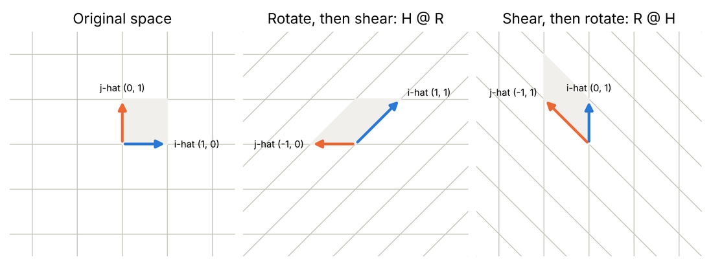

# Day 015 · 向量、矩阵与线性变换

> 📅 2026-11-18（周三）· 阶段 1「基础补齐」· 第 3 周 · ⏱️ 约 90 分钟
>
> [📅 课程表](../../SYLLABUS.md) · [🗺️ 路线图](../../ROADMAP.md) · 上一篇：[Day 014](../2026-11/day014-2026-11-17.md) · 下一篇：[Day 016](../2026-11/day016-2026-11-19.md)

## 🎯 今日目标

1. 用几何直觉理解向量、线性组合、张成空间、基和线性无关，并能把一个样本的表达谱看成高维空间中的一个向量。
2. 把矩阵理解为线性变换：说清矩阵每一列的含义，以及矩阵乘向量、矩阵乘矩阵在几何上各意味着什么。
3. 用 NumPy 解一个细胞类型反卷积的小问题，用矩阵的秩判断实验设计有没有混杂，并解释神经网络为什么需要非线性激活函数。

## 📖 核心概念

### 1. 向量：一组有序的数，也是空间中的一个点

3Blue1Brown 第 1 章给了向量三种视角：物理学家眼中有方向的箭头，计算机科学家眼中的一列有序数字，数学家眼中能做加法和数乘的对象。线性代数的威力在于三者可以互相翻译。

在生物数据里，向量无处不在：一个样本测了 2 万个基因，就是 2 万维空间中的一个点；Day 014 过滤后的 8 个 airway 样本，是 13,850 维空间中的 8 个点；一个细胞的单细胞表达谱、一个蛋白在语言模型中的嵌入（embedding），也都是向量。两个基本运算是**加法**（箭头首尾相接）和**数乘**（把箭头拉长、缩短或反向）。

### 2. 线性组合、张成空间与基

- **线性组合**（linear combination）：$a\mathbf{v} + b\mathbf{w}$，即先数乘、再相加。
- **张成空间**（span）：一组向量所有线性组合构成的集合。
- **线性相关**（linearly dependent）：其中某个向量能由其他向量组合出来，它没有带来新的方向，是“多余”的；反之称为线性无关。
- **基**（basis）：能张成整个空间、又彼此线性无关的一组向量。一个向量的坐标，就是它在这组基下的组合系数。

一个生物例子是**细胞类型反卷积**（deconvolution）：一个 bulk 组织样本的表达谱，可以近似看成各细胞类型参考表达谱的线性组合，组合系数就是各类细胞所占的比例。反过来，已知参考谱和 bulk 谱，就能估计比例（练习 1）。如果两种细胞的参考谱成比例（线性相关），无论用什么算法，它们各自的比例都无法区分。

### 3. 矩阵就是线性变换

第 3 章的核心观点：线性变换保持网格线平行且等距、原点不动，所以**只要知道基向量被变到了哪里，就知道整个空间被变成了什么样**。矩阵的第 1 列就是 $\hat{\imath}$ 变换后的位置，第 2 列是 $\hat{\jmath}$ 的位置。

于是矩阵乘向量可以理解为“用向量的分量去组合矩阵的列”：

$$A\mathbf{x} = x_1\mathbf{a}_1 + x_2\mathbf{a}_2 + \cdots + x_n\mathbf{a}_n$$

这和第 2 节的反卷积是同一件事：参考矩阵 $S$ 的每一列是一种细胞的表达谱，$S\mathbf{p}$ 就是按比例 $\mathbf{p}$ 混合出的 bulk 表达谱。神经网络的一层 $\mathbf{y} = W\mathbf{x} + \mathbf{b}$ 也是线性变换再加一个平移：把输入向量映射到一个新的空间。

### 4. 矩阵乘法就是变换的复合

第 4 章：$AB\mathbf{x} = A(B\mathbf{x})$，**先做 $B$，再做 $A$**，要从右往左读。由此可以直接看出两条性质：

- 一般 $AB \neq BA$：先旋转再剪切，和先剪切再旋转，结果不同（练习 2 的图）。
- 满足结合律 $(AB)C = A(BC)$：三个变换依次进行，怎么加括号都一样。

形状规则是 $(m \times n)(n \times p) = (m \times p)$，中间的维度必须相等。在 NumPy 中矩阵乘法用 `@`，而 `*` 是逐元素相乘（Day 009 的广播规则），两者不能混淆。

这里有一个对深度学习很重要的推论：两个线性层叠在一起，$W_2(W_1\mathbf{x}) = (W_2W_1)\mathbf{x}$，仍然只是一个线性变换。不管叠多少层，只要中间没有非线性激活函数，网络的表达能力就和一层一样。ReLU 这类非线性函数，才是神经网络能拟合复杂关系的关键（第 8 周会用到）。

### 5. 线性方程组与秩

$A\mathbf{x} = \mathbf{b}$ 问的是：用 $A$ 的列怎样组合出 $\mathbf{b}$？矩阵的**秩**（rank）是它的列中线性无关的最大个数，也就是列向量张成空间的维数（MML 2.6 节）。列满秩时，组合方式是唯一的；秩不足时，会有许多组不同的系数给出同一个结果，参数无法识别（non-identifiable）。

实验设计中的**混杂**（confounding）就是秩不足的例子。把每个样本写成设计矩阵的一行（截距、是否处理、属于哪个批次）。如果对照样本全在批次 1、处理样本全在批次 2，“处理”列和“批次”列完全相同，矩阵秩不足，处理效应和批次效应就永远分不开，任何统计方法都补救不了，只能在设计实验时把处理均衡地分配到各个批次。Day 014 能用 `~ cell + dex` 建模，正是因为每个细胞系都同时有对照和处理样本。

### 6. 局限

线性模型只能描述线性关系，而基因调控、剂量反应常常是非线性的。练习 1 用的最小二乘法也没有约束比例非负、总和为 1；参考谱不完整（bulk 里有参考矩阵中没有的细胞类型）时，估计会系统性偏移。实际的反卷积方法会加上非负约束，并仔细挑选参考谱。

## 📚 今日资源

| # | 资源 | 学什么 | 建议时长 |
|---|---|---|---|
| 1 | [3Blue1Brown：线性代数的本质](https://www.3blue1brown.com/topics/linear-algebra) · [B 站官方双语合集](https://www.bilibili.com/video/av6731067) | 第 1–4 章：Vectors, what even are they?；Linear combinations, span, and basis vectors；Linear transformations and matrices；Matrix multiplication as composition（B 站合集中序言之后的四集）。看到关键处先暂停，自己想想下一步 | 45 分钟 |
| 2 | [Mathematics for Machine Learning（MML）](https://mml-book.github.io/) 第 2 章 | 精读 2.1–2.3（线性方程组、矩阵、解方程组）和 2.5–2.6（线性无关、基与秩），读 2.7 线性映射的开头；2.4 向量空间、2.8 仿射空间可以略读 | 30 分钟 |
| 3 | [《动手学深度学习》2.3 线性代数](https://zh.d2l.ai/chapter_preliminaries/linear-algebra.html) | 中文，配代码：从“点积”读到“矩阵-矩阵乘法”，把今天的概念和张量运算对应起来 | 15 分钟 |

## 🛠️ 动手练习

在 Colab 中依次运行下面 4 段代码，全部使用代码内的小例子。

**练习 1 · 线性组合：从 bulk 表达谱估计细胞比例**

```python
import numpy as np
import matplotlib.pyplot as plt

# 6 个标记基因在 3 种细胞中的参考表达谱（数字是虚构的）
genes = ["CD3E", "CD8A", "MS4A1", "CD79A", "CD14", "LYZ"]
S = np.array([
    #  T     B   单核细胞
    [120,   2,   3],   # CD3E
    [ 80,   1,   2],   # CD8A
    [  2, 150,   1],   # MS4A1
    [  3, 110,   2],   # CD79A
    [  1,   2, 200],   # CD14
    [  5,   4, 300],   # LYZ
], dtype=float)        # 形状 (6 个基因, 3 种细胞)：每一列是一种细胞的表达谱
p_true = np.array([0.6, 0.3, 0.1])                  # 真实比例：T 60%、B 30%、单核 10%
rng = np.random.default_rng(0)
bulk = S @ p_true + rng.normal(0, 2, size=6)         # bulk = 三列的线性组合 + 测量噪声
p_hat, *_ = np.linalg.lstsq(S, bulk, rcond=None)     # 最小二乘：哪种组合最接近 bulk？
print("bulk:", bulk.round(1))
print("estimated proportions:", p_hat.round(3))
print("rank of S:", np.linalg.matrix_rank(S))

# 如果 B 细胞的参考谱恰好是 T 细胞的一半（两列线性相关）……
S2 = S.copy()
S2[:, 1] = 0.5 * S[:, 0]
print("rank of S2:", np.linalg.matrix_rank(S2))
print(np.allclose(S2 @ [0.6, 0.3, 0.1], S2 @ [0.75, 0.0, 0.1]))   # 两种不同的组成，bulk 完全一样
```

期望输出：

```text
bulk: [73.2 48.2 47.6 35.2 20.1 34.9]
estimated proportions: [0.6   0.306 0.1  ]
rank of S: 3
rank of S2: 2
True
```

参考矩阵列满秩（秩为 3）时，比例估计得很准。两列线性相关时秩降为 2，“T 60% + B 30%”和“T 75% + B 0%”产生完全相同的 bulk 表达谱，数据本身无法区分它们。

**练习 2 · 矩阵是变换，矩阵乘法是复合**

```python
BLUE, ORANGE, GRID_LINE = "#2a78d6", "#eb6834", "#c3c2b7"
plt.rcParams.update({"figure.dpi": 120, "savefig.dpi": 300, "savefig.bbox": "tight", "font.size": 9})

R = np.array([[0, -1], [1, 0]])     # 逆时针旋转 90°
H = np.array([[1, 1], [0, 1]])      # 水平剪切
print("H @ R =\n", H @ R)
print("R @ H =\n", R @ H)
M = H @ R
print("M @ [1, 0] =", M @ [1, 0], "| first column of M =", M[:, 0])

def draw(ax, M, title):
    """画出矩阵 M 作用后的网格、单位正方形和两个基向量。"""
    for t in range(-6, 7):                                   # 变换后的网格线
        for line in (np.array([[t, t], [-6, 6]]), np.array([[-6, 6], [t, t]])):
            pts = M @ line
            ax.plot(pts[0], pts[1], color=GRID_LINE, lw=0.6, zorder=0)
    square = M @ np.array([[0, 1, 1, 0], [0, 0, 1, 1]])     # 单位正方形的 4 个顶点（每列一个点）
    ax.fill(square[0], square[1], color="#f0efec", zorder=1)
    for col, color, name in [(0, BLUE, "i-hat"), (1, ORANGE, "j-hat")]:
        v = M[:, col]                                        # 第 col 列 = 第 col 个基向量变换后的位置
        ax.annotate("", xy=v, xytext=(0, 0), zorder=3,
                    arrowprops=dict(arrowstyle="-|>", color=color, lw=2, mutation_scale=12))
        ha = "left" if v[0] > 0 else "right" if v[0] < 0 else "center"
        ax.text(v[0] + 0.15 * np.sign(v[0]), v[1] + (0.25 if v[0] == 0 else 0.15 * np.sign(v[1])),
                f"{name} {tuple(int(a) for a in v)}", fontsize=7, ha=ha, va="center")
    ax.set(xlim=(-2.5, 2.5), ylim=(-2.5, 2.5), aspect="equal", title=title, xticks=[], yticks=[])
    for s in ax.spines.values():
        s.set_visible(False)

fig, axes = plt.subplots(1, 3, figsize=(7.2, 2.6), layout="constrained")
draw(axes[0], np.eye(2, dtype=int), "Original space")
draw(axes[1], H @ R, "Rotate, then shear: H @ R")
draw(axes[2], R @ H, "Shear, then rotate: R @ H")
fig.savefig("transform.png")
```

期望输出：

```text
H @ R =
 [[ 1 -1]
 [ 1  0]]
R @ H =
 [[ 0 -1]
 [ 1  1]]
M @ [1, 0] = [1 1] | first column of M = [1 1]
```

生成的图应该和下面一致：



对照数字和图：`H @ R` 的第一列 `(1, 1)` 正是蓝色箭头 $\hat{\imath}$ 最终的位置。两种顺序得到的矩阵不同，网格的形状也不同。

**练习 3 · 两个线性层等于一层，加上 ReLU 就不再是线性的了**

```python
rng = np.random.default_rng(1)
W1, W2 = rng.normal(size=(4, 3)), rng.normal(size=(2, 4))   # 3 维输入 → 4 维隐藏层 → 2 维输出
x, y = rng.normal(size=3), rng.normal(size=3)
print("two linear layers == one:", np.allclose(W2 @ (W1 @ x), (W2 @ W1) @ x))

relu = lambda z: np.maximum(z, 0)
f = lambda v: W2 @ relu(W1 @ v)                            # 中间加一个 ReLU
print("with ReLU, f(x + y) == f(x) + f(y)?", np.allclose(f(x + y), f(x) + f(y)))
print("with ReLU, f(-x) == -f(x)?", np.allclose(f(-x), -f(x)))
```

期望输出：

```text
two linear layers == one: True
with ReLU, f(x + y) == f(x) + f(y)? False
with ReLU, f(-x) == -f(x)? False
```

线性变换必须满足 $f(\mathbf{x}+\mathbf{y}) = f(\mathbf{x}) + f(\mathbf{y})$。没有 ReLU 时，两层合起来就是一个矩阵 `W2 @ W1`；加上 ReLU 后这个性质被打破，网络才可能拟合非线性的关系。

**练习 4 · 用秩检查实验设计有没有混杂**

```python
treat = np.array([0, 0, 0, 0, 1, 1, 1, 1])                 # 4 个对照、4 个处理
for name, batch in [("balanced", np.array([0, 1, 0, 1, 0, 1, 0, 1])),     # 每个批次都有对照和处理
                    ("confounded", np.array([0, 0, 0, 0, 1, 1, 1, 1]))]:  # 对照全在批次 1，处理全在批次 2
    X = np.column_stack([np.ones(8), treat, batch])        # 设计矩阵：截距、处理、批次
    print(f"{name:>10}: rank = {np.linalg.matrix_rank(X)} of {X.shape[1]} columns")
```

期望输出：

```text
  balanced: rank = 3 of 3 columns
confounded: rank = 2 of 3 columns
```

混杂设计中“处理”列和“批次”列完全一样，秩只有 2：模型有 3 个参数，数据却只能确定 2 个方向，处理效应和批次效应注定分不开。

**进阶**：

1. **用矩阵乘法算样本相关系数**。接着 Day 014 第 3 步的 `logcpm`（基因 × 样本）运行：

   ```python
   X = logcpm.to_numpy()                                  # 基因 × 样本
   Z = (X - X.mean(axis=0)) / X.std(axis=0, ddof=1)       # 每个样本（列）标准化
   C = Z.T @ Z / (X.shape[0] - 1)                         # 样本 × 样本的相关系数矩阵
   print(np.allclose(C, np.corrcoef(X.T)))
   ```

   应该输出 `True`：皮尔逊相关系数就是标准化之后向量的点积再除以 $n-1$。然后找出相关系数最高的一对样本（提示：`C2 = C.copy()`，用 `np.fill_diagonal(C2, np.nan)` 去掉对角线，再用 `np.nanargmax` 和 `np.unravel_index`）。你应该发现，最相似的是细胞系 N080611 的对照和处理样本（r ≈ 0.971），而所有样本两两之间的相关系数都在 0.93 以上：几千个基因的整体表达水平决定了相关系数，样本间的细微差异要靠 PCA 等方法才能看清（Day 017）。
2. **加上非负约束**：用 `scipy.optimize.nnls(S, bulk)` 代替 `lstsq` 重做练习 1，再把比例归一化成总和为 1。然后在 `bulk` 中给 CD3E 额外加 30（模拟参考矩阵里没有、但也表达 CD3E 的另一类细胞），看看估计的比例怎样偏移。

## ✅ 自测题

1. 矩阵 $A$ 的每一列在几何上代表什么？怎样用 $A$ 的列来理解 $A\mathbf{x}$？
2. $AB$ 和 $BA$ 一般相等吗？$AB\mathbf{x}$ 中先作用在 $\mathbf{x}$ 上的是哪个变换？
3. 什么叫线性相关？在细胞类型反卷积中，如果两种细胞的参考表达谱成比例，会出现什么问题？
4. 为什么只叠加线性层、中间没有激活函数的神经网络，表达能力和一层一样？
5. 实验设计中“批次与处理完全混杂”在线性代数上对应什么？为什么事后无法补救？

<details>
<summary>参考答案</summary>

1. 第 $k$ 列是第 $k$ 个基向量经过变换后的位置。$A\mathbf{x} = x_1\mathbf{a}_1 + \cdots + x_n\mathbf{a}_n$，即用 $\mathbf{x}$ 的各个分量作为系数，对 $A$ 的列做线性组合。
2. 一般不相等，矩阵乘法不满足交换律，练习 2 中 `H @ R` 和 `R @ H` 就不同。$AB\mathbf{x} = A(B\mathbf{x})$，先作用的是右边的 $B$，然后才是 $A$，要从右往左读。
3. 一组向量中，某个向量能由其他向量的线性组合得到，就叫线性相关，它没有提供新的方向。如果两种细胞的参考谱成比例，参考矩阵的这两列线性相关，秩不足：两种细胞之间可以任意“转移”比例而 bulk 谱完全不变，所以它们各自的比例无法识别（练习 1 中“T 60% + B 30%”和“T 75% + B 0%”给出同一个 bulk）。
4. 每个线性层都是一个矩阵，多层依次作用等于这些矩阵的乘积，$W_k \cdots W_2 W_1$ 仍然只是一个矩阵，也就是一个线性变换。只有在层与层之间加入 ReLU 等非线性函数，复合起来的函数才不再是线性的，才能拟合复杂的非线性关系。
5. 对应设计矩阵秩不足：“处理”列和“批次”列完全相同（或一列能由其他列线性组合得到），模型参数不可识别，任何一组“处理效应 + 批次效应”只要总和相同，就同样符合数据。这是数据本身缺少信息，不是统计方法不够好，所以事后无法补救，只能在设计实验时让每个批次都同时包含对照和处理样本。

</details>

## 🔭 今日前沿

- **WorldParticle：用一个 AI 模型模拟从沙粒到蛋白质的多种物理过程（MIT News，11 月 9 日）**：MIT、不列颠哥伦比亚大学等机构的研究人员把沙堆、可变形物体乃至蛋白质分子都表示成大量“粒子”，用同一个深度学习模型逐步预测粒子的运动，而不是为每种物理过程分别编写专门的模拟程序。报道称，模型在包括蛋白质在内的六类物理现象上做了演示。它离实际的蛋白质研究还有距离，但“一个模型学会多种物理规律”是 AI 科学模拟的一个新方向。来源：[MIT News](https://news.mit.edu/2026/single-ai-model-simulates-many-substances-behavior-1109)

## 📝 学习打卡

- [ ] 看完 3Blue1Brown 第 1–4 章
- [ ] 读完 MML 第 2 章的指定小节和 d2l 2.3
- [ ] 跑通练习 1–4，输出与示例一致
- [ ] 能用自己的话解释：为什么 `H @ R` 的第一列就是 $\hat{\imath}$ 最终的位置
- [ ] 进阶：用矩阵乘法算出样本相关系数矩阵，并找出最相似的一对样本
- 今日笔记 / 疑问：
