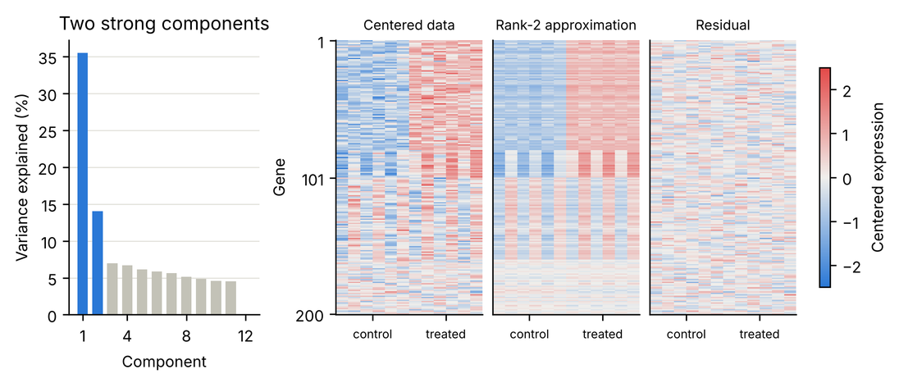

# Day 016 · 特征分解与 SVD

> 📅 2026-11-19（周四）· 阶段 1「基础补齐」· 第 3 周 · ⏱️ 约 90 分钟
>
> [📅 课程表](../../SYLLABUS.md) · [🗺️ 路线图](../../ROADMAP.md) · 上一篇：[Day 015](../2026-11/day015-2026-11-18.md) · 下一篇：[Day 017](../2026-11/day017-2026-11-20.md)

## 🎯 今日目标

1. 理解特征向量和特征值的几何含义：在变换中方向不变、只被拉伸或压缩的向量；会用 NumPy 求解并验证 $A\mathbf{v} = \lambda\mathbf{v}$。
2. 理解特征分解（对角化）为什么有用：用它计算矩阵的幂、求马尔可夫链的稳态；知道对称矩阵的特征向量相互正交。
3. 理解奇异值分解（SVD）：任何矩阵都能分解成“旋转—拉伸—旋转”；会用截断 SVD 做低秩近似和去噪，并把奇异向量和组学数据中的表达模式联系起来。

## 📖 核心概念

### 1. 特征向量：变换中不改变方向的向量

经过一个线性变换，大多数向量都会偏离原来所在的直线；少数特殊的向量只是被拉长或缩短，方向不变（或者正好反向）。它们就是**特征向量**（eigenvector），伸缩的倍数是**特征值**（eigenvalue）：

$$A\mathbf{v} = \lambda\mathbf{v}$$

3Blue1Brown 第 14 章的例子是 $A = \begin{pmatrix}3 & 1\\ 0 & 2\end{pmatrix}$：$x$ 轴上的向量都被拉长 3 倍，沿 $(-1, 1)$ 方向的向量被拉长 2 倍，其余方向都会转向。旋转 90° 的矩阵则把每个方向都转开了，没有实数特征向量，它的特征值是复数 $\pm i$。

手算时解方程 $\det(A - \lambda I) = 0$，对 2×2 矩阵很方便；实际计算交给 NumPy：一般矩阵用 `np.linalg.eig`，对称矩阵用 `np.linalg.eigh`。

### 2. 特征分解：换到特征基里，变换只剩拉伸

如果 $n \times n$ 矩阵 $A$ 有 $n$ 个线性无关的特征向量，把它们排成矩阵 $P$ 的各列，就有

$$A = PDP^{-1}$$

其中 $D$ 是由特征值组成的对角矩阵。按第 13 章“基变换”的读法，从右往左依次是：换到特征基（$P^{-1}$），在每个坐标轴上分别伸缩（$D$），再换回原来的坐标（$P$）。

最直接的好处是算矩阵的幂：$A^k = PD^kP^{-1}$，只需要把对角线上的数各自乘 $k$ 次方。所以一个变换反复作用的长期结果，由绝对值最大的特征值决定。

生物学中的例子是**马尔可夫链**（Markov chain）。用转移矩阵 $P$ 描述细胞在细胞周期各时期之间的转移（每行是“从某一期出发，下一小时到达各期的概率”，行和为 1）。不管起点在哪，经过足够长的时间，各时期的细胞比例都会收敛到稳态分布 $\boldsymbol{\pi}$，它满足 $\boldsymbol{\pi}P = \boldsymbol{\pi}$，正是 $P^\mathsf{T}$ 特征值为 1 的特征向量；第二大的特征值（取绝对值）越接近 1，收敛越慢（练习 2）。单细胞轨迹分析中，也会用细胞之间的转移矩阵来推断细胞的终末状态。

### 3. 对称矩阵：实特征值，正交特征向量

实对称矩阵有一个很好的性质（谱定理）：特征值都是实数，特征向量可以取成相互正交的单位向量，于是 $A = Q\Lambda Q^\mathsf{T}$，且 $Q^\mathsf{T}Q = I$。组学中最常见的对称矩阵是基因 × 基因的**协方差矩阵**和**相关系数矩阵**，它们的特征值还都不小于 0。最大特征值对应的特征向量，指向数据变化最大的方向，这就是明天要讲的 PCA。

### 4. SVD：任何矩阵都能分解

特征分解只适用于方阵，而且不是每个方阵都能对角化。**奇异值分解**（singular value decomposition，SVD）适用于任意 $m \times n$ 矩阵：

$$X = U\Sigma V^\mathsf{T}$$

$U$ 和 $V$ 的列都是正交的单位向量，$\Sigma$ 是对角矩阵，对角线上的**奇异值** $\sigma_1 \ge \sigma_2 \ge \cdots \ge 0$。几何上，它把任何线性变换拆成三步：旋转（$V^\mathsf{T}$）、沿坐标轴拉伸（$\Sigma$）、再旋转（$U$）。它和特征分解的关系是 $X^\mathsf{T}X = V\Sigma^2V^\mathsf{T}$：奇异值的平方，就是 $X^\mathsf{T}X$ 的特征值。

对一个“基因 × 样本”的表达矩阵（先让每个基因减去自己的均值），$V$ 的每一列是样本维度上的一种表达模式，Alter 等人 2000 年称之为“特征基因”（eigengene）；$U$ 的对应列给出每个基因在这种模式上的权重；$\sigma_i^2 / \sum_j \sigma_j^2$ 是这种模式解释的方差比例。

### 5. 低秩近似：只保留最大的几个奇异值

只保留前 $k$ 个奇异值和对应的奇异向量，

$$X_k = \sum_{i=1}^{k} \sigma_i\, \mathbf{u}_i \mathbf{v}_i^\mathsf{T}$$

就是在所有秩为 $k$ 的矩阵中最接近 $X$ 的一个（Eckart–Young 定理，MML 4.6 节）。真实的生物信号往往集中在少数几个方向上，噪声则分散在所有方向上，所以截断 SVD 可以去噪、压缩数据，还能帮我们发现主要的生物学或技术模式：如果某个成分和测序批次高度相关，就提示存在批次效应。

一个实用的提醒：把一对奇异向量同时取反，$(-\mathbf{u})(-\mathbf{v})^\mathsf{T} = \mathbf{u}\mathbf{v}^\mathsf{T}$，分解同样成立，所以奇异向量（以及特征向量）的正负号是任意的。不同软件、不同版本可能给出相反的符号，不要解读符号本身；需要逐位复现时（Day 013），可以统一规定一个符号约定。

### 6. 局限

SVD 只能找出线性结构，对数据的尺度很敏感（方差大的基因会主导结果，必要时要先标准化），也容易受离群值影响。它找到的成分彼此正交，这是数学上的约束，而真实的基因调控程序未必相互正交；需要非负或独立的成分时，可以考虑 NMF、ICA 等方法。

## 📚 今日资源

| # | 资源 | 学什么 | 建议时长 |
|---|---|---|---|
| 1 | [3Blue1Brown：Eigenvectors and eigenvalues](https://www.3blue1brown.com/lessons/eigenvalues)（第 14 章，约 17 分钟） | 先快速看一遍第 13 章 Change of basis（基变换），否则“特征基”那一段不好跟上。B 站[官方双语合集](https://www.bilibili.com/video/av6731067)中也有这两集 | 30 分钟 |
| 2 | [Mathematics for Machine Learning（MML）](https://mml-book.github.io/) 第 4 章 | 精读 4.2（特征值与特征向量）、4.4（特征分解与对角化）、4.5（SVD）和 4.6（矩阵近似）；4.1 行列式与迹可以浏览，4.3 Cholesky 分解可以跳过 | 35 分钟 |
| 3 | MIT 18.06 [第 29 讲：Singular value decomposition](https://ocw.mit.edu/courses/18-06-linear-algebra-spring-2010/resources/lecture-29-singular-value-decomposition/)（选看） | 看前 15 分钟：Strang 讲 SVD 怎样把一组正交基映射成另一组正交基。想补特征值的手算方法，可以看[第 21 讲](https://ocw.mit.edu/courses/18-06-linear-algebra-spring-2010/resources/lecture-21-eigenvalues-and-eigenvectors/) | 15 分钟 |
| 4 | [Alter et al. 2000, *Singular value decomposition for genome-wide expression data processing and modeling*](https://doi.org/10.1073/pnas.97.18.10101) | PNAS，可免费阅读。读摘要和引言：把酵母细胞周期的表达矩阵分解成“特征基因”和“特征阵列”的经典论文 | 10 分钟 |

## 🛠️ 动手练习

在 Colab 中依次运行。全部使用代码内的小例子和模拟数据。

**练习 1 · 特征向量：变换中方向不变的向量**

```python
import numpy as np
import matplotlib.pyplot as plt
from matplotlib.colors import LinearSegmentedColormap

np.set_printoptions(precision=3, suppress=True)

A = np.array([[3, 1], [0, 2]])                 # 3Blue1Brown 第 14 章的例子
vals, vecs = np.linalg.eig(A)                  # vecs 的每一列是一个特征向量（长度为 1）
vals, vecs = np.real_if_close(vals), np.real_if_close(vecs)   # 有的 NumPy 版本总是返回复数类型
print("eigenvalues:", vals)
print("eigenvectors (columns):\n", vecs)
for lam, v in zip(vals, vecs.T):
    print(f"A @ v = {A @ v}   lambda * v = {lam * v}")

R = np.array([[0, -1], [1, 0]])                # 旋转 90°：每个方向都被转开了
print("rotation eigenvalues:", np.linalg.eigvals(R))
```

期望输出：

```text
eigenvalues: [3. 2.]
eigenvectors (columns):
 [[ 1.    -0.707]
 [ 0.     0.707]]
A @ v = [3. 0.]   lambda * v = [3. 0.]
A @ v = [-1.414  1.414]   lambda * v = [-1.414  1.414]
rotation eigenvalues: [0.+1.j 0.-1.j]
```

第二个特征向量 $(-0.707, 0.707)$ 就是 $(-1, 1)$ 方向的单位向量。旋转矩阵的特征值是复数，说明它没有在实平面里保持方向的向量。

**练习 2 · 马尔可夫链：细胞周期各时期的稳态比例**

```python
states = ["G1", "S", "G2/M"]
P = np.array([[0.90, 0.10, 0.00],   # 每小时：G1 期细胞有 10% 进入 S 期（转移概率是虚构的）
              [0.00, 0.85, 0.15],   # S 期 → G2/M 期
              [0.20, 0.00, 0.80]])  # G2/M 期 → 分裂后回到 G1 期（这里不考虑细胞数量的增加）
vals, vecs = np.linalg.eig(P.T)     # 稳态 pi 满足 pi @ P = pi，即 P.T @ pi = pi
k = np.argmin(np.abs(vals - 1))     # 找到特征值 1
pi = np.real(vecs[:, k])
pi = pi / pi.sum()                  # 缩放成总和为 1 的概率分布
print("|eigenvalues| of P:", np.sort(np.abs(vals))[::-1])
print("stationary distribution (G1, S, G2/M):", pi)

x = np.array([1.0, 0.0, 0.0])       # 起点：所有细胞都在 G1 期
for hour in range(100):
    x = x @ P                       # 每过一小时，乘一次转移矩阵
print("after 100 hours:", x)
```

期望输出：

```text
|eigenvalues| of P: [1.    0.784 0.784]
stationary distribution (G1, S, G2/M): [0.462 0.308 0.231]
after 100 hours: [0.462 0.308 0.231]
```

模拟 100 小时的结果和特征向量完全一致。稳态比例还可以这样理解：各时期的平均停留时间分别是 $1/0.1 = 10$、$1/0.15 \approx 6.7$ 和 $1/0.2 = 5$ 小时，稳态比例与停留时间成正比，即 10 : 6.7 : 5。另外两个特征值的绝对值是 0.784，每过一小时，偏离稳态的部分大约缩小到原来的 78%。

**练习 3 · 对称矩阵：协方差矩阵的特征向量相互正交**

```python
rng = np.random.default_rng(0)
X = rng.normal(size=(50, 4))                   # 50 个样本 × 4 个基因
X[:, 1] = X[:, 0] + 0.3 * rng.normal(size=50)  # 基因 2 与基因 1 共表达
C = np.cov(X, rowvar=False)                    # 4 × 4 的协方差矩阵，是对称矩阵
w, Q = np.linalg.eigh(C)                       # 对称矩阵用 eigh：特征值为实数，按从小到大排列
print("eigenvalues:", w)
print("Q.T @ Q == I ?", np.allclose(Q.T @ Q, np.eye(4)))
print("C == Q diag(w) Q.T ?", np.allclose(C, Q @ np.diag(w) @ Q.T))
print("top eigenvector:", Q[:, -1])            # 最大特征值对应的方向
```

期望输出（最后一行整体变号也是正确的）：

```text
eigenvalues: [0.061 0.765 1.308 1.866]
Q.T @ Q == I ? True
C == Q diag(w) Q.T ? True
top eigenvector: [ 0.668  0.702  0.105 -0.224]
```

最大特征值对应的方向主要由基因 1 和基因 2 组成，权重几乎相等：数据变化最大的方向，就是这两个共表达基因一起升降的方向。最小的特征值只有 0.061，对应“基因 1 减基因 2”这个几乎不变的方向。

**练习 4 · SVD：从带噪声的表达矩阵中找回两种表达模式**

模拟 500 个基因 × 12 个样本：6 个对照、6 个处理，另有两个测序批次与处理交错排列。前 100 个基因受处理影响，第 81–160 个基因受批次影响，再加上随机噪声。

```python
rng = np.random.default_rng(2026)
n_genes, n_samples = 500, 12
treat = np.repeat([0, 1], 6)                   # 6 个对照、6 个处理
batch = np.tile([0, 1], 6)                     # 两个批次，与处理交错排列（没有混杂）
signal = np.zeros((n_genes, n_samples))
signal[:100] += 1.5 * treat                    # 前 100 个基因受处理影响
signal[80:160] += 1.0 * batch                  # 第 81–160 个基因受批次影响（其中 20 个两者都受影响）
data = signal + rng.normal(0, 0.5, size=signal.shape)

Xc = data - data.mean(axis=1, keepdims=True)   # 每个基因减去自己的均值（中心化）
U, s, Vt = np.linalg.svd(Xc, full_matrices=False)
var = s**2 / (s**2).sum()                      # 每个成分解释的方差比例
print("shapes:", U.shape, s.shape, Vt.shape)
print("singular values:", s[:5])
print("variance explained:", var[:5])
print("|corr(V1, treat)| =", round(abs(np.corrcoef(Vt[0], treat)[0, 1]), 3),
      "| |corr(V2, batch)| =", round(abs(np.corrcoef(Vt[1], batch)[0, 1]), 3))

k = 2
Xk = U[:, :k] @ np.diag(s[:k]) @ Vt[:k]        # 秩为 2 的近似
truth = signal - signal.mean(axis=1, keepdims=True)
err = lambda M: np.linalg.norm(M - truth) / np.linalg.norm(truth)
print(f"error vs. true signal: noisy data {err(Xc):.2f} | rank-2 approximation {err(Xk):.2f}")
print("s**2 == eigenvalues of Xc.T @ Xc ?", np.allclose(np.sort(s**2), np.sort(np.linalg.eigvalsh(Xc.T @ Xc))))
```

期望输出：

```text
shapes: (500, 12) (12,) (12, 12)
singular values: [28.372 17.847 12.588 12.335 11.797]
variance explained: [0.355 0.14  0.07  0.067 0.061]
|corr(V1, treat)| = 0.977 | |corr(V2, batch)| = 0.973
error vs. true signal: noisy data 1.23 | rank-2 approximation 0.52
s**2 == eigenvalues of Xc.T @ Xc ? True
```

前两个成分明显高出其余成分；第一个右奇异向量几乎就是“处理”模式，第二个几乎就是“批次”模式（用相关系数的绝对值比较，因为符号是任意的）。只保留这两个成分，与真实信号的误差从 1.23 降到 0.52：低秩近似去掉了大部分噪声。再把结果画出来：

```python
BLUE, RED, GRAY = "#2a78d6", "#e34948", "#c3c2b7"
DIVERGING = LinearSegmentedColormap.from_list("blue_gray_red", [BLUE, "#f0efec", RED])
plt.rcParams.update({
    "figure.dpi": 120, "savefig.dpi": 300, "savefig.bbox": "tight", "font.size": 9,
    "axes.spines.top": False, "axes.spines.right": False,
})

fig = plt.figure(figsize=(7.2, 3.0), layout="constrained")
gs = fig.add_gridspec(1, 4, width_ratios=[1.3, 1, 1, 1])
ax = fig.add_subplot(gs[0])
ax.bar(np.arange(1, 13), var * 100, color=[BLUE] * k + [GRAY] * (12 - k), width=0.7)   # 保留的成分上色
ax.set(xlabel="Component", ylabel="Variance explained (%)", title="Two strong components", xticks=[1, 4, 8, 12])
ax.grid(axis="y", color="#e1e0d9", lw=0.6)
ax.set_axisbelow(True)
for j, (M, title) in enumerate([(Xc, "Centered data"), (Xk, "Rank-2 approximation"), (Xc - Xk, "Residual")]):
    a = fig.add_subplot(gs[j + 1])
    im = a.imshow(M[:200], aspect="auto", cmap=DIVERGING, vmin=-2.5, vmax=2.5, interpolation="nearest")
    a.set_title(title, fontsize=8)
    a.set_xticks([2.5, 8.5], ["control", "treated"], fontsize=7)
    a.set_yticks([] if j else [0, 100, 199], [] if j else ["1", "101", "200"])
    if j == 0:
        a.set_ylabel("Gene")
fig.colorbar(im, ax=fig.axes[1:], shrink=0.8, label="Centered expression")
fig.savefig("svd.png")
```

图应该和下面一致（热图只显示前 200 个基因）：



在“秩为 2 的近似”中，前 100 个基因清楚地按处理分成两块，第 81–160 个基因呈现与批次对应的竖条纹；残差几乎只剩随机噪声。第 12 个成分的柱子几乎为 0：每个基因减去均值之后，12 列加起来等于零向量，列向量线性相关，矩阵的秩最多是 11（Day 015）。

**进阶**：

1. 把 `k` 依次换成 1 到 11，画出“与真实信号的误差”随 `k` 的变化。你应该发现误差在 `k = 2` 时最小（0.52），`k = 1` 时是 0.62，之后越来越大，`k = 11` 时回到 1.23。为什么保留更多成分反而更差？
2. 把练习 4 的批次改成与处理完全混杂（`batch = treat.copy()`），重新运行。还能找到两个独立的强成分吗？结合 Day 015 的“秩”解释原因。

## ✅ 自测题

1. 特征向量和特征值的几何意义是什么？旋转 90° 的矩阵为什么没有实数特征向量？
2. 为什么对角化 $A = PDP^{-1}$ 能简化 $A^k$ 的计算？反复作用一个变换的长期结果由什么决定？
3. 马尔可夫链的稳态分布对应哪个矩阵、哪个特征值的特征向量？练习 2 中 G1 期的稳态比例为什么是 0.462？
4. SVD 和特征分解是什么关系？为什么说 SVD 适用于任何矩阵？
5. 截断 SVD 为什么能去噪？为什么不能解读奇异向量的正负号？

<details>
<summary>参考答案</summary>

1. 特征向量是在变换中只被拉伸、压缩或反向，而方向所在直线不变的向量，特征值是拉伸的倍数（负值表示反向）。旋转 90° 会让平面上的每个方向都转开，没有任何非零实向量保持在原来的直线上，所以没有实数特征向量；它的特征值是复数 $\pm i$。
2. $A^k = PD^kP^{-1}$，中间的 $P^{-1}P$ 两两抵消，只需对对角矩阵 $D$ 的每个元素求 $k$ 次方。$k$ 很大时，绝对值最大的特征值对应的项增长最快（或衰减最慢），所以长期结果由它和它的特征向量决定；在马尔可夫链中，第二大特征值的绝对值决定收敛速度。
3. 稳态 $\boldsymbol{\pi}$ 满足 $\boldsymbol{\pi}P = \boldsymbol{\pi}$，转置后是 $P^\mathsf{T}\boldsymbol{\pi}^\mathsf{T} = \boldsymbol{\pi}^\mathsf{T}$，所以它是 $P^\mathsf{T}$ 特征值为 1 的特征向量（缩放到总和为 1）。G1、S、G2/M 期的平均停留时间分别为 10、约 6.7 和 5 小时，在这个“依次循环”的链中，稳态比例与停留时间成正比：$10 / (10 + 6.67 + 5) \approx 0.462$。
4. 对任意矩阵 $X = U\Sigma V^\mathsf{T}$，有 $X^\mathsf{T}X = V\Sigma^2V^\mathsf{T}$、$XX^\mathsf{T} = U\Sigma^2U^\mathsf{T}$：右奇异向量和左奇异向量分别是这两个对称矩阵的特征向量，奇异值的平方是它们的特征值。$X^\mathsf{T}X$ 和 $XX^\mathsf{T}$ 总是对称且特征值非负，总能做正交特征分解，所以 SVD 对任何形状、任何矩阵都存在；而特征分解只适用于方阵，而且不是每个方阵都能对角化。
5. 真实信号通常集中在少数几个方向上，对应几个大的奇异值；噪声则大致均匀地分散在所有方向上。只保留前几个成分，就保留了大部分信号，扔掉了大部分噪声（练习 4 中误差从 1.23 降到 0.52）。至于正负号，把 $\mathbf{u}_i$ 和 $\mathbf{v}_i$ 同时取反，乘积 $\mathbf{u}_i\mathbf{v}_i^\mathsf{T}$ 不变，分解同样正确，所以符号是任意的，不同软件或版本可能给出相反的符号。

</details>

## 🔭 今日前沿

今日无。第二届 Virtual Cell Challenge 的获奖结果和最终排行榜预计在本月下旬公布（[Arc 公告](https://arcinstitute.org/news/virtual-cell-challenge-2026)），公布后会在这里跟进。

## 📝 学习打卡

- [ ] 看完 3Blue1Brown 第 13–14 章
- [ ] 读完 MML 第 4 章的指定小节
- [ ] 跑通练习 1–4，输出与示例一致
- [ ] 能用自己的话解释：为什么细胞周期稳态比例和各时期的停留时间成正比
- [ ] 进阶：画出误差随 `k` 变化的曲线，并解释为什么 `k = 2` 最好
- 今日笔记 / 疑问：
