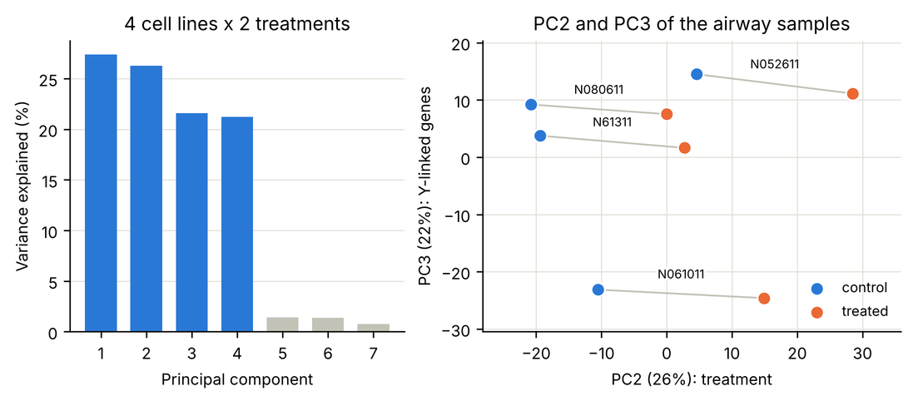

# Day 017 · PCA：原理与组学应用

> 📅 2026-11-20（周五）· 阶段 1「基础补齐」· 第 3 周 · ⏱️ 约 90 分钟
>
> [📅 课程表](../../SYLLABUS.md) · [🗺️ 路线图](../../ROADMAP.md) · 上一篇：[Day 016](../2026-11/day016-2026-11-19.md) · 下一篇：（明天更新）

## 🎯 今日目标

1. 从“最大方差”和“最小重建误差”两个角度理解主成分分析（principal component analysis，PCA），说清它和 Day 016 的协方差特征分解、SVD 之间的关系。
2. 只用 NumPy 写出一个 PCA 函数，并与协方差特征分解和 scikit-learn 的结果核对。
3. 在真实的 airway 数据上读懂 PCA：用得分（scores）看样本，用载荷（loadings）看基因，判断每个主成分代表的是处理、供体遗传差异还是性别。

## 📖 核心概念

### 1. PCA 要解决什么问题

一个样本测了 2 万个基因，就是 2 万维空间中的一个点（Day 015）。PCA 寻找少数几个新的坐标轴，即**主成分**（principal component，PC），让样本在这些轴上的分布尽可能分散。每个主成分都是所有基因的一个线性组合：第一主成分是方差最大的方向，第二主成分是与第一主成分正交的方向中方差最大的那个，以此类推。

它在组学中有三类用途：

- **可视化与质控**：在 PC1–PC2 平面上看样本是否按处理分组，有没有离群样本、批次效应或样本贴错标签。
- **降维和去噪**：单细胞分析的标准流程会先算几十个主成分，再在这个低维空间里构建邻居图、聚类和 UMAP。
- **发现主要的变异轴**：Novembre 等人 2008 年用约 19.7 万个 SNP 对 1,387 位欧洲人做 PCA，前两个主成分画出的样本分布和欧洲地图惊人地相似。

### 2. 两种等价的看法

MML 第 10 章从两个角度推导 PCA：

- **最大方差**（10.2 节）：找一个单位向量 $\mathbf{w}$，让数据投影到它上面之后方差最大。
- **最小重建误差**（10.3 节）：只用 $k$ 个方向来表示数据，让“投影再还原”之后与原数据的差距最小。

两条路得到同一个答案：协方差矩阵最大的 $k$ 个特征值对应的特征向量。直观地说，每个数据点到原点的距离是固定的，投影上保留的方差越多，丢掉的残差就越少。

### 3. 怎么算：协方差的特征分解，或中心化数据的 SVD

设 $X$ 是“样本 × 基因”的矩阵（scikit-learn 等工具都用这个方向，注意和 Day 016 的“基因 × 样本”区分）：

1. 每个基因（列）减去均值，得到中心化矩阵 $X_c$。
2. 协方差矩阵 $C = X_c^\mathsf{T}X_c / (n-1) = Q\Lambda Q^\mathsf{T}$：$Q$ 的列是主成分方向（载荷），$X_cQ$ 是每个样本的得分，$\lambda_i / \sum_j \lambda_j$ 是第 $i$ 个主成分解释的方差比例。
3. 等价地，对 $X_c$ 做 SVD：$X_c = U\Sigma V^\mathsf{T}$，载荷是 $V$，得分是 $U\Sigma$，$\lambda_i = \sigma_i^2 / (n-1)$。

基因数远多于样本数时，2 万 × 2 万的协方差矩阵既大又没必要，直接对 $X_c$ 做 SVD 更快、数值上也更稳定（MML 10.5 节）。中心化之后矩阵的秩最多是 $n-1$，所以 $n$ 个样本最多只有 $n-1$ 个有意义的主成分（Day 016）。

### 4. 怎样读懂 PCA 的结果

- **得分**：样本在新坐标轴上的位置，PCA 图画的就是它。
- **载荷**：每个基因在某个主成分上的权重。看载荷绝对值最大的基因，是判断“这个主成分代表什么”的主要依据。
- **方差解释比例**：画成碎石图（scree plot），从中判断保留几个主成分，常见的做法是找曲线的“拐点”。
- **符号是任意的**（Day 016）：同一个主成分整体取反，结果同样正确。需要逐位复现时要约定符号，练习 1 的函数让每个主成分中绝对值最大的载荷为正。

最重要的一条：**方差最大不等于生物学上最重要**。批次、文库大小、供体的遗传背景、性别、细胞周期都可能占据前几个主成分。拿到 PCA 结果后，要逐个检查主成分和已知的样本信息（处理、批次、性别等）有没有关联。今天的 airway 数据就是一个好例子：地塞米松处理只排在第二主成分。

### 5. 组学数据的实践要点

- 先做对数变换，否则少数高表达基因会主导结果。
- 常只用方差最大的几百到几千个基因，DESeq2 的 `plotPCA` 默认使用 500 个。
- 中心化必不可少（练习 4 演示忘了中心化的后果）。是否把每个基因再缩放到单位方差，取决于目的：缩放后每个基因的权重相同，相当于对相关系数矩阵做 PCA，但低表达基因的噪声也会被放大。两种做法都常见，报告结果时要写清楚用的是哪一种。

### 6. 局限

PCA 只能找到线性结构，主成分之间被强制正交，而真实的生物学因素未必彼此正交，一个主成分里可能混着几种因素。它对离群值和缩放方式敏感。单细胞数据的非线性结构更适合用 t-SNE、UMAP 来可视化，但它们通常也以 PCA 的结果作为输入。

## 📚 今日资源

| # | 资源 | 学什么 | 建议时长 |
|---|---|---|---|
| 1 | [Mathematics for Machine Learning（MML）](https://mml-book.github.io/) 第 10 章 | 精读 10.1–10.4（问题设定、最大方差视角、投影视角、特征向量计算与低秩近似），再读 10.5（高维情形）和 10.6（实际计算步骤）；10.7 隐变量视角可以跳过 | 40 分钟 |
| 2 | [Modern Statistics for Modern Biology（MSMB）第 7 章 Multivariate Analysis](https://www.huber.embl.de/msmb/07-chap.html) | Holmes 和 Huber 写给生物学家的统计教材。读数据预处理（中心化与缩放）、主成分的构建、完整的 PCA 流程，以及把样本信息投影到 PCA 图上的部分；代码是 R，看思路即可 | 30 分钟 |
| 3 | [Novembre et al. 2008, *Genes mirror geography within Europe*](https://pubmed.ncbi.nlm.nih.gov/18758442/)（选读） | Nature 论文，PubMed 页面有免费的作者稿链接。读摘要并看懂主图：用基因型数据做的 PCA 怎样还原出欧洲地图 | 15 分钟 |

## 🛠️ 动手练习

在 Colab 中依次运行。练习 2–4 使用 Day 014 的 airway 数据，下载地址同样固定到一次提交。

**练习 1 · 手写 PCA，并用两种方法核对**

```python
import numpy as np
import pandas as pd
import matplotlib.pyplot as plt
import matplotlib.patheffects as pe

def pca(X, n_components=2):
    """用 SVD 计算 PCA。X 的形状是 (样本数, 特征数)。"""
    Xc = X - X.mean(axis=0)                          # 1. 每个特征（列）减去均值
    U, s, Vt = np.linalg.svd(Xc, full_matrices=False)
    idx = np.abs(Vt).argmax(axis=1)                  # 2. 符号约定：让每个主成分中绝对值最大的载荷为正
    signs = np.sign(Vt[np.arange(len(s)), idx])
    U, Vt = U * signs, Vt * signs[:, None]
    scores = U[:, :n_components] * s[:n_components]  # 3. 得分：样本在新坐标轴上的位置
    loadings = Vt[:n_components].T                   # 4. 载荷：每个特征对各主成分的权重
    explained = s**2 / (s**2).sum()                  # 5. 每个主成分解释的方差比例
    return scores, loadings, explained[:n_components]

rng = np.random.default_rng(0)
X = rng.normal(size=(100, 5)) @ rng.normal(size=(5, 5))   # 100 个样本 × 5 个相互关联的特征
scores, loadings, explained = pca(X, 2)

w, Q = np.linalg.eigh(np.cov(X, rowvar=False))      # 对照 1：协方差矩阵的特征分解
print("explained variance:", explained.round(3), "| from covariance:", (w[::-1][:2] / w.sum()).round(3))
print("same directions (up to sign):", np.allclose(np.abs(loadings), np.abs(Q[:, ::-1][:, :2])))

from sklearn.decomposition import PCA                 # 对照 2：scikit-learn（Colab 已预装）
sk = PCA(n_components=2).fit(X)
print("same as scikit-learn (up to sign):", np.allclose(np.abs(scores), np.abs(sk.transform(X))))
```

期望输出：

```text
explained variance: [0.722 0.212] | from covariance: [0.722 0.212]
same directions (up to sign): True
same as scikit-learn (up to sign): True
```

三种方法给出相同的主成分，只是符号可能不同，所以比较时取了绝对值。

**练习 2 · 在 airway 数据上做 PCA**

```python
BASE = ("https://raw.githubusercontent.com/bioconnector/workshops/"
        "68ff3e4868b0e5673a1c4399828a3e0adc72f8e4/data")
counts = pd.read_csv(f"{BASE}/airway_scaledcounts.csv", index_col="ensgene")
meta = pd.read_csv(f"{BASE}/airway_metadata.csv", index_col="id")
anno = (pd.read_csv(f"{BASE}/annotables_grch38.csv", usecols=["ensgene", "symbol", "chr"])
          .drop_duplicates("ensgene").set_index("ensgene"))

cpm = counts / counts.sum() * 1e6
keep = (cpm >= 1).sum(axis=1) >= 4
logcpm = np.log2(cpm[keep] + 1)                      # 与 Day 014 相同的过滤和归一化
top = logcpm.var(axis=1).nlargest(500).index         # 方差最大的 500 个基因
X = logcpm.loc[top].T.to_numpy()                     # 样本 × 基因
scores, loadings, explained = pca(X, n_components=7) # 8 个样本最多有 7 个有意义的主成分
print("variance explained (%):", (explained * 100).round(1))
pc = pd.DataFrame(scores[:, :3], index=meta.index, columns=["PC1", "PC2", "PC3"]).join(meta)
print(pc[["PC1", "PC2", "PC3", "celltype", "dex"]].round(1))
```

期望输出：

```text
variance explained (%): [27.4 26.2 21.6 21.2  1.4  1.4  0.8]
             PC1   PC2   PC3 celltype      dex
id                                            
SRR1039508 -24.0 -19.4   3.8   N61311  control
SRR1039509 -18.2   2.7   1.6   N61311  treated
SRR1039512  -7.0   4.6  14.5  N052611  control
SRR1039513  -2.1  28.5  11.1  N052611  treated
SRR1039516  19.8 -20.8   9.2  N080611  control
SRR1039517  26.2   0.0   7.5  N080611  treated
SRR1039520  -0.3 -10.6 -23.1  N061011  control
SRR1039521   5.7  14.9 -24.6  N061011  treated
```

PC1 和 PC2 解释的方差与 Day 014 完全相同（27.4% 和 26.2%）。只看得分已经能读出一些信息：在每个细胞系内部，处理样本的 PC2 都比对照高；PC3 把 N061011 的两个样本和其他样本分开了。前 4 个主成分合计解释了 96.4% 的方差，后 3 个加起来不到 4%。

**练习 3 · 用载荷解读每个主成分**

```python
for i in range(3):
    w = pd.Series(loadings[:, i], index=top, name="loading").to_frame().join(anno)
    w = w.reindex(w["loading"].abs().sort_values(ascending=False).index).head(6)   # 载荷绝对值最大的 6 个基因
    print(f"PC{i + 1}:", ", ".join(f"{r.symbol} ({r.chr}, {r.loading:+.2f})" for r in w.itertuples()))
```

期望输出：

```text
PC1: HSPA1A (CHR_HSCHR6_MHC_COX_CTG1, +0.15), HLA-C (CHR_HSCHR6_MHC_MANN_CTG1, +0.14), HLA-C (CHR_HSCHR6_MHC_MCF_CTG1, +0.14), HSPA1A (6, -0.14), TMEM176B (7, -0.13), HSPA1A (CHR_HSCHR6_MHC_APD_CTG1, +0.12)
PC2: STEAP4 (7, +0.12), ZBTB16 (11, +0.11), GPX3 (5, +0.11), HLA-C (CHR_HSCHR6_MHC_DBB_CTG1, -0.10), SPARCL1 (4, +0.10), SAMHD1 (20, +0.10)
PC3: RPS4Y1 (Y, +0.22), USP9Y (Y, +0.17), DDX3Y (Y, +0.17), TXLNGY (Y, +0.16), GSTT1 (CHR_HSCHR22_1_CTG7, +0.14), HSPA1B (CHR_HSCHR6_MHC_DBB_CTG1, +0.14)
```

把载荷和得分对照起来，三个主成分的含义就清楚了：

| 主成分 | 载荷最大的基因 | 含义 |
|---|---|---|
| PC1（27%） | HLA-C、HLA-B、HSPA1A 等 6 号染色体 MHC 区域的基因，其中很多位于参考基因组中 MHC“替代单倍型”序列上（染色体一列显示为 `CHR_HSCHR6_MHC_…`）；例如 HSPA1A 在 6 号染色体主序列上的副本载荷为负，在替代序列上的副本载荷为正 | **供体之间的遗传差异**。HLA 区域在人群中高度多态，不同供体的读段很可能在主序列和替代序列的基因副本之间分配不同。这条轴主要反映供体的遗传背景，以及定量时参考序列选择带来的影响 |
| PC2（26%） | STEAP4、ZBTB16、GPX3、SPARCL1、SAMHD1，载荷为正 | **地塞米松处理**。处理样本得分更高，这些基因正是 Day 014 中被地塞米松上调的基因 |
| PC3（22%） | RPS4Y1、USP9Y、DDX3Y 等 Y 染色体基因，载荷为正 | **供体性别**。N061011 的两个样本得分约为 −24，几乎检测不到 Y 染色体基因的表达，提示这个细胞系很可能来自女性供体 |

为什么恰好有 4 个大的主成分？4 个细胞系之间的差异需要 3 个维度来描述，处理效应占 1 个维度，合起来是 4 个；剩下的 3 个维度只剩随机波动。这也解释了 Day 014 中为什么必须按细胞系配对：供体之间的差异比处理效应还大。

**练习 4 · 画出碎石图和 PC2–PC3 图**

```python
BLUE, ORANGE, GRAY = "#2a78d6", "#eb6834", "#c3c2b7"
plt.rcParams.update({
    "figure.dpi": 120, "savefig.dpi": 300, "savefig.bbox": "tight", "font.size": 9,
    "axes.spines.top": False, "axes.spines.right": False,
    "axes.grid": True, "grid.color": "#e1e0d9", "grid.linewidth": 0.6, "axes.axisbelow": True,
})
HALO = [pe.withStroke(linewidth=3, foreground="white")]

fig, (ax1, ax2) = plt.subplots(1, 2, figsize=(7.2, 3.1), layout="constrained", width_ratios=[1, 1.25])
ax1.bar(np.arange(1, 8), explained * 100, color=[BLUE] * 4 + [GRAY] * 3, width=0.7)   # 前 4 个主成分上色
ax1.set(xlabel="Principal component", ylabel="Variance explained (%)", xticks=range(1, 8),
        title="4 cell lines x 2 treatments")
ax1.grid(axis="x", visible=False)
for cell, g in pc.groupby("celltype"):                   # 同一细胞系的两个样本连一条线
    ax2.plot(g["PC2"], g["PC3"], color=GRAY, lw=1, zorder=1)
    ax2.text(g["PC2"].mean(), g["PC3"].mean() + 2.2, cell, fontsize=7, ha="center", va="bottom", path_effects=HALO)
for dex, color in [("control", BLUE), ("treated", ORANGE)]:
    g = pc[pc["dex"] == dex]
    ax2.scatter(g["PC2"], g["PC3"], s=60, color=color, edgecolor="white", linewidth=1, zorder=2, label=dex)
ax2.set(xlabel=f"PC2 ({100 * explained[1]:.0f}%): treatment", ylabel=f"PC3 ({100 * explained[2]:.0f}%): Y-linked genes",
        title="PC2 and PC3 of the airway samples")
ax2.margins(x=0.15, y=0.15)
ax2.legend(frameon=False, fontsize=8, loc="lower right")
fig.savefig("pca_airway.png")
```

图应该和下面一致：



右图中，每条连线都从左（对照）指向右（处理），这就是 PC2 代表的处理效应；N061011 单独位于下方，对应 PC3 的性别差异。

**练习 5 · 常见错误：忘了中心化**

```python
U, s, Vt = np.linalg.svd(X, full_matrices=False)    # 直接对没有中心化的 X 做 SVD
print(f"without centering, component 1 explains {100 * s[0]**2 / (s**2).sum():.1f}% of the 'variance'")
print("its direction vs. the mean expression profile: |r| =",
      round(abs(np.corrcoef(Vt[0], X.mean(axis=0))[0, 1]), 4))
```

期望输出：

```text
without centering, component 1 explains 90.0% of the 'variance'
its direction vs. the mean expression profile: |r| = 0.9999
```

不中心化时，第一个成分“解释”了 90% 的平方和，但它的方向几乎就是各基因的平均表达水平：它告诉你的只是“高表达基因的数值比较大”，和样本之间的差异毫无关系。

**进阶**：

1. 先把每个基因标准化（减均值、除以标准差）再做 PCA。方差解释比例怎样变化？PC2 载荷最大的基因还是那几个地塞米松应答基因吗？
2. 把 `nlargest(500)` 改成 2000，或者使用全部 13,850 个基因。“供体遗传背景、处理、性别”这三条轴还稳定吗？
3. 用 `PCA(n_components=3).fit_transform(X)` 重做练习 2，比较 scikit-learn 和你的函数给出的符号。它们为什么可能不同？怎样让两者一致？

## ✅ 自测题

1. 为什么做 PCA 前必须中心化？练习 5 中不中心化时，第一个成分对应的是什么？
2. 用协方差矩阵的特征分解和用中心化数据的 SVD 计算 PCA，结果有什么关系？基因数远多于样本数时，应该选哪种？
3. 得分和载荷分别是什么？怎样判断一个主成分代表什么？
4. airway 数据为什么恰好有 4 个大的主成分？PC1、PC2、PC3 分别对应什么？
5. 做 PCA 之前，应该把每个基因都缩放到单位方差吗？两种做法各有什么利弊？

<details>
<summary>参考答案</summary>

1. PCA 要找的是样本之间差异最大的方向，方差是相对于均值来算的。不中心化时，SVD 找到的第一个方向是数据整体偏离原点的方向，也就是各基因的平均表达水平（练习 5 中与平均表达谱的相关系数达到 0.9999），它“解释”了 90% 的平方和，却不包含任何样本间差异的信息，后面的成分也会因此被扭曲。
2. 两者给出相同的主成分方向：协方差矩阵的特征向量就是中心化数据的右奇异向量 $V$，特征值 $\lambda_i = \sigma_i^2 / (n-1)$，得分 $X_cV = U\Sigma$。基因数远多于样本数时选 SVD：不需要构造巨大的基因 × 基因协方差矩阵，速度更快，数值上也更稳定。
3. 得分是每个样本在主成分坐标轴上的位置，用来画 PCA 图、比较样本；载荷是每个基因在该主成分上的权重，表示主成分由哪些基因组成。判断主成分的含义要两头看：载荷绝对值最大的基因是什么（属于什么通路、位于哪条染色体），以及得分和已知的样本信息（处理、批次、性别、细胞系等）有什么关联。
4. 8 个样本来自 4 个细胞系 × 2 种处理。细胞系之间的差异需要 3 个维度来描述，处理效应占 1 个维度，系统性变异一共只有 4 个维度，所以前 4 个主成分合计解释了 96.4% 的方差，剩下的只是随机波动。PC1 主要由 MHC 区域的基因组成，反映供体之间的遗传差异；PC2 由地塞米松上调的基因组成，代表处理效应；PC3 由 Y 染色体基因组成，把很可能来自女性供体的 N061011 与其他样本分开。
5. 缩放之后每个基因的权重相同，相当于对相关系数矩阵做 PCA，能防止少数方差特别大的基因主导结果；但低表达、噪声大的基因也会被放大到和真实信号同等重要。不缩放则保留了基因原有的变化幅度，在对数尺度上，变化大的基因往往正是我们关心的。两种做法都常见，取决于数据和目的，关键是在方法部分写清楚用的是哪一种。

</details>

## 🔭 今日前沿

今日无。第二届 Virtual Cell Challenge 已停止接收提交，官网表示将在 11 月下旬公布获奖者和最终排行榜（[排行榜页面](https://virtualcellchallenge.org/leaderboard)），公布后会在这里跟进。

## 📝 学习打卡

- [ ] 读完 MML 第 10 章和 MSMB 第 7 章的指定部分
- [ ] 跑通练习 1–5，输出与示例一致
- [ ] 能根据载荷说出 airway 数据的 PC1、PC2、PC3 分别代表什么
- [ ] 能解释为什么不中心化会得到一个“解释 90% 方差”的无用成分
- [ ] 进阶：比较标准化前后的 PCA 结果
- 今日笔记 / 疑问：
