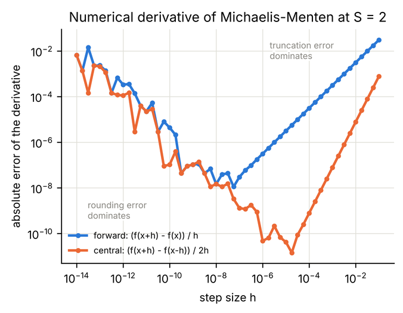

# Day 018 · 导数、梯度与链式法则

> 📅 2026-11-21（周六）· 阶段 1「基础补齐」· 第 3 周 · ⏱️ 约 90 分钟
>
> [📅 课程表](../../SYLLABUS.md) · [🗺️ 路线图](../../ROADMAP.md) · 上一篇：[Day 017](../2026-11/day017-2026-11-20.md) · 下一篇：（明天更新）

## 🎯 今日目标

1. 把导数理解为“输出对输入的敏感度”，能结合生物学模型解释导数的含义，并会用有限差分检查自己算的导数。
2. 理解偏导数和梯度：梯度指向函数增长最快的方向，它的反方向就是模型训练时更新参数的方向。
3. 掌握链式法则，用它推导逻辑回归损失函数的梯度，并理解它为什么是反向传播的核心。

## 📖 核心概念

### 1. 导数：输出对输入的敏感度

3Blue1Brown 指出，“瞬时变化率”这个说法本身有点自相矛盾：变化需要时间，而瞬间只是一个时刻。更好的理解是：把输入轻轻推动一个很小的量 $dx$，输出随之变化 $df$，导数就是两者之比在 $dx$ 趋于 0 时的极限：

$$f'(x) = \lim_{h \to 0} \frac{f(x+h) - f(x)}{h}, \qquad df \approx f'(x)\,dx$$

在生物学模型里，导数就是**敏感度**。以米氏方程（Michaelis–Menten）为例，反应速率 $v(S) = V_{\max}S / (K_m + S)$，用商法则求导得到

$$v'(S) = \frac{V_{\max} K_m}{(K_m + S)^2}$$

底物浓度很低时，速率对浓度变化非常敏感；$S = K_m$ 时，$v' = V_{\max}/(4K_m)$；$S \gg K_m$ 时，酶接近饱和，导数趋于 0，再增加底物，速率几乎不变（练习 1）。

### 2. 常用的求导法则

除了幂函数 $(x^n)' = nx^{n-1}$，机器学习中最常用的是：$(e^x)' = e^x$；$(\ln x)' = 1/x$；sigmoid 函数 $\sigma(z) = 1/(1+e^{-z})$ 的导数 $\sigma'(z) = \sigma(z)\,(1 - \sigma(z))$。再加上和、积、商的求导法则，以及下面的链式法则，就足以推导大多数模型的梯度。

### 3. 偏导数与梯度

多元函数 $f(x_1, \dots, x_n)$ 的**偏导数** $\partial f / \partial x_i$，是只轻推 $x_i$、其他变量保持不变时输出的变化率。把所有偏导数排成一个向量，就是**梯度**（gradient）：

$$\nabla f = \left(\frac{\partial f}{\partial x_1}, \dots, \frac{\partial f}{\partial x_n}\right)$$

梯度的方向是函数增长最快的方向，长度是这个方向上的斜率；反方向 $-\nabla f$ 则是下降最快的方向。训练模型时，$f$ 是损失函数，自变量是模型参数：梯度告诉我们每个参数该往哪个方向调、调多少，才能最快地降低损失。参数可能多达数十亿个，但梯度的含义不变。明天的梯度下降就建立在这一点上。如果函数的输出也是向量，所有偏导数会排成一个矩阵，称为雅可比矩阵（Jacobian，MML 5.3 节）。

### 4. 链式法则：变化沿着函数链传递

对复合函数 $f(g(x))$：

$$\frac{d}{dx} f(g(x)) = f'(g(x)) \cdot g'(x)$$

3Blue1Brown 的直观解释：$x$ 的微小变化 $dx$ 先引起 $g$ 的变化 $dg$，$dg$ 再引起 $f$ 的变化 $df$，两段的变化率相乘。多元情形下，一个变量通过多条路径影响输出，就把各条路径的贡献相加。

神经网络就是许多简单函数的复合：线性变换、激活函数、再线性变换……最后接上损失函数。**反向传播**（backpropagation）就是从损失出发，从后往前系统地应用链式法则，并重复利用前面已经算好的中间结果，只需反向遍历一次，就能得到损失对所有参数的梯度（Day 020 讲自动微分）。

一个完整的例子是**逻辑回归**：用一个生物标志物 $x$ 预测患病概率 $p = \sigma(z)$，其中 $z = wx + b$；损失用交叉熵 $L = -[\,y\ln p + (1-y)\ln(1-p)\,]$。按链式法则把三段导数相乘：

$$\frac{\partial L}{\partial w} = \frac{\partial L}{\partial p}\cdot\frac{\partial p}{\partial z}\cdot\frac{\partial z}{\partial w} = \left(-\frac{y}{p} + \frac{1-y}{1-p}\right)\cdot p(1-p)\cdot x = (p - y)\,x$$

中间的项全部约掉，结果非常简洁：梯度等于“预测误差 × 输入”。预测越准，梯度越小；输入越大，这个样本对参数的影响也越大。

### 5. 数值导数与梯度检验

导数也可以直接用有限差分近似：前向差分 $[f(x+h) - f(x)]/h$ 的误差与 $h$ 同阶；中心差分 $[f(x+h) - f(x-h)]/(2h)$ 的误差与 $h^2$ 同阶，精确得多。但 $h$ 不是越小越好：计算机的浮点数只有约 16 位有效数字，$h$ 太小时，两个几乎相等的数相减会损失大量有效位，舍入误差反而急剧增大（练习 2 的图）。

自己推导梯度后，用数值梯度核对一遍，叫做**梯度检验**（gradient checking），相对误差在 $10^{-7}$ 左右或更小，就说明推导正确。

### 6. 局限

并非处处可导：ReLU 在 0 点不可导，实际中约定用某个次梯度。梯度只包含局部信息，它不知道远处是否有更低的点，于是有局部极小值和鞍点的问题（Day 019）。数值求导对每个参数都要额外计算一到两次函数值，参数一多就慢得无法接受，这正是需要自动微分的原因。

## 📚 今日资源

| # | 资源 | 学什么 | 建议时长 |
|---|---|---|---|
| 1 | [3Blue1Brown：微积分的本质](https://www.3blue1brown.com/topics/calculus) · [B 站官方双语合集](https://www.bilibili.com/video/av44855426/) | 看两集：The paradox of the derivative（导数的悖论）和 [Visualizing the chain rule and product rule](https://www.3blue1brown.com/lessons/chain-rule-and-product-rule)（用“微小扰动”理解链式法则与乘积法则） | 35 分钟 |
| 2 | [Mathematics for Machine Learning（MML）](https://mml-book.github.io/) 第 5 章 | 精读 5.1（一元函数求导，泰勒级数可以先略过）、5.2（偏导数与梯度，含多元链式法则）和 5.3 开头（向量函数的梯度，即雅可比矩阵） | 30 分钟 |
| 3 | [《动手学深度学习》2.4 微积分](https://zh.d2l.ai/chapter_preliminaries/calculus.html) | 中文，配代码：导数和微分、偏导数、梯度、链式法则四节 | 15 分钟 |
| 4 | [3Blue1Brown：Backpropagation calculus](https://www.3blue1brown.com/lessons/backpropagation-calculus)（选看，约 10 分钟） | 用每层只有一个神经元的网络，展示链式法则怎样变成反向传播，为 Day 020 做准备 | 10 分钟 |

## 🛠️ 动手练习

在 Colab 中依次运行，全部使用代码内的函数和模拟数据。

**练习 1 · 米氏方程的导数：解析解与数值解**

```python
import numpy as np
import matplotlib.pyplot as plt
import matplotlib.patheffects as pe

Vmax, Km = 10.0, 2.0                         # 最大反应速率和米氏常数（单位任意）

def v(S):
    return Vmax * S / (Km + S)               # 米氏方程

def dv(S):
    return Vmax * Km / (Km + S) ** 2         # 用商法则求出的解析导数

def central_diff(f, x, h=1e-5):
    return (f(x + h) - f(x - h)) / (2 * h)   # 中心差分

for S in [0.5, 2.0, 8.0, 50.0]:
    print(f"S = {S:5.1f}   v = {v(S):6.3f}   dv/dS = {dv(S):.4f}   numerical = {central_diff(v, S):.4f}")
```

期望输出：

```text
S =   0.5   v =  2.000   dv/dS = 3.2000   numerical = 3.2000
S =   2.0   v =  5.000   dv/dS = 1.2500   numerical = 1.2500
S =   8.0   v =  8.000   dv/dS = 0.2000   numerical = 0.2000
S =  50.0   v =  9.615   dv/dS = 0.0074   numerical = 0.0074
```

$S = K_m = 2$ 时，速率正好是最大值的一半，导数为 $V_{\max}/(4K_m) = 1.25$；浓度增加到 50 后，导数只剩 0.0074，酶已经接近饱和。

**练习 2 · 有限差分的步长：不是越小越好**

```python
hs = np.logspace(-14, -1, 53)                # 步长从 1e-14 到 1e-1
x0, true = 2.0, dv(2.0)
fwd = np.abs((v(x0 + hs) - v(x0)) / hs - true)             # 前向差分的误差
ctr = np.abs((v(x0 + hs) - v(x0 - hs)) / (2 * hs) - true)  # 中心差分的误差
print(f"forward: best h = {hs[fwd.argmin()]:.0e}, error = {fwd.min():.1e}")
print(f"central: best h = {hs[ctr.argmin()]:.0e}, error = {ctr.min():.1e}")
print(f"h = 1e-14: forward error = {fwd[0]:.1e}, central error = {ctr[0]:.1e}")

BLUE, ORANGE, INK_MUTED = "#2a78d6", "#eb6834", "#898781"
plt.rcParams.update({
    "figure.dpi": 120, "savefig.dpi": 300, "savefig.bbox": "tight", "font.size": 9,
    "axes.spines.top": False, "axes.spines.right": False,
    "axes.grid": True, "grid.color": "#e1e0d9", "grid.linewidth": 0.6, "axes.axisbelow": True,
})
HALO = [pe.withStroke(linewidth=3, foreground="white")]
fig, ax = plt.subplots(figsize=(4.8, 3.4))
ax.loglog(hs, fwd, color=BLUE, lw=2, marker="o", ms=3, label="forward: (f(x+h) - f(x)) / h")
ax.loglog(hs, ctr, color=ORANGE, lw=2, marker="o", ms=3, label="central: (f(x+h) - f(x-h)) / 2h")
ax.text(3e-14, 3e-9, "rounding error\ndominates", fontsize=7, color=INK_MUTED, va="top", path_effects=HALO)
ax.text(2e-6, 3e-2, "truncation error\ndominates", fontsize=7, color=INK_MUTED, va="top", path_effects=HALO)
ax.set(xlabel="step size h", ylabel="absolute error of the derivative",
       title="Numerical derivative of Michaelis-Menten at S = 2")
ax.legend(frameon=False, fontsize=7, loc="lower left")
fig.savefig("finite_diff.png")
```

期望输出：

```text
forward: best h = 6e-08, error = 1.1e-08
central: best h = 2e-05, error = 1.4e-11
h = 1e-14: forward error = 6.6e-03, central error = 6.6e-03
```

图应该和下面一致：



图的右半边，步长越大，近似公式本身的误差（截断误差）越大，中心差分的线更陡，因为它的误差与 $h^2$ 同阶；左半边，步长太小，浮点舍入误差占了上风。中心差分在 $h \approx 10^{-5}$ 时误差最小，只有约 $10^{-11}$，比前向差分的最好结果精确了约 1000 倍。

**练习 3 · 链式法则：逻辑回归的梯度与梯度检验**

模拟 200 个人：$x$ 是标准化后的某个生物标志物水平，$y$ 表示是否患病，真实关系是 $p = \sigma(2x - 0.5)$。

```python
rng = np.random.default_rng(42)
n = 200
x = rng.normal(size=n)                                     # 标准化后的生物标志物水平
p_true = 1 / (1 + np.exp(-(2.0 * x - 0.5)))
y = (rng.random(n) < p_true).astype(float)                 # 1 = 患病，0 = 健康

def sigmoid(z):
    return 1 / (1 + np.exp(-z))

def loss(w, b):
    p = sigmoid(w * x + b)
    return -np.mean(y * np.log(p) + (1 - y) * np.log(1 - p))   # 平均交叉熵

def grad(w, b):
    p = sigmoid(w * x + b)
    return np.array([np.mean((p - y) * x), np.mean(p - y)])   # 链式法则推出：(p - y) * x 和 (p - y)

w, b = 0.0, 0.0
g = grad(w, b)
g_num = np.array([(loss(w + 1e-5, b) - loss(w - 1e-5, b)) / 2e-5,   # 数值梯度：对每个参数分别做中心差分
                  (loss(w, b + 1e-5) - loss(w, b - 1e-5)) / 2e-5])
print("analytic gradient: ", g.round(6))
print("numerical gradient:", g_num.round(6))
print("relative difference:", f"{np.linalg.norm(g - g_num) / np.linalg.norm(g):.1e}")

print(f"loss before step: {loss(w, b):.4f}")
w, b = np.array([w, b]) - 0.5 * g                          # 沿负梯度方向走一小步
print(f"loss after one step: {loss(w, b):.4f}  (w = {w:.3f}, b = {b:.3f})")
```

期望输出：

```text
analytic gradient:  [-0.283939  0.05    ]
numerical gradient: [-0.283939  0.05    ]
relative difference: 9.9e-12
loss before step: 0.6931
loss after one step: 0.6536  (w = 0.142, b = -0.025)
```

解析梯度和数值梯度的相对差只有 $10^{-11}$ 量级，说明链式法则的推导正确。起点 $w = b = 0$ 时，模型对每个人都预测 $p = 0.5$，损失正好是 $\ln 2 \approx 0.6931$；沿负梯度方向走一步后，损失下降到 0.6536，$w$ 开始朝真实值 2 的方向增大。明天会把这一步重复很多次，这就是梯度下降。

**进阶**：

1. **Hill 方程的导数**：剂量–效应曲线 $R(D) = D^n / (K^n + D^n)$（$K$ 是 EC50）。推导 $dR/dD$，取 $K = 1$、$n = 2$，用中心差分检验。再找出斜率最大的剂量：在线性剂量尺度上，最大斜率出现在 $D = K\,[(n-1)/(n+1)]^{1/n} \approx 0.577$；换成对数剂量尺度（计算 $D \cdot dR/dD$），最大斜率正好在 EC50 处（$D = 1$）。这也是剂量–效应实验常用对数剂量作图的原因之一。
2. 给练习 3 的损失加上 L2 正则项 $\frac{\lambda}{2}w^2$（取 $\lambda = 0.1$），自己推导新的梯度，再用梯度检验确认推导正确。

## ✅ 自测题

1. 米氏方程中 $v'(S)$ 的生物学含义是什么？为什么 $S \gg K_m$ 时导数趋近于 0？
2. 梯度的方向和长度分别代表什么？为什么训练模型时要沿负梯度方向更新参数？
3. 写出逻辑回归中 $\partial L / \partial w$ 的链式法则三个因子，并解释最终结果 $(p - y)\,x$ 的直观含义。
4. 为什么中心差分比前向差分更准确？为什么步长 $h$ 不是越小越好？
5. 既然数值差分就能算梯度，为什么训练神经网络时要用反向传播（自动微分）？

<details>
<summary>参考答案</summary>

1. $v'(S)$ 表示底物浓度增加一点点时，反应速率增加多少，也就是速率对底物浓度的敏感度。$S \gg K_m$ 时，几乎所有酶分子都已结合底物，速率接近上限 $V_{\max}$，再增加底物也几乎不会提高速率，所以导数 $V_{\max}K_m/(K_m+S)^2$ 趋近于 0。
2. 梯度的方向是函数值增长最快的方向，长度是沿这个方向的变化率（最陡的斜率）。训练的目标是让损失变小，而沿负梯度方向移动，损失在局部下降得最快，所以用 $\theta \leftarrow \theta - \eta\nabla L$ 更新参数。
3. 三个因子是：$\partial L/\partial p = -y/p + (1-y)/(1-p)$，$\partial p/\partial z = p(1-p)$，$\partial z/\partial w = x$。前两项相乘化简为 $p - y$，再乘以 $x$。直观含义：梯度等于“预测误差 × 输入”，预测越准，梯度越小；预测偏高（$p > y$）时，梯度与 $x$ 同号，更新会朝着降低该样本预测概率的方向调整 $w$。
4. 由泰勒展开，前向差分的误差与 $h$ 同阶，而中心差分中的一阶误差项正好相互抵消，误差与 $h^2$ 同阶，所以在相同步长下精确得多。$h$ 太小时，$f(x+h)$ 和 $f(x)$ 几乎相等，在只有约 16 位有效数字的浮点运算中相减，会丢掉大部分有效位，舍入误差再被除以很小的 $h$ 放大，总误差反而变大（练习 2 中 $h = 10^{-14}$ 时误差约为 $10^{-2}$）。
5. 数值差分对每个参数都要额外计算一到两次损失，参数有几百万个时就要计算几百万次，慢得无法接受，而且结果只是近似值。反向传播利用链式法则，从损失出发反向遍历一次计算图，就能精确得到所有参数的梯度，计算量与一次前向计算同一量级。数值差分仍然有用，主要用来做梯度检验。

</details>

## 🔭 今日前沿

- **第二届 Virtual Cell Challenge 公布结果（11 月 19 日）**：Arc Institute 公布了 2026 年虚拟细胞挑战赛的获奖队伍和总结。今年的任务是零样本预测：在模型从未见过的细胞系中，只根据细胞未受扰动时的状态，预测基因敲低后的转录组响应，并用 Arc 新产生、此前未公开的实验数据评分。第一名是 Illumina 的 BioInsight AI Lab，使用了公司“十亿细胞图谱”（Billion Cell Atlas）的数据和名为 CellularAI 的新算法，并同时发布了算法的开源版本。Arc 的总结文章介绍了获奖队伍的训练数据和模型，也讨论了现有模型在全新细胞背景中的局限，值得在第 22 周学虚拟细胞时回头细读。来源：[Arc 总结](https://arcinstitute.org/news/virtual-cell-challenge-2026-wrap-up) · [Illumina 新闻稿](https://www.illumina.com/company/news-center/press-releases/press-release-details.html?newsid=29411)

## 📝 学习打卡

- [ ] 看完 3Blue1Brown 微积分的本质中的两集
- [ ] 读完 MML 第 5 章的指定小节和 d2l 2.4
- [ ] 跑通练习 1–3，输出与示例一致
- [ ] 能不看笔记，用链式法则推导出逻辑回归的梯度 $(p - y)\,x$
- [ ] 进阶：推导 Hill 方程的导数，并找出斜率最大的剂量
- 今日笔记 / 疑问：
