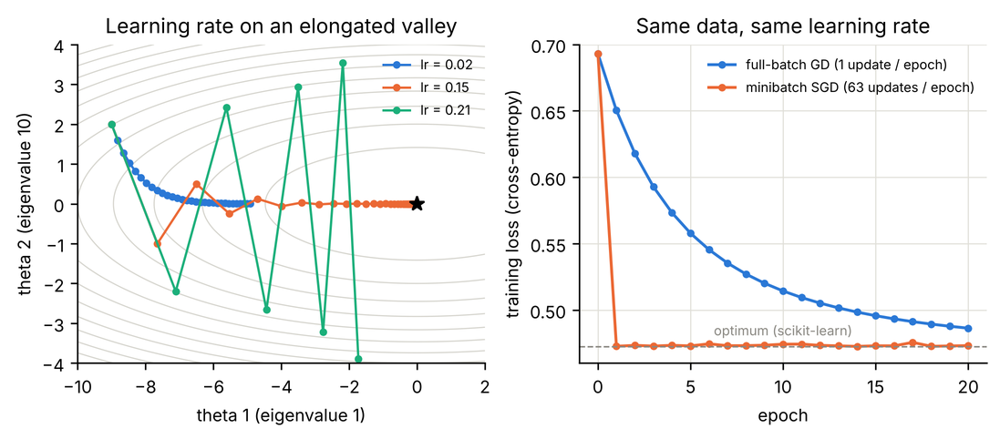

# Day 019 · 优化：梯度下降与学习率

> 📅 2026-11-22（周日）· 阶段 1「基础补齐」· 第 3 周 · ⏱️ 约 90 分钟
>
> [📅 课程表](../../SYLLABUS.md) · [🗺️ 路线图](../../ROADMAP.md) · 上一篇：[Day 018](../2026-11/day018-2026-11-21.md) · 下一篇：[Day 020](../2026-11/day020-2026-11-23.md)

## 🎯 今日目标

1. 掌握梯度下降的更新规则，理解学习率的作用，能用海森矩阵的特征值判断学习率会不会让训练发散。
2. 理解条件数怎样决定收敛速度，以及为什么训练模型前要把特征标准化。
3. 区分全批量梯度下降、随机梯度下降和小批量随机梯度下降，理解它们在计算量与噪声之间的取舍，并了解动量法和 Adam 的基本思路。

## 📖 核心概念

### 1. 梯度下降：沿着最陡的方向下山

训练模型就是寻找让损失函数 $L(\boldsymbol\theta)$ 最小的参数。梯度下降（gradient descent）每一步都沿负梯度方向走一小段（Day 018）：

$$\boldsymbol\theta_{t+1} = \boldsymbol\theta_t - \eta\,\nabla L(\boldsymbol\theta_t)$$

$\eta$ 叫**学习率**（learning rate），即步长。可以想象在大雾中下山：看不清整座山，只能感觉脚下哪边最陡，然后朝那边迈一步。梯度接近 0、或者损失不再下降时停止。

### 2. 学习率：太小走得慢，太大会发散

在极小值附近，任何光滑函数都近似一个二次函数（泰勒展开，MML 5.8 节）。对二次函数 $L(\boldsymbol\theta) = \frac{1}{2}\boldsymbol\theta^\mathsf{T}H\boldsymbol\theta$（$H$ 是二阶导数组成的**海森矩阵**，Hessian），梯度是 $H\boldsymbol\theta$，于是

$$\boldsymbol\theta_{t+1} = (I - \eta H)\,\boldsymbol\theta_t$$

沿 $H$ 的第 $i$ 个特征向量方向（Day 016），误差每一步乘以 $(1 - \eta\lambda_i)$。要让所有方向都收敛，需要 $|1 - \eta\lambda_i| < 1$，即

$$0 < \eta < \frac{2}{\lambda_{\max}}$$

练习 1 中两个特征值是 1 和 10，学习率上限是 0.2：取 0.02 时走得很慢，0.15 时在陡的方向上来回振荡、但仍然收敛，0.21 时振荡越来越大，直接发散。

### 3. 条件数：狭长的山谷走得慢

**条件数**（condition number）$\kappa = \lambda_{\max} / \lambda_{\min}$ 描述山谷有多狭长。学习率受最陡方向（$\lambda_{\max}$）的限制，不能太大；而在最平缓的方向上，每一步只能把误差缩小到原来的 $1 - \eta\lambda_{\min}$ 倍左右。条件数越大，需要的迭代次数就越多，大致与 $\kappa$ 成正比。

对线性回归，均方误差的海森矩阵是 $\frac{2}{n}X^\mathsf{T}X$，如果各特征的数值尺度相差很大，条件数就会非常大。生物医学数据中这很常见：一个指标以 mg/dL 计，在 100 左右；另一个是比值，在 0.5 左右。把每个特征**标准化**（减均值、除以标准差）之后，特征不相关时条件数接近 1。练习 2 中，标准化让条件数从约 $1.5 \times 10^6$ 降到 1.01，迭代次数从“20 万次仍未收敛”变成 3 次。

### 4. 凸与非凸

如果损失函数是**凸函数**（convex），任何局部最小值都是全局最小值，只要学习率合适，梯度下降一定能找到它。线性回归的均方误差、逻辑回归的交叉熵都是凸的。神经网络的损失则是非凸的，会有局部极小值、**鞍点**（梯度为 0 但不是极小值的点）和大片平坦区域。在高维参数空间里，鞍点往往比“糟糕的局部极小值”更常见（d2l 11.1 节）。

### 5. 随机梯度下降与小批量

损失通常是所有样本损失的平均，梯度也就是所有样本梯度的平均：

- **全批量梯度下降**：每走一步都要用全部 $n$ 个样本算一次梯度，数据量大时非常慢。
- **随机梯度下降**（stochastic gradient descent，SGD）：每次只用一个样本估计梯度，计算便宜，但估计的噪声很大。
- **小批量随机梯度下降**（minibatch SGD）：每次用一小批样本（如 32–512 个），兼顾速度和稳定性，也能充分利用 GPU 的并行计算。这是深度学习的标准做法。

把全部数据过一遍叫一个 **epoch**。练习 3 中，同样的学习率训练 20 个 epoch：全批量梯度下降只更新了 20 次，损失还远没到最优；小批量 SGD 每个 epoch 更新 63 次，1 个 epoch 后就接近最优值，之后在最优值附近小幅抖动。这是因为每个小批量的梯度都带有噪声，学习率固定时参数会一直轻微晃动。常见的解决办法是随训练逐步减小学习率（学习率调度，d2l 11.11 节）。

### 6. 动量法与 Adam（预告）

- **动量法**（momentum，MML 7.1.2 节）：把过去的梯度累积成一个“速度”，在方向一致的维度上越走越快，在来回振荡的维度上互相抵消，特别适合狭长的山谷。
- **Adam**：在动量的基础上，再根据每个参数梯度大小的历史，自动调整各参数的步长。它是深度学习中最常用的默认优化器，第 8 周用 PyTorch 时会直接用到。

### 7. 局限

梯度下降对学习率很敏感，往往需要调参；对非凸问题，只能保证找到局部的解。对于规模不大的凸问题，有更好的选择：线性回归有解析解，scikit-learn 的 `LogisticRegression` 默认使用 L-BFGS，它利用曲率信息，所需迭代次数少得多。

## 📚 今日资源

| # | 资源 | 学什么 | 建议时长 |
|---|---|---|---|
| 1 | [Mathematics for Machine Learning（MML）](https://mml-book.github.io/) 第 7 章 | 精读 7.1（梯度下降，含 7.1.1 步长、7.1.2 动量、7.1.3 随机梯度下降）；7.3 凸优化只读开头凸集与凸函数的定义 | 35 分钟 |
| 2 | 《动手学深度学习》[11.1 优化和深度学习](https://zh.d2l.ai/chapter_optimization/optimization-intro.html)、[11.2 凸性](https://zh.d2l.ai/chapter_optimization/convexity.html)、[11.3 梯度下降](https://zh.d2l.ai/chapter_optimization/gd.html) | 中文，配代码：局部最小值、鞍点与梯度消失，凸函数的性质，学习率对梯度下降的影响（11.3 中的牛顿法可以略读） | 30 分钟 |
| 3 | 《动手学深度学习》[11.4 随机梯度下降](https://zh.d2l.ai/chapter_optimization/sgd.html)、[11.5 小批量随机梯度下降](https://zh.d2l.ai/chapter_optimization/minibatch-sgd.html) | 随机梯度的噪声、动态学习率，以及批量大小与向量化计算的关系 | 20 分钟 |

## 🛠️ 动手练习

在 Colab 中依次运行，全部使用代码内的函数和模拟数据。

**练习 1 · 学习率：二次函数上的稳定性条件**

```python
import numpy as np
import matplotlib.pyplot as plt
import matplotlib.patheffects as pe

H = np.diag([1.0, 10.0])                       # 海森矩阵：一个平缓方向（特征值 1）、一个陡峭方向（特征值 10）

def f(theta):
    return 0.5 * theta @ H @ theta

def grad_f(theta):
    return H @ theta

print("eigenvalues of H:", np.linalg.eigvalsh(H), "-> stable if lr < 2 / 10 =", 2 / 10)
paths = {}
for lr in [0.02, 0.15, 0.21]:
    theta = np.array([-9.0, 2.0])              # 起点
    path = [theta]
    for step in range(30):
        theta = theta - lr * grad_f(theta)     # 梯度下降的一步
        path.append(theta)
    paths[lr] = np.array(path)
    print(f"lr = {lr:4.2f}: f after 30 steps = {f(theta):.3g}, theta = ({theta[0]:.3f}, {theta[1]:.3f})")
```

期望输出：

```text
eigenvalues of H: [ 1. 10.] -> stable if lr < 2 / 10 = 0.2
lr = 0.02: f after 30 steps = 12.1, theta = (-4.909, 0.002)
lr = 0.15: f after 30 steps = 0.00236, theta = (-0.069, 0.000)
lr = 0.21: f after 30 steps = 6.09e+03, theta = (-0.008, 34.899)
```

学习率 0.02 时，陡的方向（第 2 维）很快收敛，平缓的方向（第 1 维）30 步后才走了一半；0.21 只比上限 0.2 大一点，第 2 维每步乘以 $1 - 0.21 \times 10 = -1.1$，越振荡越远。

**练习 2 · 特征缩放：条件数决定收敛速度**

```python
rng = np.random.default_rng(0)
n = 500
glucose = rng.normal(100, 20, n)               # 指标 1：数值在 100 左右（如以 mg/dL 计）
ratio = rng.normal(0.5, 0.1, n)                # 指标 2：数值在 0.5 左右（一个比值）
y = 0.03 * glucose + 4 * ratio + rng.normal(0, 0.3, n)

def gd_linear(X, y, tol=1e-6, max_iter=200_000):
    """用梯度下降拟合线性回归（均方误差），学习率取 1 / λmax。"""
    Xb = np.column_stack([np.ones(len(y)), X])            # 加一列 1 作为截距
    Hm = 2 / len(y) * Xb.T @ Xb                            # 均方误差的海森矩阵（是常数矩阵）
    lam = np.linalg.eigvalsh(Hm)
    lr = 1 / lam.max()
    w_star = np.linalg.lstsq(Xb, y, rcond=None)[0]         # 用最小二乘直接求出的最优解，作为参照
    w = np.zeros(Xb.shape[1])
    for it in range(1, max_iter + 1):
        w = w - lr * (2 / len(y) * Xb.T @ (Xb @ w - y))
        if np.linalg.norm(w - w_star) < tol * (1 + np.linalg.norm(w_star)):
            return lam.max() / lam.min(), f"converged in {it} iterations"
    return lam.max() / lam.min(), f"not converged after {max_iter} iterations, w = {w.round(3)} vs w* = {w_star.round(3)}"

X_raw = np.column_stack([glucose, ratio])
X_std = (X_raw - X_raw.mean(axis=0)) / X_raw.std(axis=0)  # 标准化：每列均值 0、标准差 1
for name, X in [("raw", X_raw), ("standardized", X_std)]:
    kappa, status = gd_linear(X, y)
    print(f"{name:>12}: condition number = {kappa:.3g}, {status}")
```

期望输出（第一行需要运行几秒钟）：

```text
         raw: condition number = 1.51e+06, not converged after 200000 iterations, w = [0.881 0.036 1.006] vs w* = [0.017 0.03  3.919]
standardized: condition number = 1.01, converged in 3 iterations
```

原始尺度下，迭代 20 万次后，“比值”指标的系数还停在 1.006，离最优值 3.919 很远：沿这个方向的曲率太小，每一步几乎不动。标准化之后，3 次迭代就收敛了。

**练习 3 · 全批量梯度下降 vs 小批量 SGD**

模拟 2,000 个人的两个标准化生物标志物和患病状态，用逻辑回归拟合（损失和梯度见 Day 018），比较两种训练方式。

```python
rng = np.random.default_rng(1)
n = 2000
Xl = rng.normal(size=(n, 2))                   # 两个标准化后的生物标志物
p = 1 / (1 + np.exp(-(1.5 * Xl[:, 0] - 1.0 * Xl[:, 1] - 0.5)))
yl = (rng.random(n) < p).astype(float)
Xb = np.column_stack([np.ones(n), Xl])         # 第一列对应截距

def bce(w):
    q = 1 / (1 + np.exp(-(Xb @ w)))
    return -np.mean(yl * np.log(q) + (1 - yl) * np.log(1 - q))   # 全部数据上的交叉熵

def grad_bce(w, idx):
    q = 1 / (1 + np.exp(-(Xb[idx] @ w)))
    return Xb[idx].T @ (q - yl[idx]) / len(idx)                  # 只用 idx 这批样本估计梯度

def train(batch_size, lr, epochs, seed=0):
    rng = np.random.default_rng(seed)
    w = np.zeros(3)
    history = [bce(w)]
    for epoch in range(epochs):
        order = rng.permutation(n)                                # 每个 epoch 重新打乱样本顺序
        for start in range(0, n, batch_size):
            w = w - lr * grad_bce(w, order[start:start + batch_size])
        history.append(bce(w))
    return w, np.array(history)

w_gd, h_gd = train(batch_size=n, lr=0.5, epochs=20)     # 全批量：每个 epoch 更新 1 次
w_sgd, h_sgd = train(batch_size=32, lr=0.5, epochs=20)  # 小批量：每个 epoch 更新 63 次
for name, h, w in [("full-batch GD", h_gd, w_gd), ("minibatch SGD", h_sgd, w_sgd)]:
    print(f"{name}: loss after 1 / 5 / 20 epochs = {h[1]:.4f} / {h[5]:.4f} / {h[20]:.4f}, w = {w.round(2)}")

from sklearn.linear_model import LogisticRegression
sk = LogisticRegression(C=1e10).fit(Xl, yl)            # C 取极大值，相当于不加正则化
w_sk = np.r_[sk.intercept_, sk.coef_.ravel()]
loss_opt = bce(w_sk)
print("scikit-learn:", w_sk.round(2), f"loss = {loss_opt:.4f}")
```

期望输出：

```text
full-batch GD: loss after 1 / 5 / 20 epochs = 0.6503 / 0.5578 / 0.4863, w = [-0.38  1.02 -0.7 ]
minibatch SGD: loss after 1 / 5 / 20 epochs = 0.4727 / 0.4730 / 0.4732, w = [-0.48  1.52 -0.95]
scikit-learn: [-0.54  1.49 -1.02] loss = 0.4725
```

真实参数是 $(-0.5, 1.5, -1.0)$。小批量 SGD 第 1 个 epoch 后的损失（0.4727）已经很接近 scikit-learn 求得的最优值（0.4725），之后不再继续下降，而是在附近小幅波动；全批量梯度下降 20 个 epoch 后仍在 0.4863。

**画图**：

```python
BLUE, ORANGE, AQUA, INK_MUTED = "#2a78d6", "#eb6834", "#1baf7a", "#898781"
plt.rcParams.update({
    "figure.dpi": 120, "savefig.dpi": 300, "savefig.bbox": "tight", "font.size": 9,
    "axes.spines.top": False, "axes.spines.right": False,
})
fig, (ax1, ax2) = plt.subplots(1, 2, figsize=(7.2, 3.1), layout="constrained")

g1, g2 = np.meshgrid(np.linspace(-10, 2, 200), np.linspace(-4, 4, 200))
ax1.contour(g1, g2, 0.5 * (H[0, 0] * g1**2 + H[1, 1] * g2**2), levels=12, colors="#d5d4cd", linewidths=0.6)
for lr, color in [(0.02, BLUE), (0.15, ORANGE), (0.21, AQUA)]:
    path = paths[lr][:8] if lr == 0.21 else paths[lr]           # 发散的路径只画前 8 步
    ax1.plot(path[:, 0], path[:, 1], "-o", color=color, ms=3, lw=1.2, label=f"lr = {lr}")
ax1.plot(0, 0, marker="*", color="black", ms=8)
ax1.set(xlim=(-10, 2), ylim=(-4, 4), xlabel="theta 1 (eigenvalue 1)", ylabel="theta 2 (eigenvalue 10)",
        title="Learning rate on an elongated valley")
ax1.legend(frameon=False, fontsize=7, loc="upper right")

epochs = np.arange(len(h_gd))
ax2.plot(epochs, h_gd, "-o", color=BLUE, ms=3, lw=1.5, label="full-batch GD (1 update / epoch)")
ax2.plot(epochs, h_sgd, "-o", color=ORANGE, ms=3, lw=1.5, label="minibatch SGD (63 updates / epoch)")
ax2.axhline(loss_opt, color=INK_MUTED, lw=0.8, ls="--")
ax2.text(10, loss_opt + 0.006, "optimum (scikit-learn)", fontsize=7, color=INK_MUTED, ha="center", va="bottom")
ax2.set(xlabel="epoch", ylabel="training loss (cross-entropy)", title="Same data, same learning rate",
        xticks=[0, 5, 10, 15, 20], ylim=(0.46, 0.70))
ax2.grid(color="#e1e0d9", lw=0.6)
ax2.set_axisbelow(True)
ax2.legend(frameon=False, fontsize=7, loc="upper right")
fig.savefig("optimization.png")
```

图应该和下面一致：



左图中，蓝线（0.02）沿平缓方向走得很慢；橙线（0.15）在陡的方向上先来回摆动，然后沿谷底走向最小值（星号）；绿线（0.21）在陡的方向上振荡得越来越厉害，很快冲出了画面。

**进阶**：

1. 对二次函数，固定学习率的最优值是 $2/(\lambda_{\min} + \lambda_{\max}) = 2/11 \approx 0.18$，此时两个方向的误差每步都缩小到原来的 $(\kappa - 1)/(\kappa + 1) = 9/11$ 倍。用它重跑练习 1，30 步后的 $f$ 应该约为 $3.6 \times 10^{-4}$，比 0.15 时的 0.00236 小得多。
2. 给练习 3 的小批量 SGD 加上学习率衰减（例如每个 epoch 结束后把学习率乘以 0.8），看看最终损失能不能更接近 0.4725。再试试 `batch_size=1` 和 `batch_size=256`，比较曲线的抖动程度。
3. 实现动量法：$\mathbf{v} \leftarrow \beta\mathbf{v} + \nabla L$，$\boldsymbol\theta \leftarrow \boldsymbol\theta - \eta\mathbf{v}$（取 $\beta = 0.9$），在练习 1 的狭长山谷上和普通梯度下降比较，看看谁先到达最小值附近。

## ✅ 自测题

1. 学习率太小和太大分别会怎样？对二次函数，稳定的学习率上限由什么决定？
2. 什么是条件数？为什么特征尺度相差很大时，梯度下降会非常慢？标准化为什么能解决这个问题？
3. 全批量梯度下降、随机梯度下降和小批量 SGD 有什么区别？在练习 3 中，一个 epoch 里它们各更新几次参数？
4. 练习 3 中，为什么小批量 SGD 很快就接近最优值，之后却一直在附近“抖动”？怎样减小抖动？
5. 凸函数有什么好的性质？逻辑回归和神经网络的损失函数分别是不是凸的？

<details>
<summary>参考答案</summary>

1. 学习率太小，每一步都很保守，需要非常多的迭代才能收敛；太大则会在陡峭的方向上越过谷底，来回振荡，超过上限后振幅越来越大，最终发散。对二次函数（或极小值附近的二次近似），稳定的条件是 $0 < \eta < 2/\lambda_{\max}$，$\lambda_{\max}$ 是海森矩阵最大的特征值，也就是最陡方向的曲率。
2. 条件数是海森矩阵最大与最小特征值之比，$\kappa = \lambda_{\max}/\lambda_{\min}$，描述损失曲面有多“狭长”。学习率必须小于 $2/\lambda_{\max}$，否则在最陡方向上会发散；但这么小的步长在最平缓的方向上几乎不动，所需迭代次数大致与 $\kappa$ 成正比。特征尺度相差很大时，线性模型的海森矩阵 $\frac{2}{n}X^\mathsf{T}X$ 的特征值也相差悬殊，条件数巨大。标准化后各特征尺度相同，特征不相关时海森矩阵接近单位矩阵的倍数，条件数接近 1（练习 2 中从 $1.5 \times 10^6$ 降到 1.01）。
3. 全批量梯度下降每一步都用全部样本计算梯度；随机梯度下降每一步只用一个样本；小批量 SGD 每一步用一小批样本。练习 3 中 $n = 2000$，一个 epoch 里全批量更新 1 次，批量大小为 32 的小批量 SGD 更新 $\lceil 2000/32 \rceil = 63$ 次（如果是批量为 1 的 SGD，就是 2000 次）。
4. 小批量 SGD 每个 epoch 更新 63 次，所以按 epoch 计算进展很快；但每个小批量算出的梯度只是全部样本梯度的带噪声估计，即使参数已经在最优值附近，噪声梯度仍会推着参数来回移动，学习率固定时这种抖动不会消失。可以随训练逐步减小学习率，也可以增大批量大小来降低梯度噪声。
5. 凸函数的任何局部最小值都是全局最小值，没有“陷入糟糕局部极小值”的问题，选择合适的学习率，梯度下降一定能找到最优解。线性回归的均方误差和逻辑回归的交叉熵损失对参数都是凸的；神经网络因为层层复合了非线性激活函数，损失函数是非凸的，存在许多局部极小值、鞍点和平坦区域。

</details>

## 🔭 今日前沿

- **为 AI 驱动的生物序列设计构建“纵深防御”（Nature Communications，11 月 19 日）**：生成式模型已经能设计蛋白质，甚至整条基因组序列，这篇观点文章讨论这类工具可能被滥用的风险，主张采用“纵深防御”（defence-in-depth）的思路：不依赖任何单一的防护措施，而是在多个环节层层设防。学习和使用蛋白质设计、DNA 语言模型时（第 15–18 周），了解这类生物安全讨论同样重要。来源：[Nature Communications](https://www.nature.com/articles/s41467-026-78758-5)

## 📝 学习打卡

- [ ] 读完 MML 第 7 章的指定小节和 d2l 11.1–11.5
- [ ] 跑通练习 1–3 和画图代码，输出与示例一致
- [ ] 能用海森矩阵的特征值解释为什么学习率 0.21 会发散
- [ ] 能解释练习 2 中标准化为什么让迭代次数从 20 万次以上降到 3 次
- [ ] 进阶：实现学习率衰减或动量法
- 今日笔记 / 疑问：
