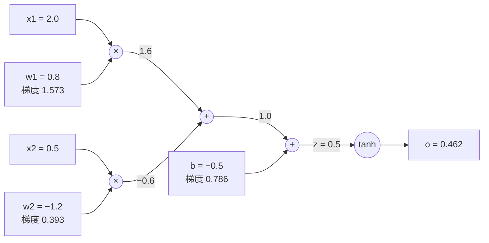

# Day 020 · 自动微分：从手推到 autograd

> 📅 2026-11-23（周一）· 阶段 1「基础补齐」· 第 3 周 · ⏱️ 约 90 分钟
>
> [📅 课程表](../../SYLLABUS.md) · [🗺️ 路线图](../../ROADMAP.md) · 上一篇：[Day 019](../2026-11/day019-2026-11-22.md) · 下一篇：（明天更新）

## 🎯 今日目标

1. 说清符号求导、数值求导和自动微分的区别，理解为什么所有深度学习框架都建立在自动微分之上。
2. 理解计算图上的前向传播与反向传播：每个节点把“上游梯度 × 局部导数”传给自己的输入。
3. 只用 Python 写出一个约 60 行的自动微分引擎（仿照 Karpathy 的 micrograd），用它求梯度、做梯度检验，并训练一个最简单的“神经元”。

## 📖 核心概念

### 1. 求导的三种方法

- **符号求导**：像手推公式一样得到导数的表达式。结果精确，但表达式会越推越长，也难以处理循环、条件判断等程序结构。
- **数值求导**（Day 018）：用有限差分近似。实现简单，但只是近似值，而且每个参数都要额外算一两次函数值，参数一多就太慢。
- **自动微分**（automatic differentiation，AD）：把程序拆成一个个基本运算（加、乘、指数、tanh 等），每个基本运算的导数都是已知的，再用链式法则把它们组合起来。结果精确到浮点误差，计算量与原计算同一量级。PyTorch、JAX 等深度学习框架的核心都是自动微分。

### 2. 计算图：前向传播记录，反向传播求导

以一个最简单的“神经元”为例：两个转录因子的水平 $x_1, x_2$ 经过加权求和与 tanh，得到目标基因的激活程度 $o = \tanh(w_1x_1 + w_2x_2 + b)$（练习 2）。



- **前向传播**：从左到右计算每个节点的值，同时记录“谁由谁、经过什么运算得到”，这就是**计算图**（computational graph）。
- **反向传播**：从输出开始，令 $\partial o/\partial o = 1$，按相反的顺序遍历节点。每个节点把**上游梯度 × 局部导数**传给自己的输入。

几种基本运算的局部规则：

| 运算 | 前向 | 反向（把上游梯度 $g$ 传给输入） |
|---|---|---|
| 加法 $c = a + b$ | 相加 | $a$ 和 $b$ 都得到 $g$，像一个“梯度分配器” |
| 乘法 $c = a \times b$ | 相乘 | $a$ 得到 $g \times b$，$b$ 得到 $g \times a$，即乘以“另一个因子” |
| $c = \tanh(a)$ | tanh | $a$ 得到 $g \times (1 - c^2)$ |

上图中，tanh 的局部导数是 $1 - 0.462^2 \approx 0.786$；经过两个加法节点，这个梯度原样传给 $b$ 和两个乘积；再经过乘法节点，$w_1$ 得到 $0.786 \times x_1 = 1.573$。

### 3. 两个关键细节

- **梯度要累加**：如果一个变量在图中被使用了多次，按多元链式法则（Day 018），它的梯度是各条路径贡献之和。所以代码里必须写 `+=` 而不是 `=`。练习 4 中，$c = a^2 + a$ 里 $a$ 出现了 3 次，$dc/da = 2a + 1 = 7$，三份贡献缺一不可。
- **按拓扑顺序反向遍历**：一个节点必须先收齐所有下游传回来的梯度，才能继续往上游传。所以先对计算图做拓扑排序，再按相反的顺序执行。

正因为梯度是累加的，训练时每一步更新参数之前都要先把梯度清零，否则会把上一步的梯度也加进来。PyTorch 中的 `optimizer.zero_grad()` 就是做这件事。

### 4. 前向模式与反向模式

自动微分有两种方式。**前向模式**让导数随着数值从输入往输出传，每遍只能得到所有输出对**一个**输入的导数；**反向模式**（即反向传播）从一个标量输出往回传，一遍就能得到它对**所有**输入的导数。机器学习恰好是“一个损失、上百万个参数”，所以几乎都用反向模式，计算量只是前向计算的几倍。代价是内存：反向传播要用到前向传播的所有中间结果，必须先存下来，这正是训练比推理占用多得多的 GPU 显存的原因。

### 5. 在 PyTorch 中

第 8 周会正式使用 PyTorch，它的用法和今天手写的引擎一一对应：给需要求导的张量设置 `requires_grad=True`，调用 `loss.backward()` 后从 `.grad` 读出梯度；梯度默认会累加，所以每步都要清零；推理时用 `torch.no_grad()` 关闭计算图的记录；用 `detach()` 把某个中间结果从计算图中“分离”出来（d2l 2.5 节）。PyTorch 在程序运行时动态记录计算图，所以带 `if` 和循环的代码也能正常求导。

### 6. 局限

自动微分要求每一步运算都可导：取最大值的位置（argmax）、随机采样等离散操作的梯度是 0 或无定义，需要专门的技巧绕过。网络很深时，梯度在层层相乘中可能越来越小或越来越大（梯度消失与梯度爆炸），这要靠合适的激活函数、初始化和网络结构来缓解，后面的课会讲到。

## 📚 今日资源

| # | 资源 | 学什么 | 建议时长 |
|---|---|---|---|
| 1 | [Karpathy：Neural Networks: Zero to Hero](https://karpathy.ai/zero-to-hero.html) 第 1 讲 *The spelled-out intro to neural networks and backpropagation: building micrograd*（约 2 小时 25 分钟）· [micrograd 代码](https://github.com/karpathy/micrograd) | 今天先看前 1 小时左右：导数的直觉、`Value` 类、对一个表达式和一个神经元手动做反向传播，再为每种运算写出 `_backward`。其余部分留到周复盘看完 | 60 分钟 |
| 2 | [《动手学深度学习》2.5 自动微分](https://zh.d2l.ai/chapter_preliminaries/autograd.html) | 中文，配代码：一个简单的例子、非标量变量的反向传播、分离计算、Python 控制流的梯度计算 | 15 分钟 |
| 3 | [Mathematics for Machine Learning（MML）](https://mml-book.github.io/) 5.6 节 | 5.6.1 深度网络中的梯度、5.6.2 自动微分：从数学上看反向传播为什么高效 | 15 分钟 |

## 🛠️ 动手练习

在 Colab 中依次运行。只用 Python 标准库，不需要安装任何包。

**练习 1 · 写一个最小的自动微分引擎**

```python
import math

class Value:
    """一个标量节点：保存数值、梯度，以及它由哪些节点经过什么运算得到。"""

    def __init__(self, data, parents=(), op=""):
        self.data = data
        self.grad = 0.0                        # d(输出)/d(本节点)，反向传播时累加
        self._parents = parents
        self._op = op
        self._backward = lambda: None          # 把本节点的梯度传给输入节点的函数

    def __repr__(self):
        return f"Value(data={self.data:.4f}, grad={self.grad:.4f})"

    def __add__(self, other):
        other = other if isinstance(other, Value) else Value(other)
        out = Value(self.data + other.data, (self, other), "+")
        def _backward():
            self.grad += out.grad              # 加法：梯度原样传给两个输入
            other.grad += out.grad
        out._backward = _backward
        return out

    def __mul__(self, other):
        other = other if isinstance(other, Value) else Value(other)
        out = Value(self.data * other.data, (self, other), "*")
        def _backward():
            self.grad += other.data * out.grad   # 乘法：乘以“另一个因子”的值
            other.grad += self.data * out.grad
        out._backward = _backward
        return out

    def tanh(self):
        t = math.tanh(self.data)
        out = Value(t, (self,), "tanh")
        def _backward():
            self.grad += (1 - t ** 2) * out.grad   # tanh 的导数是 1 - tanh²
        out._backward = _backward
        return out

    def __neg__(self):
        return self * -1

    def __sub__(self, other):
        return self + (-other if isinstance(other, Value) else Value(-other))

    __radd__ = __add__                         # 让 3 + Value 和 3 * Value 也能用
    __rmul__ = __mul__

    def backward(self):
        order, seen = [], set()
        def build(v):                          # 拓扑排序：先放入所有上游节点，再放入自己
            if v not in seen:
                seen.add(v)
                for p in v._parents:
                    build(p)
                order.append(v)
        build(self)
        self.grad = 1.0                        # 输出对自己的导数为 1
        for v in reversed(order):              # 从输出往输入，逐个节点应用链式法则
            v._backward()
```

这段代码没有输出。核心只有两点：每种运算在前向计算时，顺便定义好自己的 `_backward`；`backward()` 先排序，再从输出往回依次调用它们。

**练习 2 · 对一个“神经元”做反向传播**

```python
x1, x2 = Value(2.0), Value(0.5)                # 两个转录因子的水平（输入）
w1, w2, b = Value(0.8), Value(-1.2), Value(-0.5)   # 权重和偏置（参数）
z = w1 * x1 + w2 * x2 + b
o = z.tanh()                                   # 目标基因的“激活程度”
o.backward()
print("o =", round(o.data, 4))
for name, v in [("w1", w1), ("w2", w2), ("b", b), ("x1", x1), ("x2", x2)]:
    print(f"d o / d {name} = {v.grad:+.4f}")
```

期望输出：

```text
o = 0.4621
d o / d w1 = +1.5729
d o / d w2 = +0.3932
d o / d b = +0.7864
d o / d x1 = +0.6292
d o / d x2 = -0.9437
```

对照“核心概念”中的计算图手算一遍：$z = 0.5$，tanh 的局部导数 $1 - 0.4621^2 = 0.7864$ 就是 $b$ 的梯度；乘以 $x_1 = 2$ 得到 $w_1$ 的梯度 1.5729，乘以 $w_2 = -1.2$ 得到 $x_2$ 的梯度 −0.9437。

**练习 3 · 梯度检验**

```python
def forward(w1, w2, b, x1=2.0, x2=0.5):
    return math.tanh(w1 * x1 + w2 * x2 + b)   # 同一个神经元，只用普通浮点数计算

h = 1e-6
params = {"w1": 0.8, "w2": -1.2, "b": -0.5}
for name in params:
    up, down = dict(params), dict(params)
    up[name] += h
    down[name] -= h
    print(f"numerical d o / d {name} = {(forward(**up) - forward(**down)) / (2 * h):+.4f}")
```

期望输出：

```text
numerical d o / d w1 = +1.5729
numerical d o / d w2 = +0.3932
numerical d o / d b = +0.7864
```

数值梯度与练习 2 完全一致。数值方法需要对每个参数各算两次前向，而反向传播一遍就得到了所有 5 个梯度。

**练习 4 · 梯度为什么要累加**

```python
a = Value(3.0)
c = a * a + a                                  # c = a² + a，a 在计算图中被使用了 3 次
c.backward()
print("dc/da =", a.grad, "(expected 2a + 1 =", 2 * 3.0 + 1, ")")
```

期望输出：

```text
dc/da = 7.0 (expected 2a + 1 = 7.0 )
```

乘法节点给 $a$ 传回两份 $3$（“另一个因子”恰好也是 $a$），加法节点再传回 $1$，累加起来正好是 7。如果把 `_backward` 中的 `+=` 改成 `=`，后来的贡献会覆盖前面的，结果就错了。

**练习 5 · 用自己的引擎训练一个神经元**

用 4 组数据（转录因子水平 → 目标基因响应）拟合 $\hat y = \tanh(wx + b)$，损失是平方误差之和，优化用 Day 019 的梯度下降。

```python
xs = [-2.0, -1.0, 1.0, 2.0]                    # 转录因子水平
ys = [-0.9, -0.6, 0.6, 0.9]                    # 目标基因响应（已缩放到 -1 到 1 之间）
w, b = Value(0.1), Value(0.0)
for step in range(51):
    loss = Value(0.0)
    for x, y in zip(xs, ys):
        err = (w * x + b).tanh() - y
        loss = loss + err * err                # 平方误差之和
    w.grad, b.grad = 0.0, 0.0                  # 每一步先清零：梯度是累加的
    loss.backward()
    if step % 10 == 0:
        print(f"step {step:2d}: loss = {loss.data:.4f}, w = {w.data:.3f}, b = {b.data:.3f}")
    w.data -= 0.1 * w.grad                     # 沿负梯度方向更新参数
    b.data -= 0.1 * b.grad
```

期望输出：

```text
step  0: loss = 1.4880, w = 0.100, b = 0.000
step 10: loss = 0.0008, w = 0.725, b = 0.000
step 20: loss = 0.0004, w = 0.707, b = 0.000
step 30: loss = 0.0004, w = 0.706, b = 0.000
step 40: loss = 0.0004, w = 0.706, b = 0.000
step 50: loss = 0.0004, w = 0.706, b = 0.000
```

不到 10 步，损失就从 1.488 降到 0.001 以下，$w$ 收敛到约 0.706。数据关于原点对称，所以 $b$ 始终是 0。这个循环已经包含了训练神经网络的全部要素：前向计算损失、梯度清零、反向传播、更新参数。PyTorch 做的是同一件事，只是把标量换成了张量，并且在 GPU 上运行。

**进阶**：

1. 给 `Value` 加上 `exp()` 和除法（`__truediv__`，可以借助 `__pow__` 实现），然后用它构造 sigmoid 函数 $\sigma(z) = 1/(1 + e^{-z})$，验证 `z.grad` 等于 $\sigma(z)(1 - \sigma(z))$（Day 018）。
2. 把练习 5 中梯度清零的那一行注释掉，重新运行。损失曲线会变成什么样？为什么？
3. 如果 Colab 中已经可以用 PyTorch，用 `torch.tensor(..., requires_grad=True)` 定义练习 2 的五个量，计算 `o` 后调用 `o.backward()`，读取各自的 `.grad`，确认与练习 2 的结果一致。第 8 周会系统学习 PyTorch。

## ✅ 自测题

1. 符号求导、数值求导和自动微分各有什么优缺点？
2. 在反向传播中，加法节点和乘法节点分别怎样把梯度传给输入？
3. 为什么 `_backward` 中必须用 `+=`？练习 4 中 $dc/da$ 为什么是 7？
4. 为什么训练循环中，每一步都要先把梯度清零？
5. 为什么深度学习几乎都用反向模式的自动微分？它的主要代价是什么？

<details>
<summary>参考答案</summary>

1. 符号求导能得到精确的导数公式，但表达式会急剧膨胀，难以处理循环、条件等程序结构。数值求导实现简单、适用于任何函数，但只是近似，还受步长和浮点误差影响，而且每个参数都要额外计算函数值，参数多时太慢。自动微分把程序拆成基本运算，用链式法则组合各运算已知的局部导数，结果精确到浮点误差，反向模式一遍就能得到所有参数的梯度；代价是要记录计算图、保存中间结果，并且要求每一步运算都可导。
2. 加法的局部导数是 1，所以上游梯度原样传给两个输入，像一个“梯度分配器”。乘法 $c = ab$ 中，$\partial c/\partial a = b$、$\partial c/\partial b = a$，所以 $a$ 得到“上游梯度 × $b$”，$b$ 得到“上游梯度 × $a$”。
3. 一个变量可能在计算图中被使用多次，按多元链式法则，它的梯度是所有路径贡献之和，所以每条路径传回的梯度都要累加。练习 4 中 $c = a \cdot a + a$：乘法节点给 $a$ 传回两份，各为“另一个因子” $a = 3$；加法节点再传回 1。合计 $3 + 3 + 1 = 7$，正好等于 $2a + 1$。如果用 `=`，后到的贡献会覆盖先到的，结果就错了。
4. 因为 `backward()` 把新算出的梯度累加到 `.grad` 上，而不是覆盖。不清零的话，这一步的梯度会混进之前所有步骤的梯度，相当于沿着过时的方向越走越远，训练会出错甚至发散。PyTorch 中对应的是每步调用 `optimizer.zero_grad()`。
5. 训练时需要的是“一个标量损失对大量参数”的梯度。反向模式从损失出发反向遍历一次计算图，就能得到对所有参数的梯度，计算量只是前向计算的几倍；前向模式每遍只能得到对一个输入的导数，参数有上百万个就要算上百万遍。反向模式的主要代价是内存：反向传播要用到前向传播中所有的中间结果，必须先存下来，所以训练比推理占用多得多的显存。

</details>

## 🔭 今日前沿

- **scMomer：只用单细胞转录组，学习“多模态感知”的细胞表示（Nature Communications，11 月）**：很多单细胞数据只测了 RNA，没有同时测染色质可及性（ATAC）。据论文和预印本介绍，scMomer 先分别预训练 RNA 和 ATAC 两个编码器，再在约 30 万个同时测了两种模态的胚胎细胞上把两者对齐，最后用知识蒸馏（knowledge distillation）把多模态“教师模型”学到的知识传给只读 RNA 的“学生模型”。作者报告，得到的细胞表示可用于跨模态预测、多样本整合、细胞类型注释和药物响应预测。来源：[论文](https://doi.org/10.1038/s41467-026-78811-3) · [预印本](https://www.biorxiv.org/content/10.1101/2025.08.04.668374)

## 📝 学习打卡

- [ ] 看完 Zero to Hero 第 1 讲的前 1 小时左右
- [ ] 读完 d2l 2.5 和 MML 5.6
- [ ] 不看笔记，独立写出 `Value` 类的加法、乘法和 tanh
- [ ] 跑通练习 2–5，输出与示例一致
- [ ] 进阶：给引擎加上 `exp` 和除法，实现 sigmoid
- 今日笔记 / 疑问：
