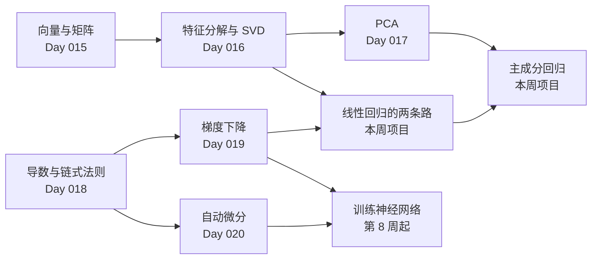
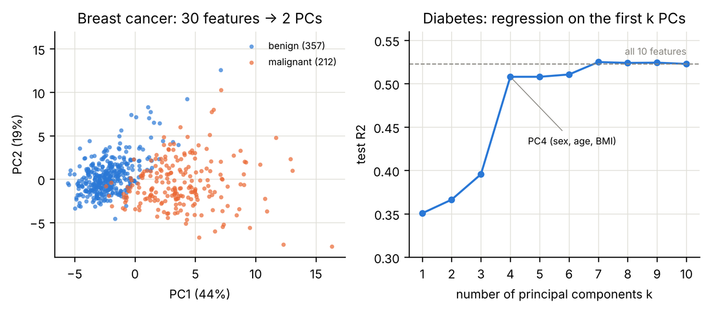

# Day 021 · 🔁 周复盘 ③：从零实现 PCA 与线性回归

> 📅 2026-11-24（周二）· 阶段 1「基础补齐」· 第 3 周 · ⏱️ 约 2–3 小时
>
> [📅 课程表](../../SYLLABUS.md) · [🗺️ 路线图](../../ROADMAP.md) · 上一篇：[Day 020](../2026-11/day020-2026-11-23.md) · 下一篇：[Day 022](../2026-11/day022-2026-11-25.md)

## 🎯 今日目标

1. 把第 3 周六天的内容串成一张知识地图：线性代数（向量、矩阵、特征分解、SVD）通向 PCA，微积分（导数、梯度、链式法则）通向梯度下降和自动微分。
2. 完成本周小项目：只用 NumPy 实现 PCA 和线性回归（精确解与梯度下降两种方法），在两个真实的生物医学数据集上与 scikit-learn 核对，再用主成分回归把两者结合起来。
3. 重做本周最重要的 5 道自测题，再完成 1 道综合题。

## 📖 核心概念

### 1. 本周知识地图

- [Day 015 向量、矩阵与线性变换](../2026-11/day015-2026-11-18.md)：矩阵的每一列是基向量变换后的位置；矩阵乘法是变换的复合，要从右往左读；设计矩阵秩不足时参数无法识别，这就是实验设计中的混杂。
- [Day 016 特征分解与 SVD](../2026-11/day016-2026-11-19.md)：特征向量在变换中只伸缩、不转向；对称矩阵有正交的特征向量；任何矩阵都能分解成“旋转—拉伸—旋转”；截断 SVD 可以去噪。
- [Day 017 PCA](../2026-11/day017-2026-11-20.md)：先中心化，再做 SVD；得分用来看样本，载荷用来看基因；方差最大不等于最重要（airway 数据中依次是供体遗传差异、处理、性别）。
- [Day 018 导数、梯度与链式法则](../2026-11/day018-2026-11-21.md)：导数是敏感度；梯度指向上升最快的方向；用链式法则推出逻辑回归的梯度 $(p - y)\,x$；用有限差分做梯度检验。
- [Day 019 优化](../2026-11/day019-2026-11-22.md)：学习率上限是 $2/\lambda_{\max}$；条件数决定收敛速度，所以训练前要标准化；小批量 SGD 在计算量和噪声之间取得平衡。
- [Day 020 自动微分](../2026-11/day020-2026-11-23.md)：前向传播记录计算图，反向传播把“上游梯度 × 局部导数”传回去；梯度要累加；反向模式一遍得到所有参数的梯度。

### 2. 它们怎么连起来



两条主线在线性回归这里汇合：用 SVD 可以一步求出精确解，用梯度下降则可以迭代逼近同一个解。以后的神经网络没有精确解，只能走第二条路，梯度由自动微分提供。

### 3. 本周项目的新知识：线性回归的两条路

线性回归的模型是 $\hat{\mathbf{y}} = X\mathbf{w}$（在 $X$ 中加一列 1 表示截距），目标是让残差平方和 $\lVert \mathbf{y} - X\mathbf{w} \rVert^2$ 最小。

- **精确解**：令梯度为零，得到正规方程 $X^\mathsf{T}X\mathbf{w} = X^\mathsf{T}\mathbf{y}$。不要直接求逆 $(X^\mathsf{T}X)^{-1}$：$X^\mathsf{T}X$ 的条件数是 $X$ 的平方，特征相关时数值误差很大。`np.linalg.lstsq` 用 SVD 求解（Day 016）：$X = U\Sigma V^\mathsf{T}$，$\mathbf{w} = V\Sigma^{-1}U^\mathsf{T}\mathbf{y}$，数值上稳定得多。
- **梯度下降**：梯度是 $\frac{2}{n}X^\mathsf{T}(X\mathbf{w} - \mathbf{y})$（Day 018），按 Day 019 的方法选学习率、先标准化。它对超大数据集（小批量）和没有精确解的模型都适用。

评价模型要用没参与训练的**测试集**，指标常用决定系数 $R^2 = 1 - \text{残差平方和}/\text{总平方和}$：1 表示完美预测，0 表示和只预测均值一样。把自己的实现与 scikit-learn 的结果逐项核对，是确认代码正确的好办法（Day 013）。

项目中还会遇到两个现象：

- **共线性**（collinearity）：糖尿病数据中，总胆固醇（s1）和低密度脂蛋白（s2）的相关系数约 0.89。标准化只能消除尺度差异，消除不了特征之间的相关，所以海森矩阵的条件数仍有 437，梯度下降收敛得慢；这个方向上的回归系数也很不稳定。第 6 周的岭回归（ridge regression）会专门处理这个问题。
- **PCA 是无监督的**：主成分回归（principal component regression，PCR）先做 PCA，再用前 $k$ 个主成分做回归。方差最大的主成分不一定与结果最相关：项目中第 4 主成分让测试 $R^2$ 从 0.40 跳到 0.51，前 3 个主成分反而贡献较少。
- **防止信息泄漏**：标准化用的均值和标准差、PCA 找到的主成分，都只能在训练集上估计，再原样用到测试集上。如果先用全部数据做标准化或 PCA，再划分训练集和测试集，测试集的信息就会悄悄“泄漏”进模型，评估结果偏乐观。Day 040 会专门讲生物数据中更隐蔽的泄漏方式。

## 📚 今日资源

| # | 资源 | 学什么 | 建议时长 |
|---|---|---|---|
| 1 | [Karpathy：Neural Networks: Zero to Hero](https://karpathy.ai/zero-to-hero.html) 第 1 讲后半部分 | 从 Day 020 停下的地方接着看：用 micrograd 搭一个小型多层感知机，并完整地训练它 | 60 分钟 |
| 2 | [ISLP](https://www.statlearning.com/) 第 3 章 Linear Regression | 读 3.1–3.2（简单与多元线性回归、系数的含义、$R^2$），以及 3.3 中关于共线性（collinearity）的部分；本章的 Python Lab 可选做 | 40 分钟 |
| 3 | [ISLP](https://www.statlearning.com/) 12.2 节 Principal Components Analysis | 主成分的两种解释、方差解释比例，以及主成分的其他用途 | 20 分钟 |

## 🛠️ 动手练习

### 本周项目：只用 NumPy 实现 PCA 与线性回归

- **目标**：自己写出 PCA 和线性回归，在真实数据上与 scikit-learn 的结果核对到小数点后很多位；再把两者结合成主成分回归，观察“方差最大”和“最有预测力”之间的差别。
- **数据**：两个都随 scikit-learn 一起安装，不需要下载。
  - **威斯康星乳腺癌诊断数据**（Wisconsin Diagnostic Breast Cancer）：569 个乳腺肿块样本（212 个恶性、357 个良性），30 个特征由细针穿刺样本的数字化图像计算得到，描述细胞核的大小、形状、纹理等。
  - **糖尿病进展数据**（Efron et al. 2004）：442 名糖尿病患者的 10 个基线指标（年龄、性别、体重指数、平均血压，以及 6 项血清指标：s1 总胆固醇、s2 低密度脂蛋白、s3 高密度脂蛋白、s4 总胆固醇 / 高密度脂蛋白、s5 甘油三酯（可能是对数值）、s6 血糖），预测目标是一年后的疾病进展程度。这些特征已经中心化并缩放过。
- **环境**：Colab 默认环境即可，只需要 NumPy、scikit-learn 和 matplotlib。

**第 1 步：手写 PCA，在乳腺癌数据上与 scikit-learn 核对。**

```python
import numpy as np
from sklearn.datasets import load_breast_cancer, load_diabetes
from sklearn.decomposition import PCA
from sklearn.linear_model import LinearRegression

class MyPCA:
    """只用 NumPy 实现的 PCA，接口仿照 scikit-learn。"""

    def __init__(self, n_components):
        self.n_components = n_components

    def fit(self, X):
        self.mean_ = X.mean(axis=0)
        U, s, Vt = np.linalg.svd(X - self.mean_, full_matrices=False)
        idx = np.abs(Vt).argmax(axis=1)                       # 符号约定（Day 017）
        Vt = Vt * np.sign(Vt[np.arange(len(s)), idx])[:, None]
        var = s**2 / (len(X) - 1)                            # 各主成分的方差 λ = σ² / (n - 1)
        self.components_ = Vt[:self.n_components]
        self.explained_variance_ = var[:self.n_components]
        self.explained_variance_ratio_ = (var / var.sum())[:self.n_components]
        return self

    def transform(self, X):
        return (X - self.mean_) @ self.components_.T

bc = load_breast_cancer()
Xbc = (bc.data - bc.data.mean(axis=0)) / bc.data.std(axis=0)   # 30 个特征尺度差别很大，先标准化
mine = MyPCA(n_components=5).fit(Xbc)
sk = PCA(n_components=5).fit(Xbc)
print("explained variance ratio:", mine.explained_variance_ratio_.round(3))
print("same as scikit-learn:", np.allclose(mine.explained_variance_ratio_, sk.explained_variance_ratio_),
      "| same components (up to sign):", np.allclose(np.abs(mine.components_), np.abs(sk.components_)))
Z = mine.transform(Xbc)
malignant = bc.target == 0                                     # 在这个数据集中，0 = 恶性，1 = 良性
print(f"mean PC1 score: malignant {Z[malignant, 0].mean():+.2f}, benign {Z[~malignant, 0].mean():+.2f}")
print(f"rule 'PC1 > 0 means malignant' is correct for {np.mean((Z[:, 0] > 0) == malignant):.1%} of samples")
```

```text
explained variance ratio: [0.443 0.19  0.094 0.066 0.055]
same as scikit-learn: True | same components (up to sign): True
mean PC1 score: malignant +3.71, benign -2.21
rule 'PC1 > 0 means malignant' is correct for 91.6% of samples
```

PCA 计算时完全没有用到诊断标签，第一主成分却几乎把恶性和良性肿瘤分开了：只用“PC1 是否大于 0”这一条规则，就能正确判断 91.6% 的样本。这说明 30 个形态特征的主要变化方向，恰好与良恶性一致。

**第 2 步：用 `lstsq` 求线性回归的精确解。**

```python
X, y = load_diabetes(return_X_y=True)
rng = np.random.default_rng(0)
idx = rng.permutation(len(y))
test, train = idx[:88], idx[88:]                               # 约 20% 的样本作为测试集
Xtr, Xte, ytr, yte = X[train], X[test], y[train], y[test]

def r2(y_true, y_pred):
    """决定系数：1 - 残差平方和 / 总平方和。"""
    return 1 - np.sum((y_true - y_pred) ** 2) / np.sum((y_true - y_true.mean()) ** 2)

Xb = np.column_stack([np.ones(len(ytr)), Xtr])                 # 加一列 1 作为截距
w_ls = np.linalg.lstsq(Xb, ytr, rcond=None)[0]                 # 最小二乘的精确解（内部用 SVD）
pred_ls = np.column_stack([np.ones(len(yte)), Xte]) @ w_ls

lr = LinearRegression().fit(Xtr, ytr)
print("max |coef difference| vs scikit-learn:", f"{np.max(np.abs(w_ls - np.r_[lr.intercept_, lr.coef_])):.1e}")
print(f"test R2: mine {r2(yte, pred_ls):.4f} | scikit-learn {lr.score(Xte, yte):.4f}")
```

```text
max |coef difference| vs scikit-learn: 1.9e-12
test R2: mine 0.5226 | scikit-learn 0.5226
```

11 个系数（含截距）与 scikit-learn 的差异只有 $10^{-12}$ 量级，测试集 $R^2$ 完全相同。10 个基线指标能解释一年后疾病进展约一半的变异。

**第 3 步：用梯度下降求解同一个问题。**

```python
print("corr(s1, s2) =", np.corrcoef(Xtr[:, 4], Xtr[:, 5])[0, 1].round(2))   # 总胆固醇与低密度脂蛋白
mu, sd = Xtr.mean(axis=0), Xtr.std(axis=0)
Ztr, Zte = (Xtr - mu) / sd, (Xte - mu) / sd                    # 用训练集的均值和标准差标准化（Day 019）
Zb = np.column_stack([np.ones(len(ytr)), Ztr])
H = 2 / len(ytr) * Zb.T @ Zb                                   # 均方误差的海森矩阵
step = 1 / np.linalg.eigvalsh(H).max()
w = np.zeros(Zb.shape[1])
for it in range(5000):
    w -= step * 2 / len(ytr) * Zb.T @ (Zb @ w - ytr)           # 梯度下降的一步
pred_gd = np.column_stack([np.ones(len(yte)), Zte]) @ w
print(f"condition number after standardization: {np.linalg.cond(H):.0f}")
print(f"test R2 after 5000 steps: {r2(yte, pred_gd):.4f} | max |prediction difference| vs lstsq: {np.max(np.abs(pred_gd - pred_ls)):.1e}")
```

```text
corr(s1, s2) = 0.89
condition number after standardization: 437
test R2 after 5000 steps: 0.5226 | max |prediction difference| vs lstsq: 2.1e-04
```

标准化之后条件数仍有 437，原因是 s1 和 s2 高度相关（0.89）：沿“s1 增大、s2 同时减小”这个方向，数据几乎没有变化，损失曲面在这里非常平坦。即便如此，5000 步之后梯度下降的预测已经与精确解相差不到 $10^{-3}$，测试 $R^2$ 相同。

**第 4 步：主成分回归。**

```python
pca = MyPCA(n_components=10).fit(Ztr)
Ptr, Pte = pca.transform(Ztr), pca.transform(Zte)              # 用训练集拟合的 PCA 变换测试集
scores = []
for k in range(1, 11):
    Pb = np.column_stack([np.ones(len(ytr)), Ptr[:, :k]])      # 只用前 k 个主成分做回归
    wk = np.linalg.lstsq(Pb, ytr, rcond=None)[0]
    scores.append(r2(yte, np.column_stack([np.ones(len(yte)), Pte[:, :k]]) @ wk))
print("test R2 with k PCs:", np.round(scores, 3))
```

```text
test R2 with k PCs: [0.351 0.366 0.396 0.508 0.508 0.51  0.525 0.524 0.524 0.523]
```

用全部 10 个主成分时，结果与普通线性回归相同（0.523，与第 2 步只差舍入）。曲线在 $k = 4$ 处有一个大跳跃：第 4 主成分主要由性别、年龄和体重指数组成，它与疾病进展的相关性比第 2、3 主成分都强，但方差更小，所以排在后面。

**第 5 步：作图。**

```python
import matplotlib.pyplot as plt
BLUE, ORANGE, INK_MUTED = "#2a78d6", "#eb6834", "#898781"
plt.rcParams.update({
    "figure.dpi": 120, "savefig.dpi": 300, "savefig.bbox": "tight", "font.size": 9,
    "axes.spines.top": False, "axes.spines.right": False,
    "axes.grid": True, "grid.color": "#e1e0d9", "grid.linewidth": 0.6, "axes.axisbelow": True,
})
fig, (ax1, ax2) = plt.subplots(1, 2, figsize=(7.2, 3.1), layout="constrained")
for mask, color, name in [(~malignant, BLUE, f"benign ({(~malignant).sum()})"),
                          (malignant, ORANGE, f"malignant ({malignant.sum()})")]:
    ax1.scatter(Z[mask, 0], Z[mask, 1], s=10, color=color, alpha=0.7, linewidths=0, label=name)
ax1.set(xlabel=f"PC1 ({100 * mine.explained_variance_ratio_[0]:.0f}%)",
        ylabel=f"PC2 ({100 * mine.explained_variance_ratio_[1]:.0f}%)",
        title="Breast cancer: 30 features -> 2 PCs", ylim=(-9, 17))
ax1.legend(frameon=False, fontsize=7, loc="upper right")

ks = np.arange(1, 11)
ax2.plot(ks, scores, "-o", color=BLUE, ms=4, lw=1.5)
ax2.axhline(lr.score(Xte, yte), color=INK_MUTED, lw=0.8, ls="--")
ax2.text(10, lr.score(Xte, yte) + 0.008, "all 10 features", fontsize=7, color=INK_MUTED, ha="right", va="bottom")
ax2.annotate("PC4 (sex, age, BMI)", xy=(4, scores[3]), xytext=(4.6, 0.43), fontsize=7,
             arrowprops=dict(arrowstyle="-", color=INK_MUTED, lw=0.6))
ax2.set(xlabel="number of principal components k", ylabel="test R2", xticks=ks,
        title="Diabetes: regression on the first k PCs", ylim=(0.3, 0.56))
fig.savefig("week3_project.png")
```

图应该和下面一致：



**第 6 步：整理成项目。** 按 Day 013 的结构，把 `MyPCA`、`r2` 和梯度下降写进 `src/`，主流程写成一个脚本或一个“重启并全部运行”不报错的 Notebook，推送到学习仓库的 `projects/week03/`。README 写明数据来源、两种方法与 scikit-learn 的核对结果，以及共线性和 PCR 的发现。

**自查清单**

- [ ] `MyPCA` 的方差解释比例和主成分（不计符号）与 scikit-learn 一致
- [ ] 线性回归的系数与 scikit-learn 相差小于 $10^{-8}$，测试 $R^2$ 为 0.5226
- [ ] 梯度下降的预测与 `lstsq` 的精确解基本一致，能解释为什么标准化后仍收敛得慢
- [ ] 能解释 PCR 曲线为什么在 $k = 4$ 处跳跃
- [ ] 测试集的标准化和 PCA 都使用训练集拟合的参数，没有用测试集的信息
- [ ] 项目已推送，README 写清数据、方法和发现

**进阶**：

1. **岭回归的精确解**：$\mathbf{w} = (X^\mathsf{T}X + \lambda I)^{-1}X^\mathsf{T}\mathbf{y}$（截距不加惩罚）。在标准化后的糖尿病数据上取几个不同的 $\lambda$，看看 s1、s2 的系数怎样变化，海森矩阵的条件数又怎样变化。第 6 周会系统学习正则化。
2. 删掉 s2 这一列再做第 3 步，条件数会降到多少？梯度下降收敛快了多少？
3. 用乳腺癌数据前 2 个、5 个、10 个主成分训练逻辑回归（scikit-learn 的 `LogisticRegression`），比较分类准确率，并想一想：为什么不能用全部数据先做 PCA、再划分训练集和测试集？

## ✅ 自测题

先不看笔记作答，再展开答案核对。

1. （Day 015）实验设计中“批次与处理完全混杂”在线性代数上对应什么？为什么事后无法补救？
2. （Day 016）SVD 和特征分解是什么关系？为什么说 SVD 适用于任何矩阵？
3. （Day 017）为什么做 PCA 前必须中心化？不中心化时，第一个成分对应的是什么？
4. （Day 018）写出逻辑回归中 $\partial L / \partial w$ 的链式法则三个因子，并解释最终结果 $(p - y)\,x$ 的直观含义。
5. （Day 019）什么是条件数？为什么特征尺度相差很大时，梯度下降会非常慢？标准化为什么能解决这个问题？
6. **综合题**：本周项目中，线性回归既可以用 `np.linalg.lstsq` 一步求出，也可以用梯度下降迭代求解。两种方法分别用到了本周的哪些知识？各适合什么场景？为什么糖尿病数据标准化后，梯度下降仍然收敛得慢？

<details>
<summary>参考答案</summary>

1. 对应设计矩阵秩不足：“处理”列和“批次”列完全相同（或一列能由其他列线性组合得到），模型参数不可识别，任何一组“处理效应 + 批次效应”只要总和相同，就同样符合数据。这是数据本身缺少信息，不是统计方法不够好，所以事后无法补救，只能在设计实验时让每个批次都同时包含对照和处理样本。
2. 对任意矩阵 $X = U\Sigma V^\mathsf{T}$，有 $X^\mathsf{T}X = V\Sigma^2V^\mathsf{T}$、$XX^\mathsf{T} = U\Sigma^2U^\mathsf{T}$：右奇异向量和左奇异向量分别是这两个对称矩阵的特征向量，奇异值的平方是它们的特征值。$X^\mathsf{T}X$ 和 $XX^\mathsf{T}$ 总是对称且特征值非负，总能做正交特征分解，所以 SVD 对任何形状、任何矩阵都存在；而特征分解只适用于方阵，而且不是每个方阵都能对角化。
3. PCA 要找的是样本之间差异最大的方向，方差是相对于均值来算的。不中心化时，SVD 找到的第一个方向是数据整体偏离原点的方向，也就是各特征的平均水平（Day 017 练习 5 中与平均表达谱的相关系数达到 0.9999），它“解释”了 90% 的平方和，却不包含任何样本间差异的信息，后面的成分也会因此被扭曲。
4. 三个因子是：$\partial L/\partial p = -y/p + (1-y)/(1-p)$，$\partial p/\partial z = p(1-p)$，$\partial z/\partial w = x$。前两项相乘化简为 $p - y$，再乘以 $x$。直观含义：梯度等于“预测误差 × 输入”，预测越准，梯度越小；预测偏高（$p > y$）时，梯度与 $x$ 同号，更新会朝着降低该样本预测概率的方向调整 $w$。
5. 条件数是海森矩阵最大与最小特征值之比，$\kappa = \lambda_{\max}/\lambda_{\min}$，描述损失曲面有多“狭长”。学习率必须小于 $2/\lambda_{\max}$，否则在最陡方向上会发散；但这么小的步长在最平缓的方向上几乎不动，所需迭代次数大致与 $\kappa$ 成正比。特征尺度相差很大时，线性模型的海森矩阵 $\frac{2}{n}X^\mathsf{T}X$ 的特征值也相差悬殊，条件数巨大。标准化后各特征尺度相同，特征不相关时海森矩阵接近单位矩阵的倍数，条件数接近 1。
6. `lstsq` 用的是 SVD（Day 016）：把 $X$ 分解后直接写出最小二乘解，一步得到精确结果，即使特征相关，数值上也很稳定，适合特征数不太多、数据能一次放进内存的问题。梯度下降用的是梯度（Day 018）和优化方法（Day 019）：需要选学习率、先标准化，迭代逼近同一个解；它的优势是可以用小批量处理海量数据，也适用于没有精确解的模型（逻辑回归、神经网络），这时梯度由自动微分提供（Day 020）。糖尿病数据标准化后仍收敛得慢，是因为标准化只消除了尺度差异，消除不了特征之间的相关：s1 和 s2 的相关系数约 0.89，协方差矩阵在“s1 与 s2 反向变化”这个方向上的特征值很小，条件数仍有 437，梯度下降在这个平坦方向上前进得很慢。岭回归、删除冗余特征或改用主成分回归都能改善这一点。

</details>

## 🔭 今日前沿

- **用病理基础模型，从 H&E 切片预测单细胞空间基因表达（arXiv 预印本，11 月）**：常规 H&E 染色切片随处可得，而单细胞分辨率的空间转录组（如 10x Xenium）成本很高。这篇预印本把预训练的病理图像基础模型改造为单细胞水平的基因表达预测器。在成对的 H&E 与 Xenium 5K 数据上，作者报告基因的平均 Pearson 相关系数比零样本基线提高约 2.67 倍。这类“从图像推断分子”的工作，第 23 周学生物医学影像时还会遇到。来源：[arXiv](https://arxiv.org/abs/2611.13649)

## 📝 学习打卡

- [ ] 重读本周 6 篇笔记的“核心概念”，画出自己的知识地图
- [ ] 看完 Zero to Hero 第 1 讲，读完 ISLP 第 3 章和 12.2 节的指定部分
- [ ] 完成本周项目，逐条通过自查清单
- [ ] 项目已推送到学习仓库的 `projects/week03/`
- [ ] 完成 6 道自测题，把答错的题加入 Anki
- [ ] 进阶：推导并实现岭回归的精确解
- 今日笔记 / 疑问：
