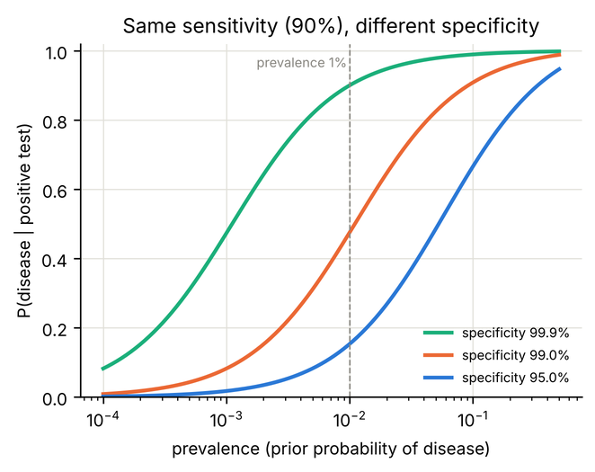

# Day 022 · 概率基础与贝叶斯定理

> 📅 2026-11-25（周三）· 阶段 1「基础补齐」· 第 4 周 · ⏱️ 约 90 分钟
>
> [📅 课程表](../../SYLLABUS.md) · [🗺️ 路线图](../../ROADMAP.md) · 上一篇：[Day 021](../2026-11/day021-2026-11-24.md) · 下一篇：[Day 023](../2026-11/day023-2026-11-26.md)

## 🎯 今日目标

1. 掌握概率的基本语言：事件、条件概率、独立性和全概率公式。
2. 熟练使用贝叶斯定理的概率形式和几率形式，能算出诊断试验的阳性预测值，并理解“基础比率”为什么起决定作用。
3. 用蒙特卡洛模拟检验自己的概率推理，并把贝叶斯思维用到遗传咨询和 AI 分类器的评估上。

## 📖 核心概念

### 1. 概率的语言

一次随机试验所有可能结果的集合叫**样本空间**，其中的子集叫**事件**。概率满足三条公理：非负；整个样本空间的概率为 1；互不相交的事件，概率可以相加。

概率有两种常见的解释：**频率解释**把它看作大量重复试验中事件发生的比例；**信念解释**把它看作对一个不确定命题的相信程度。贝叶斯统计主要用后者，因为很多问题无法重复，例如“这位患者有没有患病”“这个变异是不是致病的”。

### 2. 条件概率与独立性

$$P(A \mid B) = \frac{P(A \cap B)}{P(B)}$$

可以理解为：只在 $B$ 发生的那些情况中，看 $A$ 占多大比例。由此得到乘法法则 $P(A \cap B) = P(A \mid B)\,P(B)$。

如果 $P(A \cap B) = P(A)\,P(B)$，即 $P(A \mid B) = P(A)$，就称 $A$ 与 $B$ **独立**：知道 $B$ 发生了，对判断 $A$ 没有帮助。生物数据中独立性常常不成立：同一份样本的两次检测、染色体上相互连锁的位点、同一家庭的成员，都可能彼此相关。

**全概率公式**把一个事件按互斥的情况拆开计算：$P(E) = \sum_i P(E \mid H_i)\,P(H_i)$。这就是 Stat 110 反复强调的“分情况讨论”。

### 3. 贝叶斯定理

$$P(H \mid E) = \frac{P(E \mid H)\,P(H)}{P(E)}$$

$P(H)$ 是看到证据之前对假设 $H$ 的相信程度，叫**先验**（prior）；$P(E \mid H)$ 是假设成立时出现这个证据的概率，叫**似然**（likelihood）；$P(H \mid E)$ 是看到证据之后的**后验**（posterior）。分母 $P(E)$ 用全概率公式展开。3Blue1Brown 建议想象一个具体的人群：先验决定“人群中有多少人患病”，似然决定“患者和健康人中各有多少人检测阳性”，后验就是“所有阳性者中，真正患病的人占多少”。

### 4. 诊断试验：基础比率为什么重要

诊断试验有三个关键数字：**灵敏度**（sensitivity）$P(+ \mid \text{患病})$、**特异度**（specificity）$P(- \mid \text{健康})$，以及我们真正关心的**阳性预测值**（positive predictive value，PPV）$P(\text{患病} \mid +)$。

设灵敏度 90%、特异度 95%，看起来是不错的检测。但如果人群患病率只有 1%，每 1 万人中有 90 个真阳性，却有 $9900 \times 5\% = 495$ 个假阳性，阳性者中真正患病的只有 $90 / 585 \approx 15\%$。忽视患病率（基础比率）、只看灵敏度和特异度，就会大大高估一个阳性结果的意义，这叫**基础比率谬误**（base rate fallacy）。

贝叶斯定理还有一个更方便的**几率形式**（odds，即 $p / (1-p)$）：

$$\text{后验几率} = \text{先验几率} \times \text{贝叶斯因子}$$

阳性结果的贝叶斯因子（阳性似然比）是 $\text{灵敏度} / (1 - \text{特异度}) = 0.9 / 0.05 = 18$：一个阳性结果，把患病的几率放大 18 倍。如果做两次相互**独立**的检测，就再乘一次 18（练习 2）。但同一种方法的重复检测，误差往往是相关的，这时不能简单地连乘（进阶 1）。

### 5. 与 AI 的联系

分类模型输出的“概率”本质上是后验概率，训练集中各类别的比例起着先验的作用。一个模型在类别平衡的测试集上，灵敏度和特异度都是 95%；部署到患病率只有 2% 的人群中，它的**精确率**（precision，即 PPV）只有约 28%，大多数“阳性”预测都是错的。因此，报告模型性能时必须说明评估数据中各类别的比例。生物医学中罕见的东西特别多（罕见病、稀有细胞类型、真正致病的变异），尤其要注意这一点。Day 038 会系统讲分类模型的评估指标。

### 6. 局限与常见误区

最常见的错误是把 $P(E \mid H)$ 当成 $P(H \mid E)$，例如把“患者中 90% 检测阳性”误读成“阳性者中 90% 患病”。其次是忽视基础比率，以及在不独立的情况下把概率直接相乘。先验的选择带有主观性，稳妥的做法是换几个合理的先验，看结论是否稳定。

## 📚 今日资源

| # | 资源 | 学什么 | 建议时长 |
|---|---|---|---|
| 1 | 3Blue1Brown：[Bayes theorem, the geometry of changing beliefs](https://www.3blue1brown.com/lessons/bayes-theorem)（约 15 分钟）和 [The medical test paradox](https://www.3blue1brown.com/lessons/better-bayes)（约 21 分钟） | 第一集用面积图理解贝叶斯定理；第二集用贝叶斯因子解释“准确率 90% 以上的检测，阳性结果却未必可信” | 35 分钟 |
| 2 | [Harvard Stat 110](https://stat110.hsites.harvard.edu/youtube) 第 4 讲 Conditional Probability | Joe Blitzstein 讲条件概率与贝叶斯定理；配套教材 [Introduction to Probability](http://probabilitybook.net/)（Blitzstein & Hwang）第 2 章可免费在线阅读，作为参考 | 45 分钟 |
| 3 | [Seeing Theory](https://seeing-theory.brown.edu/) 第 2 章 Compound Probability | 布朗大学的交互式可视化：集合、计数与条件概率，拖动滑块直观感受条件概率 | 10 分钟 |

## 🛠️ 动手练习

在 Colab 中依次运行，只需要 NumPy 和 matplotlib。

**练习 1 · 阳性预测值：公式与模拟**

```python
import numpy as np
import matplotlib.pyplot as plt

def ppv(prevalence, sensitivity, specificity):
    """阳性预测值 P(患病 | 阳性)，由贝叶斯定理得到。"""
    true_pos = sensitivity * prevalence                 # P(阳性, 患病)
    false_pos = (1 - specificity) * (1 - prevalence)    # P(阳性, 健康)
    return true_pos / (true_pos + false_pos)            # 分母用全概率公式得到 P(阳性)

for prev in [0.001, 0.01, 0.1, 0.5]:
    print(f"prevalence {prev:6.1%}: P(disease | positive) = {ppv(prev, 0.90, 0.95):.3f}")

# 用模拟核对：100 万人，患病率 1%
rng = np.random.default_rng(0)
n = 1_000_000
disease = rng.random(n) < 0.01
positive = np.where(disease, rng.random(n) < 0.90, rng.random(n) < 0.05)   # 患者 90% 阳性，健康人 5% 阳性
print(f"simulation, prevalence 1%: {positive.sum()} positives, of which {disease[positive].mean():.3f} have the disease")
```

期望输出：

```text
prevalence   0.1%: P(disease | positive) = 0.018
prevalence   1.0%: P(disease | positive) = 0.154
prevalence  10.0%: P(disease | positive) = 0.667
prevalence  50.0%: P(disease | positive) = 0.947
simulation, prevalence 1%: 58261 positives, of which 0.154 have the disease
```

同一个检测，在患病率 50% 的专科门诊里，阳性结果 95% 可信；拿到患病率 0.1% 的人群中筛查，阳性者中只有不到 2% 真正患病。模拟的 58,261 个阳性者中，患者的比例与公式完全一致。

**练习 2 · 几率形式：连续多次阳性**

```python
prior = 0.01
bayes_factor = 0.90 / (1 - 0.95)          # 阳性似然比 = 灵敏度 / (1 - 特异度) = 18
odds = prior / (1 - prior)                # 概率换成几率
for k in range(1, 4):
    odds *= bayes_factor                  # 每多一次独立的阳性，几率乘以 18
    print(f"after {k} positive test(s): P(disease) = {odds / (1 + odds):.3f}")
```

期望输出：

```text
after 1 positive test(s): P(disease) = 0.154
after 2 positive test(s): P(disease) = 0.766
after 3 positive test(s): P(disease) = 0.983
```

一次阳性之后患病概率是 15%，两次独立的阳性之后升到 77%。上一次的后验，就是下一次的先验。

**练习 3 · 画出阳性预测值随患病率的变化**

```python
BLUE, ORANGE, AQUA, INK_MUTED = "#2a78d6", "#eb6834", "#1baf7a", "#898781"
plt.rcParams.update({
    "figure.dpi": 120, "savefig.dpi": 300, "savefig.bbox": "tight", "font.size": 9,
    "axes.spines.top": False, "axes.spines.right": False,
    "axes.grid": True, "grid.color": "#e1e0d9", "grid.linewidth": 0.6, "axes.axisbelow": True,
})
prev = np.logspace(-4, np.log10(0.5), 200)                    # 患病率从 0.01% 到 50%
fig, ax = plt.subplots(figsize=(4.8, 3.4))
for spec, color in [(0.999, AQUA), (0.99, ORANGE), (0.95, BLUE)]:
    ax.plot(prev, ppv(prev, 0.90, spec), color=color, lw=2, label=f"specificity {spec:.1%}")
ax.axvline(0.01, color=INK_MUTED, lw=0.8, ls="--")
ax.text(0.0095, 0.99, "prevalence 1%", fontsize=7, color=INK_MUTED, ha="right", va="top")
ax.set_xscale("log")
ax.set(xlabel="prevalence (prior probability of disease)", ylabel="P(disease | positive test)",
       ylim=(0, 1.02), title="Same sensitivity (90%), different specificity")
ax.legend(frameon=False, fontsize=7, loc="lower right")
fig.savefig("ppv.png")
```

图应该和下面一致：



在患病率 1% 处（虚线），三种检测的阳性预测值分别约为 15%、48% 和 90%。用于罕见病筛查时，特异度比灵敏度更关键：特异度从 95% 提高到 99.9%，假阳性减少了 50 倍。

**练习 4 · 遗传咨询：隐性遗传病的携带者概率**

一对表型正常的夫妇生了一个患常染色体隐性遗传病的孩子，所以父母都是携带者（Aa）。他们另一个表型正常的女儿是携带者的概率是多少？她与一位已知的携带者结婚后，生了 $k$ 个健康的孩子，这个概率又该怎样更新？

先验：在“表型正常”的条件下，她的基因型是 AA 或 Aa，比例为 1 : 2，所以 $P(\text{携带者}) = 2/3$。如果她是携带者，每个孩子健康的概率是 3/4；如果不是，孩子一定不会患病。

```python
def carrier_posterior(k):
    """生了 k 个健康孩子后，她是携带者的后验概率。"""
    prior_carrier = 2 / 3
    like_carrier = (3 / 4) ** k              # 她是携带者时，k 个孩子都健康的概率
    return prior_carrier * like_carrier / (prior_carrier * like_carrier + (1 - prior_carrier) * 1.0)

# 用模拟核对：模拟许多这样的家庭
rng = np.random.default_rng(1)
n = 2_000_000
a1 = rng.random(n) < 0.5                     # 从母亲那里得到致病等位基因 a 的概率是 1/2
a2 = rng.random(n) < 0.5                     # 从父亲那里得到 a 的概率也是 1/2
unaffected = ~(a1 & a2)                      # 只保留表型正常的女儿（排除 aa）
carrier = (a1 ^ a2)[unaffected]              # 恰好有一个 a 的就是携带者
m = carrier.size
for k in [0, 1, 2, 3, 5]:
    from_her = carrier[:, None] & (rng.random((m, k)) < 0.5)   # 她把 a 传给孩子
    from_partner = rng.random((m, k)) < 0.5                    # 携带者丈夫把 a 传给孩子
    all_unaffected = ~(from_her & from_partner).any(axis=1)    # k 个孩子都健康
    print(f"{k} unaffected children: exact {carrier_posterior(k):.3f}, simulated {carrier[all_unaffected].mean():.3f}")
```

期望输出（模拟值的最后一位可能略有不同）：

```text
0 unaffected children: exact 0.667, simulated 0.666
1 unaffected children: exact 0.600, simulated 0.600
2 unaffected children: exact 0.529, simulated 0.529
3 unaffected children: exact 0.458, simulated 0.458
5 unaffected children: exact 0.322, simulated 0.322
```

每多一个健康的孩子，她是携带者的概率就下降一些，但永远不会降到 0：健康的孩子是“不是携带者”的证据，却不是决定性的证据。这正是遗传咨询中常用的贝叶斯计算。

**进阶**：

1. **检测不独立时**：假设对健康人来说，第一次假阳性之后，第二次仍为阳性的概率是 50%（而不是 5%），对患者两次检测仍然独立。重新计算两次阳性后的患病概率。你应该得到约 0.247，远低于练习 2 中的 0.766：重复同一种检测的价值大打折扣。
2. **辛普森悖论**（Stat 110 第 6 讲）：Charig et al. 1986（[BMJ](https://doi.org/10.1136/bmj.292.6524.879)）比较了两种肾结石手术。小结石：开放手术成功 81/87，经皮肾镜取石成功 234/270；大结石：开放手术 192/263，经皮肾镜 55/80。分别计算两种结石大小下和合并后的成功率。为什么在每一层中开放手术都更好，合并后却是经皮肾镜更好？提示：看看两种手术分别更多地用于哪种结石。

## ✅ 自测题

1. 灵敏度、特异度和阳性预测值分别是哪一个条件概率？哪一个依赖于患病率？
2. 灵敏度 90%、特异度 95% 的检测，在患病率 1% 的人群中，阳性者真正患病的概率约为多少？请用“每 1 万人”的方式算一遍。
3. 什么是贝叶斯因子？为什么用几率形式更新信念特别方便？什么情况下不能把多次检测的贝叶斯因子直接相乘？
4. 一个分类模型在平衡的测试集上灵敏度和特异度都是 95%，部署到患病率 2% 的人群中，精确率大约是多少？这对报告模型性能有什么启示？
5. 练习 4 中，为什么生了几个健康的孩子之后，她是携带者的概率下降了，却永远不会变成 0？

<details>
<summary>参考答案</summary>

1. 灵敏度是 $P(\text{阳性} \mid \text{患病})$，特异度是 $P(\text{阴性} \mid \text{健康})$，它们描述的是检测本身的性质，不随人群而变。阳性预测值是 $P(\text{患病} \mid \text{阳性})$，由贝叶斯定理可知它依赖于先验，也就是人群的患病率：同一个检测，患病率越低，阳性预测值越低。
2. 1 万人中有 100 名患者、9900 名健康人。患者中 90 人检测阳性（真阳性）；健康人中 $9900 \times 5\% = 495$ 人阳性（假阳性）。阳性共 585 人，其中真正患病的是 $90 / 585 \approx 15\%$。
3. 贝叶斯因子是证据在两种假设下出现的概率之比，例如阳性似然比 $P(+ \mid \text{患病}) / P(+ \mid \text{健康})$，表示这条证据把“患病”的几率放大了多少倍。几率形式下，“后验几率 = 先验几率 × 贝叶斯因子”只需要一次乘法；多条证据相互独立时，依次相乘即可，上一次的后验就是下一次的先验。如果几条证据不独立，比如同一种方法的重复检测，误差往往同时出现，第二次阳性带来的新信息比独立时少得多，就不能直接连乘，必须使用两次结果的联合概率（进阶 1）。
4. 精确率 $= 0.95 \times 0.02 / (0.95 \times 0.02 + 0.05 \times 0.98) = 0.019 / 0.068 \approx 28\%$，也就是说约 72% 的阳性预测是错的。在平衡测试集上看起来很好的模型，在真实的低患病率场景中可能并不实用。所以报告性能时必须说明测试集的类别比例，最好直接在与实际应用相近的比例下评估，或者报告不同患病率下的精确率。
5. 健康的孩子这个证据，在“她是携带者”时出现的概率（每个 3/4）比在“她不是携带者”时（每个 1）要低，贝叶斯因子小于 1，所以每多一个健康孩子，她是携带者的后验概率就降低一些。但只要她是携带者，生出 $k$ 个健康孩子的概率 $(3/4)^k$ 始终大于 0，这个证据不能完全排除携带者的可能，所以后验概率只会趋近于 0，而不会等于 0。

</details>

## 🔭 今日前沿

今日无。近两周内没有找到既有可靠一手来源、又尚未收录的新进展。

## 📝 学习打卡

- [ ] 看完 3Blue1Brown 的两集和 Stat 110 第 4 讲
- [ ] 在 Seeing Theory 上玩一遍条件概率的交互演示
- [ ] 跑通练习 1–4，输出与示例一致
- [ ] 能不看笔记，用“每 1 万人”的方法算出阳性预测值
- [ ] 进阶：算出辛普森悖论中各层和合并后的成功率，并解释原因
- 今日笔记 / 疑问：
