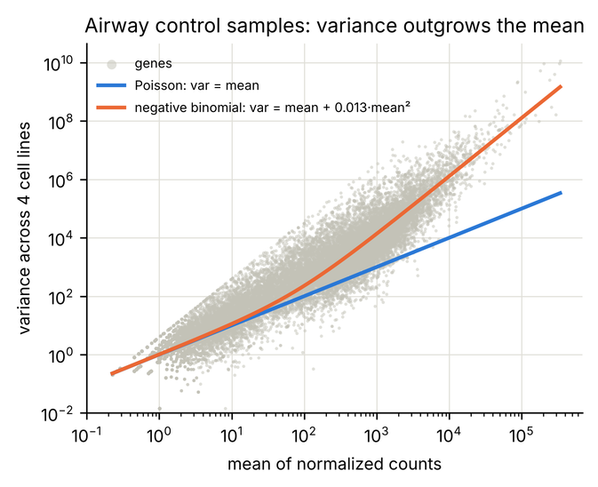

# Day 023 · 常见分布与生物计数数据

> 📅 2026-11-26（周四）· 阶段 1「基础补齐」· 第 4 周 · ⏱️ 约 90 分钟
>
> [📅 课程表](../../SYLLABUS.md) · [🗺️ 路线图](../../ROADMAP.md) · 上一篇：[Day 022](../2026-11/day022-2026-11-25.md) · 下一篇：（明天更新）

## 🎯 今日目标

1. 讲清二项、泊松、负二项三种分布各自的“生成故事”，写出它们的均值和方差，并会用 SciPy 计算和模拟。
2. 理解过度离散（overdispersion）：为什么同一文库的技术重复近似服从泊松分布，生物学重复却要用负二项分布。
3. 在真实的 airway RNA-seq 数据上画出均值-方差关系图，粗略估计离散度，并说明“测得更深”和“多做重复”各自能解决什么问题。

## 📖 核心概念

### 1. 分布是一个“生成故事”

测序数据本质上是计数：落在某个基因上的读段（read）数、一个细胞里检测到的 UMI 数、一段基因组上的突变数。计数是非负整数，分布往往偏斜，方差还会随均值增大。把原始计数直接当成正态分布去做 t 检验，常常会得出错误的结论。

MSMB 第 1 章把概率分布叫作**生成模型**（generative model）：它讲的是“数据是怎么产生的”。有了这个故事，就能算出某个观测结果出现的概率，能模拟数据，也能反过来从数据估计参数（明天的最大似然估计）。

### 2. 二项分布：n 次独立试验中的成功次数

只有两种结果的一次试验叫**伯努利试验**（Bernoulli trial）。把成功概率为 $p$ 的伯努利试验独立重复 $n$ 次，成功的次数服从**二项分布**（binomial distribution）：

$$P(X=k)=\binom{n}{k}p^k(1-p)^{n-k},\qquad E[X]=np,\qquad \operatorname{Var}(X)=np(1-p)$$

生物学例子：一个杂合 SNP 被 40 条读段覆盖。如果两个等位基因的表达量相同，每条读段来自替代等位基因（alt）的概率是 0.5，alt 读段数就服从 $\text{Bin}(40, 0.5)$。观察到 29 条 alt 读段时，可以算出这件事有多罕见，以此判断是否存在**等位基因特异表达**（allele-specific expression，练习 1）。

### 3. 泊松分布：大量机会中的稀有事件

当 $n$ 很大、$p$ 很小、$np=\lambda$ 适中时，二项分布趋近于**泊松分布**（Poisson distribution）：

$$P(X=k)=\frac{e^{-\lambda}\lambda^k}{k!},\qquad E[X]=\operatorname{Var}(X)=\lambda$$

测序正是这种情形：一个文库有几千万条读段，某个基因的转录本只占其中极小的一部分。把同一个文库重复测序（**技术重复**），一个基因的读段数近似服从泊松分布。Marioni et al. 2008（[Genome Research](https://doi.org/10.1101/gr.079558.108)）发现，技术重复之间的差异基本可以用泊松模型描述。泊松分布最重要的性质是**方差等于均值**，这给了我们一个简单的诊断方法：比较数据的方差和均值。

### 4. 过度离散与负二项分布

**生物学重复**（不同的小鼠、病人、细胞系）就不同了：每个样本中基因的真实表达水平本身就不一样。可以把数据的产生写成两层：

1. 第 $i$ 个样本的真实表达水平 $\lambda_i$ 服从均值为 $\mu$ 的 Gamma 分布，这是生物学变异；
2. 给定 $\lambda_i$，测到的读段数服从 $\text{Poisson}(\lambda_i)$，这是测序抽样。

对所有可能的 $\lambda_i$ 求平均后，计数的分布就是**负二项分布**（negative binomial，NB），也叫 gamma-Poisson 分布：

$$E[X]=\mu,\qquad \operatorname{Var}(X)=\mu+\alpha\mu^2$$

$\alpha$ 叫**离散度**（dispersion），$\sqrt{\alpha}$ 就是真实表达水平在生物学重复之间的变异系数，edgeR 称之为生物学变异系数（BCV）。$\alpha\to 0$ 时，负二项分布退化为泊松分布。方差大于均值的现象就叫**过度离散**。

方差的两项各有含义：$\mu$ 是测序抽样带来的泊松噪声，$\alpha\mu^2$ 是生物学变异。低表达基因以泊松噪声为主，测得更深就能看得更准；高表达基因以生物学变异为主。设 $\alpha=0.04$，均值为 1000 的基因，方差约为 $1000+40000$，测序深度翻倍几乎没有帮助，只有增加生物学重复才能提高检验功效（自测题 4）。

过度离散本身也可以成为生物学证据。Luria & Delbrück 1943（[Genetics](https://doi.org/10.1093/genetics/28.6.491)）发现，平行培养的细菌中，抗噬菌体突变体数目的方差远大于均值。如果突变是接触噬菌体时才被诱导出来的，这个数目应该近似服从泊松分布。他们由此推断，突变在接触噬菌体之前就已经随机发生了（进阶 2）。

| 分布 | 生成故事 | 均值 | 方差 | 生物学例子 |
|---|---|---|---|---|
| 二项 $\text{Bin}(n,p)$ | $n$ 次独立试验中成功的次数 | $np$ | $np(1-p)$ | 杂合 SNP 上的 alt 读段数；CpG 位点的甲基化读段数 |
| 泊松 $\text{Pois}(\lambda)$ | 大量机会中稀有事件发生的次数 | $\lambda$ | $\lambda$ | 技术重复中某基因的读段数；一段 DNA 上的突变数 |
| 负二项 $\text{NB}(\mu,\alpha)$ | 速率本身服从 Gamma 分布的泊松 | $\mu$ | $\mu+\alpha\mu^2$ | 生物学重复中某基因的读段数；单细胞的 UMI 计数 |

### 5. 在 RNA-seq 和 AI 模型中怎么用

DESeq2（Love et al. 2014，[Genome Biology](https://doi.org/10.1186/s13059-014-0550-8)）和 edgeR 都假设：基因 $g$ 在样本 $j$ 中的计数服从负二项分布，均值为 $s_j q_{gj}$，离散度为 $\alpha_g$。其中 $s_j$ 是文库的大小因子（size factor），$q_{gj}$ 是归一化的表达量，它的对数再按实验设计做线性回归，也就是广义线性模型（GLM）。每个基因通常只有 3–4 个重复，单独估计 $\alpha_g$ 噪声很大，所以 DESeq2 先拟合“离散度随均值变化”的趋势，再把每个基因的估计值向趋势收缩，相当于从其他基因那里借来一个先验，正是昨天讲的贝叶斯思想。Day 014 进阶中 PyDESeq2 找到的差异基因比配对 t 检验多得多，这是原因之一。

单细胞 UMI 数据同样常用负二项模型。scVI（Lopez et al. 2018，[Nature Methods](https://doi.org/10.1038/s41592-018-0229-2)）这类深度生成模型，用神经网络从细胞的低维表示算出每个基因计数分布（负二项或零膨胀负二项）的均值等参数，训练时的重建损失就是这个分布下的负对数似然。Day 026 会讲损失函数与似然的关系，Day 079 会讲 scVI 为什么是一个变分自编码器。

### 6. 局限与常见误区

- **只对原始计数建模**：TPM、CPM 或取对数之后的数据不再服从这些分布。测序深度的差异要通过大小因子写进模型，而不是事先除掉。
- **零多不等于零膨胀**：均值很低时，负二项分布本身就会产生大量的零。Svensson 2020（[Nature Biotechnology](https://doi.org/10.1038/s41587-019-0379-5)）用阴性对照数据表明，基于 UMI 的液滴单细胞数据中，零的数量与计数模型的预期一致。判断是否“零膨胀”，要先和模型预期的零比例比较（自测题 5）。
- **负二项也只是近似**：离群样本、批次效应和不同的建库方法都可能让它失灵，需要用均值-方差图、rootogram（MSMB 第 2 章）等方法检查拟合。

## 📚 今日资源

| # | 资源 | 学什么 | 建议时长 |
|---|---|---|---|
| 1 | [MSMB 第 1 章 Generative Models for Discrete Data](https://www.huber.embl.de/msmb/01-chap.html) | 伯努利、二项、泊松和多项分布，以及用泊松分布分析表位检测数据的完整例子。书中代码是 R，读懂思路即可，今天的练习会用 Python 重做关键部分 | 30 分钟 |
| 2 | MSMB [第 2 章 Statistical Modeling](https://www.huber.embl.de/msmb/02-chap.html) 开头 + [第 4 章 Mixture Models](https://www.huber.embl.de/msmb/04-chap.html) 中的 gamma-Poisson 一节 | 第 2 章开头：用 rootogram 检查表位数据是否符合泊松分布，参数估计部分留到明天。第 4 章：泊松的速率本身服从 Gamma 分布时，怎样得到适合 RNA-seq 的 gamma-Poisson（负二项）分布 | 20 分钟 |
| 3 | [Harvard Stat 110](https://stat110.hsites.harvard.edu/youtube) 第 11 讲 The Poisson Distribution | Joe Blitzstein 讲泊松分布的性质，以及“用泊松分布近似稀有事件计数”的直觉和例子。配套教材 [Introduction to Probability](http://probabilitybook.net/)（可免费在线阅读）第 4 章讲几何分布、负二项分布、泊松分布及其与二项分布的联系，可作参考 | 45 分钟 |

## 🛠️ 动手练习

在 Colab 中依次运行。需要 NumPy、SciPy、pandas 和 matplotlib，Colab 都已预装。模拟结果的最后一位可能与下面略有不同。

**练习 1 · 二项分布：这个 SNP 有等位基因不平衡吗？**

```python
import numpy as np
from scipy import stats

rng = np.random.default_rng(23)

n, p = 40, 0.5                  # 杂合 SNP 被 40 条读段覆盖；两个等位基因表达相同时，每条读段来自 alt 的概率是 0.5
B = stats.binom(n, p)
print(f"Binomial(40, 0.5): mean = {B.mean():.0f}, var = {B.var():.0f}")   # np 和 np(1 - p)
print(f"P(alt reads >= 29) = {B.sf(28):.4f}")                              # sf(k) = P(X > k)，所以 P(X >= 29) 写 sf(28)

sim = rng.binomial(n, p, size=100_000)                                     # 用模拟核对
print(f"simulated: mean = {sim.mean():.2f}, var = {sim.var():.2f}, P(>= 29) = {(sim >= 29).mean():.4f}")
```

期望输出：

```text
Binomial(40, 0.5): mean = 20, var = 10
P(alt reads >= 29) = 0.0032
simulated: mean = 20.00, var = 9.97, P(>= 29) = 0.0029
```

如果两个等位基因表达相同，40 条读段中有 29 条或更多来自 alt 的概率只有 0.3%。这提示可能存在等位基因特异表达，也可能是比对偏好等技术原因。“在原假设下出现这么极端的结果有多罕见”，就是单侧 p 值，Day 025 会系统讲。

**练习 2 · 泊松近似：测序中的稀有事件**

```python
N = 20_000_000          # 文库共 2000 万条读段
p_gene = 5e-7           # 某基因的转录本在文库中所占的比例
lam = N * p_gene        # 期望读段数 λ = Np = 10
k = np.arange(0, 31)
diff = np.abs(stats.binom.pmf(k, N, p_gene) - stats.poisson.pmf(k, lam)).max()
print(f"lambda = {lam:.0f}; max |Binomial - Poisson| for k = 0..30: {diff:.1e}")

tech = rng.binomial(N, p_gene, size=10_000)      # 1 万次“把同一个文库重新测一遍”，即技术重复
print(f"technical replicates: mean = {tech.mean():.2f}, var = {tech.var():.2f}, var/mean = {tech.var() / tech.mean():.2f}")
```

期望输出：

```text
lambda = 10; max |Binomial - Poisson| for k = 0..30: 3.1e-08
technical replicates: mean = 10.01, var = 10.17, var/mean = 1.02
```

二项分布与泊松分布的概率之差不到 $10^{-7}$。技术重复的方差与均值之比约为 1，这就是泊松分布的特征。

**练习 3 · 负二项分布就是 gamma-Poisson 混合**

```python
mu, alpha = 100, 0.1        # 平均 100 条读段；离散度 0.1，即生物学变异系数约为 √0.1 ≈ 32%
lam_i = rng.gamma(shape=1 / alpha, scale=mu * alpha, size=100_000)   # 第 1 层：每个生物学重复的真实表达水平，均值 μ、方差 αμ²
y = rng.poisson(lam_i)                                               # 第 2 层：给定表达水平，测序抽样服从泊松分布
print(f"gamma-Poisson simulation: mean = {y.mean():.1f}, var = {y.var():.0f}")
print(f"theory: mean = {mu}, var = mu + alpha * mu^2 = {mu + alpha * mu**2:.0f}")

# SciPy 的 nbinom(n, p) 描述“第 n 次成功之前失败的次数”。与 (μ, α) 的换算：n = 1/α，p = 1/(1 + αμ)
r = 1 / alpha
nb = stats.nbinom(r, 1 / (1 + alpha * mu))
print(f"scipy nbinom(n={r:.0f}, p={1 / (1 + alpha * mu):.4f}): mean = {nb.mean():.1f}, var = {nb.var():.0f}")

for name, dist in [("Poisson ", stats.poisson(mu)), ("NegBinom", nb)]:
    print(f"{name}: P(X <= 50) = {dist.cdf(50):.1e}, P(X >= 150) = {dist.sf(149):.1e}")
print(f"simulated: P(X <= 50) = {(y <= 50).mean():.1e}, P(X >= 150) = {(y >= 150).mean():.1e}")
```

期望输出：

```text
gamma-Poisson simulation: mean = 100.0, var = 1106
theory: mean = 100, var = mu + alpha * mu^2 = 1100
scipy nbinom(n=10, p=0.0909): mean = 100.0, var = 1100
Poisson : P(X <= 50) = 2.4e-08, P(X >= 150) = 1.9e-06
NegBinom: P(X <= 50) = 4.3e-02, P(X >= 150) = 7.9e-02
simulated: P(X <= 50) = 4.4e-02, P(X >= 150) = 7.9e-02
```

两层模拟得到的方差与公式 $\mu+\alpha\mu^2$ 一致，分布也和 SciPy 的负二项分布吻合。均值同样是 100，在泊松模型下，计数减半（≤ 50）或增加一半（≥ 150）几乎不可能发生；在负二项模型下，却有约 12% 的样本落在这个范围之外。如果用泊松模型去比较生物学重复，大量正常的生物学波动会被判为“显著差异”，假阳性泛滥。

**练习 4 · 真实数据：airway 对照样本的均值-方差关系**

使用 Day 014 的 airway 数据（读段计数来自 [bioconnector 的 RNA-seq 课程](https://github.com/bioconnector/workshops)，CC BY-NC-SA 4.0 许可，仅限非商业使用）。4 个细胞系的对照样本彼此是生物学重复。

```python
import pandas as pd
import matplotlib.pyplot as plt

BASE = ("https://raw.githubusercontent.com/bioconnector/workshops/"
        "68ff3e4868b0e5673a1c4399828a3e0adc72f8e4/data")      # 与 Day 014 相同，固定到一次提交
counts = pd.read_csv(f"{BASE}/airway_scaledcounts.csv", index_col="ensgene")
meta = pd.read_csv(f"{BASE}/airway_metadata.csv", index_col="id")
ctrl = counts.loc[:, meta["dex"] == "control"]

# DESeq2 的中位数比值法（median-of-ratios）计算大小因子
expressed = (ctrl > 0).all(axis=1)
log_ctrl = np.log(ctrl[expressed])
sf = np.exp(log_ctrl.sub(log_ctrl.mean(axis=1), axis=0).median())   # 每个样本与“几何平均样本”之比的中位数
norm = ctrl / sf
print("size factors:", ", ".join(f"{s:.2f}" for s in sf))

m = norm.mean(axis=1)
v = norm.var(axis=1, ddof=1)
m, v = m[m > 0], v[m > 0]
xim = np.mean(1 / sf)                   # 归一化后，泊松部分的方差约为 mean × mean(1/s)
alpha_g = (v - xim * m) / m**2          # 每个基因的矩估计：方差减去泊松部分，再除以 mean²
high = m > 100
alpha_hat = alpha_g[high].median()      # 每个基因只有 4 个数，估计很不稳定，所以取高表达基因的中位数
print(f"genes with mean > 0: {len(m)}; with mean > 100: {high.sum()}")
print(f"rough dispersion alpha = {alpha_hat:.3f} (biological CV about {np.sqrt(alpha_hat):.0%})")
print(f"genes (mean > 100) with variance > 2 x Poisson: {(v > 2 * xim * m)[high].mean():.0%}")
print(f"biological variance exceeds Poisson noise when mean > {xim / alpha_hat:.0f}")
for mu_ in [10, 100, 1000]:
    bio = alpha_hat * mu_**2
    print(f"mean {mu_:>4}: biological share of variance = {bio / (bio + xim * mu_):.0%}")

BLUE, ORANGE, GRAY = "#2a78d6", "#eb6834", "#c3c2b7"
plt.rcParams.update({
    "figure.dpi": 120, "savefig.dpi": 300, "savefig.bbox": "tight", "font.size": 9,
    "axes.spines.top": False, "axes.spines.right": False,
    "axes.grid": True, "grid.color": "#e1e0d9", "grid.linewidth": 0.6, "axes.axisbelow": True,
})
fig, ax = plt.subplots(figsize=(4.8, 3.6))
ax.scatter(m, v, s=3, color=GRAY, alpha=0.5, lw=0, rasterized=True, label="genes")
grid = np.logspace(np.log10(m.min()), np.log10(m.max()), 200)
ax.plot(grid, xim * grid, color=BLUE, lw=2, label="Poisson: var = mean")
ax.plot(grid, xim * grid + alpha_hat * grid**2, color=ORANGE, lw=2,
        label=f"negative binomial: var = mean + {alpha_hat:.3f}·mean²")
ax.set(xscale="log", yscale="log", xlim=(0.1, None), ylim=(1e-2, None),
       xlabel="mean of normalized counts", ylabel="variance across 4 cell lines",
       title="Airway control samples: variance outgrows the mean")
ax.legend(frameon=False, fontsize=7, loc="upper left", markerscale=3)
fig.savefig("mean_variance.png")
```

期望输出：

```text
size factors: 0.96, 1.11, 1.10, 0.87
genes with mean > 0: 23662; with mean > 100: 11505
rough dispersion alpha = 0.013 (biological CV about 11%)
genes (mean > 100) with variance > 2 x Poisson: 88%
biological variance exceeds Poisson noise when mean > 78
mean   10: biological share of variance = 11%
mean  100: biological share of variance = 56%
mean 1000: biological share of variance = 93%
```

图应该和下面一致：



每个灰点是一个基因。低表达基因（左下）大致沿着蓝色的泊松线分布，这里主要是测序抽样噪声；均值超过约 80 以后，点云明显向上偏离泊松线，跟着橙色的负二项曲线走，生物学变异成了方差的主要来源。均值大于 100 的基因中，88% 的方差超过泊松预期的两倍。$\alpha \approx 0.013$ 对应约 11% 的生物学变异系数，同一种细胞的不同细胞系之间差异较小；不同病人的组织样本通常会大得多。

这里用的是最粗略的矩估计（method of moments）。PyDESeq2 的 `fit_moments_dispersions` 用的就是同一个公式。DESeq2 用它和另一个粗略估计给出离散度的初始值，再用最大似然和跨基因收缩得到正式的估计（明天和进阶 1）。

**进阶**：

1. **打开 Day 014 的黑箱**：用 PyDESeq2 估计每个基因的离散度，比较两种设计：只用 4 个对照样本（设计 `~1`），以及用全部 8 个样本、把细胞系和处理都写进模型（设计 `~celltype + dex`）。

   ```python
   !pip install -q pydeseq2
   from pydeseq2.dds import DeseqDataSet

   X = counts.T.round().astype(int)                # PyDESeq2 要求：样本 × 基因、整数计数
   X = X.loc[:, X.sum() > 0]
   for samples, design in [(ctrl.columns, "~1"), (meta.index, "~celltype + dex")]:
       dds = DeseqDataSet(counts=X.loc[samples], metadata=meta.loc[samples, ["dex", "celltype"]],
                          design=design, quiet=True)
       dds.fit_size_factors()
       dds.fit_genewise_dispersions()              # 每个基因单独用最大似然估计离散度
       mean = dds.layers["normed_counts"].mean(axis=0)
       disp = np.median(dds.var["genewise_dispersions"][mean > 100])
       print(f"{design:>15}: median gene-wise dispersion (mean > 100) = {disp:.4f}")
   ```

   在 PyDESeq2 0.7.0 中输出：

   ```text
                ~1: median gene-wise dispersion (mean > 100) = 0.0128
   ~celltype + dex: median gene-wise dispersion (mean > 100) = 0.0066
   ```

   只用对照样本时，结果与练习 4 的粗略估计几乎相同。把细胞系写进模型后，离散度降到一半左右。想一想：减少的那部分变异去哪儿了？这和 Day 014 强调的配对设计有什么关系？
2. **模拟 Luria–Delbrück 波动试验**：设每个培养物从 1 个细胞开始同步分裂 20 代（约 100 万个细胞），每产生一个新细胞，就以概率 $2\times10^{-7}$ 发生抗性突变，突变细胞的后代都具有抗性。提示：第 $g$ 代分裂产生 $2^g$ 个新细胞，新突变数约服从 $\text{Poisson}(\mu \cdot 2^g)$，每个新突变最后会长成 $2^{20-g-1}$ 个抗性细胞。模拟 1000 个培养物，计算抗性细胞数的方差与均值之比；再按“接触噬菌体时才诱导突变”的假说，用均值相同的泊松分布模拟一遍。你应该看到：诱导假说下方差/均值约为 1；自发突变假说下，这个比值通常在几十到几百之间，而且每次运行差别很大，因为偶尔会出现几百上千个抗性细胞的“大奖”培养物。

## ✅ 自测题

1. 写出二项、泊松、负二项分布的均值和方差。泊松分布最突出的性质是什么？怎样用它快速检查一组计数数据？
2. 为什么同一文库的技术重复中，基因的读段数近似服从泊松分布？请用“二项分布的极限”来解释。
3. 负二项分布的 gamma-Poisson 生成故事是什么？离散度 $\alpha$ 是什么意思？$\alpha \to 0$ 时会怎样？用 SciPy 的 `nbinom(n, p)` 表示均值为 $\mu$、离散度为 $\alpha$ 的负二项分布时，`n` 和 `p` 各取多少？
4. 设某基因的 $\alpha = 0.04$。均值为 1000 时，方差中的泊松部分和生物学部分各是多少？测序深度翻倍（均值变成 2000）后，变异系数（CV）怎样变化？换成均值为 5 的基因呢？这说明了什么？
5. 一个 UMI 单细胞数据集中，某基因平均每个细胞只有 0.2 个 UMI，80% 的细胞计数为 0。这说明必须用“零膨胀”模型吗？请分别用泊松分布和 $\text{NB}(\mu=0.2,\ \alpha=0.5)$ 算出零的预期比例。

<details>
<summary>参考答案</summary>

1. 二项：均值 $np$，方差 $np(1-p)$；泊松：均值和方差都是 $\lambda$；负二项：均值 $\mu$，方差 $\mu+\alpha\mu^2$。泊松分布的方差等于均值。检查时先算方差与均值之比：约等于 1，与泊松分布相符；明显大于 1，说明过度离散。基因很多时，可以像练习 4 那样在对数坐标下画均值-方差图，看点云是否偏离 $\text{var}=\text{mean}$ 这条线。
2. 设文库共有 $N$ 条读段，每条读段独立地以很小的概率 $p_g$ 落在基因 $g$ 上，所以该基因的读段数服从 $\text{Bin}(N, p_g)$。$N$ 是千万量级，$p_g$ 很小，$Np_g$ 适中，二项分布就趋近于 $\text{Poisson}(Np_g)$。技术重复是对同一个文库重新抽样，$p_g$ 不变，差异只来自抽样本身，所以近似服从泊松分布（Marioni et al. 2008）。
3. 每个生物学样本的真实表达水平 $\lambda_i$ 服从均值为 $\mu$、方差为 $\alpha\mu^2$ 的 Gamma 分布；给定 $\lambda_i$，读段数服从 $\text{Poisson}(\lambda_i)$。对 $\lambda_i$ 求平均后得到均值 $\mu$、方差 $\mu+\alpha\mu^2$ 的负二项分布。$\alpha$ 是真实表达水平在生物学重复之间变异系数的平方，$\sqrt{\alpha}$ 就是生物学变异系数。$\alpha\to 0$ 时各个样本的表达水平都等于 $\mu$，负二项分布退化为泊松分布。SciPy 中取 `n = 1/α`，`p = 1/(1 + αμ)`（等价于 `n / (n + μ)`）。
4. 均值为 1000 时，泊松部分为 1000，生物学部分为 $0.04 \times 1000^2 = 40000$，后者约占 98%。$\text{CV}^2 = \text{Var}/\mu^2 = 1/\mu + \alpha$：均值 1000 时 $\text{CV}^2 = 0.041$，CV 约 20.2%；均值 2000 时 $\text{CV}^2 = 0.0405$，CV 约 20.1%，几乎不变。均值为 5 时 $\text{CV}^2 = 0.24$，CV 约 49%；深度翻倍后 $\text{CV}^2 = 0.14$，CV 约 37%，改善明显。可见增加测序深度只对低表达基因有帮助；对多数中高表达基因，生物学变异是主要矛盾，要提高检验功效，就得增加生物学重复。
5. 泊松分布：$P(0) = e^{-0.2} \approx 0.819$。负二项分布：$P(0) = (1+\alpha\mu)^{-1/\alpha} = 1.1^{-2} \approx 0.826$。两者都预期约 82% 的细胞计数为 0，与观察到的 80% 相当，所以这些零完全可以用“均值很低”来解释，不需要零膨胀模型，这与 Svensson 2020 的结论一致。判断是否零膨胀，要拿观察到的零比例和同样均值下模型预期的零比例比较，而不是只看零多不多。如果某个基因只在一部分细胞类型中表达，零的比例也会偏高，这是细胞类型的差异，应该把细胞类型纳入模型。

</details>

## 🔭 今日前沿

- **PyDESeq2 0.7.0 发布（11 月 25 日）**：新增似然比检验（likelihood ratio test），给 `DeseqStats` 传入简化设计 `reduced` 即可，对应 R 版 DESeq2 的 `test="LRT"`；新增“局部回归”式的离散度趋势拟合（`fit_type="local"`），对应 DESeq2 的 `fitType="local"`。还加入了 RLE 图和 pasilla 数据集教程，并修正了几处与 R 版结果不一致的细节。今天讲的“离散度随均值变化的趋势”多了一种拟合方式。来源：[GitHub](https://github.com/owkin/PyDESeq2/releases/tag/v0.7.0) · [PyPI](https://pypi.org/project/pydeseq2/0.7.0/)
- **OpenAI 报告 GPT-6 系列模型的蛋白质设计能力（11 月 24 日）**：OpenAI 称，通用大模型 GPT-6.2（预发布版）能借助推理和编写代码设计蛋白质的结构与序列。合作公司 Onava 针对 5 个靶点在实验室中测试了 322 个小型结合蛋白（minibinder），5 个靶点上都观察到了结合信号。候选设计在实验前仍经过 Boltz-2、ESMFold2 等专用结构预测模型筛选；结果来自厂商自己的报告，尚未经过同行评审。来源：[OpenAI](https://openai.com/index/gpt-6-models-demonstrate-intrinsic-protein-design-capabilities/)

## 📝 学习打卡

- [ ] 读完 MSMB 第 1 章，以及第 2 章开头和第 4 章的 gamma-Poisson 一节
- [ ] 看完 Stat 110 第 11 讲
- [ ] 跑通练习 1–4，输出与示例一致
- [ ] 能不看笔记写出三种分布的均值和方差，并解释为什么 RNA-seq 用负二项分布
- [ ] 进阶：用 PyDESeq2 比较两种设计下的离散度，或完成 Luria–Delbrück 模拟
- 今日笔记 / 疑问：
