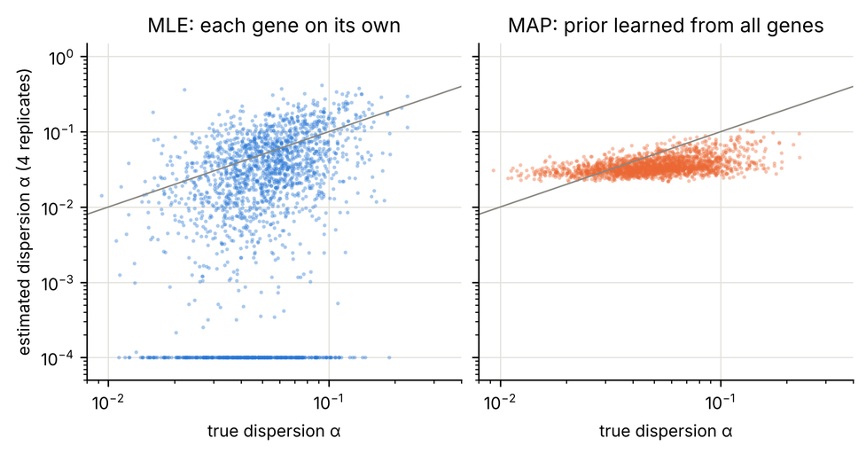

# Day 024 · 参数估计：MLE、MAP 与贝叶斯推断

> 📅 2026-11-27（周五）· 阶段 1「基础补齐」· 第 4 周 · ⏱️ 约 90 分钟
>
> [📅 课程表](../../SYLLABUS.md) · [🗺️ 路线图](../../ROADMAP.md) · 上一篇：[Day 023](../2026-11/day023-2026-11-26.md) · 下一篇：（明天更新）

## 🎯 今日目标

1. 分清“概率”和“似然”，会写出常见分布的最大似然估计（MLE），并能在没有解析解时用数值优化求 MLE。
2. 理解最大后验估计（MAP）：先验为什么相当于正则项，Beta 先验的“伪计数”是什么意思，样本量增大时 MAP 怎样接近 MLE。
3. 会用共轭先验做完整的贝叶斯推断，报告后验均值和可信区间；理解 DESeq2 为什么用经验贝叶斯来估计离散度。

## 📖 核心概念

### 1. 从“概率”到“似然”

昨天我们在已知参数的前提下，计算数据出现的概率。今天反过来：数据已经有了，要推断参数。**似然函数**（likelihood）$L(\theta)=p(D\mid\theta)$ 和概率的公式完全相同，只是把数据固定，把参数当作自变量。

似然不是参数的概率分布。例如某个 CpG 位点被 10 条读段覆盖，其中 3 条是甲基化的，$L(p)=\binom{10}{3}p^3(1-p)^7$ 在 $[0,1]$ 上的面积是 $1/11$，而不是 1（练习 1）。似然回答的问题是：哪个参数值让我们观测到的数据最不意外？

### 2. 最大似然估计（MLE）

$$\hat\theta_{\text{MLE}}=\arg\max_\theta \log p(D\mid\theta)=\arg\max_\theta\sum_i \log p(x_i\mid\theta)$$

取对数把连乘变成求和，数值上也更稳定。常见的结果：二项分布 $\hat p=k/n$；泊松分布 $\hat\lambda=\bar x$；正态分布的均值是 $\bar x$，方差是 $\frac1n\sum_i(x_i-\bar x)^2$（除以 $n$ 而不是 $n-1$，略微偏小）。样本量足够大时，MLE 会接近真值，误差近似服从正态分布。

MLE 与机器学习直接相连：训练模型往往就是最小化**负对数似然**（negative log-likelihood，NLL）。假设误差服从方差固定的正态分布，NLL 就是均方误差；二分类假设伯努利分布，NLL 就是交叉熵（Day 026）。没有解析解时，比如负二项分布的离散度，就用数值优化求解（Day 019 的梯度下降，或练习 2 中 SciPy 的优化器）。

MLE 的弱点在小样本。3 条读段都没有甲基化，$\hat p=0$，等于断言这个位点不可能甲基化；每个基因只有 4 个重复时，约两成基因的离散度 MLE 落在 0 附近（练习 4）。

### 3. 最大后验估计（MAP）

用贝叶斯定理（Day 022）把先验加进来：

$$\hat\theta_{\text{MAP}}=\arg\max_\theta\,\big[\log p(D\mid\theta)+\log p(\theta)\big]$$

对数先验相当于给损失函数加了一个**正则项**：参数服从零均值高斯先验，对应 L2 正则（岭回归、权重衰减）；服从拉普拉斯先验，对应 L1 正则（Lasso，Day 037）。数据越多，似然项越占主导，MAP 越接近 MLE。

例如比例 $p$ 取 $\text{Beta}(a,b)$ 先验，$n$ 次中观察到 $k$ 次成功：

$$\hat p_{\text{MAP}}=\frac{k+a-1}{n+a+b-2}$$

先验相当于事先多看到了 $a-1$ 次成功和 $b-1$ 次失败，这叫**伪计数**（pseudo-count）。

### 4. 完整的贝叶斯推断

MAP 仍然只给出一个数。完整的贝叶斯推断保留整个**后验分布**。Beta 先验与二项似然是**共轭**（conjugate）的，后验仍是 Beta 分布：$\text{Beta}(a+k,\ b+n-k)$。由后验可以得到后验均值 $(k+a)/(n+a+b)$ 和 95% **可信区间**（credible interval），意思是参数落在这个区间内的后验概率为 95%。频率学派的置信区间没有这样直接的解释（PML1 第 4.7.5 节）。取 $a=b=1$（均匀先验）时，后验均值是 $(k+1)/(n+2)$，就是 3Blue1Brown 视频中的拉普拉斯继承法则。没有共轭先验时，要用 MCMC 或变分推断来近似后验，变分推断正是 VAE 的基础（Day 079）。

| | MLE | MAP | 完整的贝叶斯推断 |
|---|---|---|---|
| 结果 | 一个点 | 一个点 | 整个后验分布 |
| 是否需要先验 | 不需要 | 需要 | 需要 |
| 不确定性 | 需另外计算（如似然比区间，练习 2） | 不提供 | 可信区间、预测分布 |
| 机器学习中的对应 | 最小化 NLL | NLL + 正则项 | 高斯过程、贝叶斯神经网络 |

### 5. 经验贝叶斯：先验从哪里来

在基因组学中，先验常常来自数据本身：成千上万个基因或位点告诉我们“典型值是多少、彼此差多少”，这叫**经验贝叶斯**（empirical Bayes）。DESeq2 估计离散度就是这样做的（Love et al. 2014，[Genome Biology](https://doi.org/10.1186/s13059-014-0550-8)）：

1. 先对每个基因单独估计离散度，再拟合离散度随均值变化的趋势（Day 023）；
2. 以趋势值为中心，给 $\log\alpha$ 设一个正态先验，先验的宽度由全部基因估计值的离散程度估出；
3. 求每个基因的 MAP，相当于把单个基因的估计向趋势收缩。估计值比趋势高出 2 个标准差以上的基因保留原来的估计，不做收缩，以免掩盖真正高变异的基因。

练习 4 用模拟数据重现了这个过程。

### 6. 局限与常见误区

- **MLE 假设模型是对的**：模型错了，样本再大，也只会收敛到“最不坏”的错误参数。
- **MAP 依赖先验，也依赖参数化方式**：对 $p$ 和对 $\log p$ 求后验的最大值，结果不同。它只是一个点，不反映不确定性。
- **先验有主观成分**：换几个合理的先验做**敏感性分析**，看结论是否稳定（进阶 2）。
- **收缩有代价**：真正与众不同的个体也会被拉向平均值。练习 4 的图中，离散度最高的那些基因就被低估了。

## 📚 今日资源

| # | 资源 | 学什么 | 建议时长 |
|---|---|---|---|
| 1 | [MML](https://mml-book.github.io/) 第 8.3 节 Parameter Estimation 和第 8.4.2 节 Bayesian Inference | 8.3.1–8.3.2：以回归为例，从高斯似然推导 MLE（负对数似然就是平方误差），加上零均值高斯先验得到 MAP，并说明它和正则化的关系；8.3.3：用不同复杂度的模型说明过拟合；8.4.2：完整的贝叶斯推断与后验预测 | 35 分钟 |
| 2 | [Murphy《Probabilistic Machine Learning: An Introduction》](https://probml.github.io/pml-book/)（免费 PDF）第 4 章选读 | 4.2.1–4.2.3（MLE 的定义、为什么用 MLE、伯努利分布的 MLE）；4.5.1（伯努利分布的 MAP）；4.6.1–4.6.2（共轭先验、beta-binomial 模型）；4.6.6（可信区间） | 35 分钟 |
| 3 | 3Blue1Brown：[Binomial distributions（Probabilities of probabilities, part 1）](https://www.3blue1brown.com/lessons/binomial-distributions) | 从“三个网店卖家，好评分别是 10/10、48/50、186/200，选谁？”出发，讲成功率未知时观测数据的二项概率，以及“先加一个好评、一个差评”的拉普拉斯继承法则（约 12 分钟） | 15 分钟 |

## 🛠️ 动手练习

在 Colab 中依次运行，只需要 NumPy、SciPy、matplotlib 和 scikit-learn（Colab 都已预装）。

**练习 1 · 似然函数：一个 CpG 位点的甲基化水平**

```python
import numpy as np
from scipy import stats, optimize, special
from scipy.integrate import trapezoid

k, n = 3, 10                                     # 某个 CpG 位点被 10 条读段覆盖，其中 3 条是甲基化的
p_grid = np.linspace(0.001, 0.999, 999)
loglik = stats.binom.logpmf(k, n, p_grid)        # 数据固定，把对数似然看作参数 p 的函数
print(f"grid MLE: p = {p_grid[np.argmax(loglik)]:.3f}; closed form k/n = {k / n:.3f}")
print(f"area under the likelihood curve = {trapezoid(np.exp(loglik), p_grid):.4f} (equals 1/(n+1) = {1 / (n + 1):.4f}, not 1)")
for p in [0.1, 0.3, 0.5]:
    print(f"L(p = {p}) = {stats.binom.pmf(k, n, p):.4f}")
```

期望输出：

```text
grid MLE: p = 0.300; closed form k/n = 0.300
area under the likelihood curve = 0.0909 (equals 1/(n+1) = 0.0909, not 1)
L(p = 0.1) = 0.0574
L(p = 0.3) = 0.2668
L(p = 0.5) = 0.1172
```

网格搜索找到的最大值与公式 $k/n$ 一致。似然曲线下的面积是 $1/11$，不是 1，所以似然不是 $p$ 的概率分布。$p=0.3$ 时观测到“10 条中 3 条”的概率最大，约是 $p=0.5$ 时的 2.3 倍。

**练习 2 · 数值求 MLE：一个基因的负二项离散度**

取 Day 023 中 airway 数据的第一个基因 TSPAN6（ENSG00000000003）。它在 4 个对照样本中的计数和大小因子如下，计数服从均值为 $s_j\mu$、离散度为 $\alpha$ 的负二项分布。$\mu$ 和 $\alpha$ 都没有解析解，就让优化器去最小化负对数似然。

```python
y = np.array([723, 904, 1170, 806])             # TSPAN6 在 4 个对照样本中的读段数
s = np.array([0.96, 1.11, 1.10, 0.87])          # 各样本的大小因子（Day 023）

def nll(params):
    """负对数似然。在对数尺度上优化，保证 mu 和 alpha 始终为正。"""
    mu, alpha = np.exp(params)
    r = 1 / alpha
    return -stats.nbinom.logpmf(y, r, r / (r + s * mu)).sum()

res = optimize.minimize(nll, x0=[np.log(y.mean()), np.log(0.1)], method="Nelder-Mead")
mu_hat, alpha_hat = np.exp(res.x)
print(f"MLE: mu = {mu_hat:.0f}, alpha = {alpha_hat:.4f}")

# 似然比区间：固定 alpha、对 mu 取最优（剖面似然），找出负对数似然比最小值高不到 3.84 / 2 的 alpha 范围
def profile_nll(log_alpha):
    return optimize.minimize_scalar(lambda log_mu: nll([log_mu, log_alpha]),
                                    bounds=(np.log(100), np.log(5000)), method="bounded").fun

cut = res.fun + stats.chi2.ppf(0.95, df=1) / 2
lo = optimize.brentq(lambda la: profile_nll(la) - cut, np.log(1e-5), np.log(alpha_hat))
hi = optimize.brentq(lambda la: profile_nll(la) - cut, np.log(alpha_hat), np.log(10))
print(f"95% likelihood-ratio interval for alpha: [{np.exp(lo):.4f}, {np.exp(hi):.3f}]")
```

期望输出：

```text
MLE: mu = 890, alpha = 0.0163
95% likelihood-ratio interval for alpha: [0.0046, 0.102]
```

只有 4 个重复时，95% 区间的上下限相差 20 多倍，单个基因的数据几乎定不住离散度。这正是 DESeq2 要从其他基因“借信息”的原因。

**练习 3 · MAP 与完整的贝叶斯推断：低覆盖度的甲基化位点**

假设我们知道这个区域的位点甲基化水平多在中间，取先验 $\text{Beta}(2, 2)$，相当于事先看到 1 条甲基化和 1 条非甲基化读段。比较不同覆盖度下的三种估计：

```python
a, b = 2, 2
print("    k/n    MLE    MAP  post. mean  95% credible interval")
for k, n in [(0, 3), (3, 10), (30, 100), (300, 1000)]:
    post = stats.beta(a + k, b + n - k)               # 共轭：后验仍是 Beta 分布
    lo_, hi_ = post.ppf([0.025, 0.975])               # 后验分布的 2.5% 和 97.5% 分位数
    print(f"{k:>3}/{n:<4} {k / n:6.3f} {(k + a - 1) / (n + a + b - 2):6.3f} {post.mean():8.3f}      [{lo_:.3f}, {hi_:.3f}]")
```

期望输出：

```text
    k/n    MLE    MAP  post. mean  95% credible interval
  0/3     0.000  0.200    0.286      [0.043, 0.641]
  3/10    0.300  0.333    0.357      [0.139, 0.614]
 30/100   0.300  0.304    0.308      [0.223, 0.399]
300/1000  0.300  0.300    0.301      [0.273, 0.330]
```

只有 3 条读段时，MLE 断言甲基化水平为 0，MAP 和后验均值则被先验拉向中间，可信区间也宽得多，如实反映了“数据太少”。读段增加到 1000 条，三种估计几乎相同，可信区间也收窄到 ±3% 左右。

**练习 4 · 经验贝叶斯：为什么 DESeq2 要收缩离散度**

模拟 2000 个基因，每个基因只有 4 个生物学重复，真实离散度各不相同。先对每个基因单独求 MLE，再像 DESeq2 那样从全部基因估出一个先验，求 MAP，最后与真值比较。

```python
import matplotlib.pyplot as plt

rng = np.random.default_rng(24)
G, J = 2000, 4                                                  # 2000 个基因，每个 4 个重复
mu_true = 10 ** rng.uniform(1, 3, G)                            # 真实均值：10 到 1000
alpha_true = np.exp(rng.normal(np.log(0.05), 0.5, G))           # 真实离散度：中心 0.05，log 尺度标准差 0.5
lam = rng.gamma(1 / alpha_true[:, None], (mu_true * alpha_true)[:, None], size=(G, J))
counts = rng.poisson(lam)                                       # gamma-Poisson 生成负二项计数（Day 023）

# 1. 每个基因单独求 MLE：mu 的 MLE 就是样本均值，alpha 在网格上找对数似然的最大值
grid = np.logspace(-4, 1, 501)
mu_hat = counts.mean(axis=1)
r = 1 / grid[None, :, None]
loglik = stats.nbinom.logpmf(counts[:, None, :], r, r / (r + mu_hat[:, None, None])).sum(axis=2)   # 形状 (基因, 网格)
alpha_mle = grid[loglik.argmax(axis=1)]

# 2. 从全部基因估计先验：log alpha ~ Normal(中心, 方差)
ok = alpha_mle > grid[0]                                        # 去掉落在下界（估计为 0）的基因
log_center = np.median(np.log(alpha_mle[ok]))
resid = np.log(alpha_mle[ok]) - log_center
mad = np.median(np.abs(resid - np.median(resid))) / stats.norm.ppf(0.75)        # 稳健的标准差估计
prior_var = max(mad**2 - special.polygamma(1, (J - 1) / 2), 0.25)              # 减去抽样误差本身的方差（DESeq2 的做法）
print(f"prior: center alpha = {np.exp(log_center):.3f}, sd of log alpha = {np.sqrt(prior_var):.2f}  (truth: 0.050, 0.50)")

# 3. MAP：对数似然 + 对数先验
log_prior = -(np.log(grid) - log_center) ** 2 / (2 * prior_var)
alpha_map = grid[(loglik + log_prior[None, :]).argmax(axis=1)]

for name, est in [("MLE", alpha_mle), ("MAP", alpha_map)]:
    err = np.log2(est / alpha_true)
    print(f"{name}: at lower bound {np.mean(est <= grid[0]):5.1%} | within 2-fold of truth {np.mean(np.abs(err) < 1):5.1%} | median |log2 error| {np.median(np.abs(err)):.2f}")

BLUE, ORANGE, INK_MUTED = "#2a78d6", "#eb6834", "#898781"
plt.rcParams.update({
    "figure.dpi": 120, "savefig.dpi": 300, "savefig.bbox": "tight", "font.size": 9,
    "axes.spines.top": False, "axes.spines.right": False,
    "axes.grid": True, "grid.color": "#e1e0d9", "grid.linewidth": 0.6, "axes.axisbelow": True,
})
fig, axes = plt.subplots(1, 2, figsize=(6.4, 3.3), sharex=True, sharey=True, layout="constrained")
for ax, est, color, title in [(axes[0], alpha_mle, BLUE, "MLE: each gene on its own"),
                              (axes[1], alpha_map, ORANGE, "MAP: prior learned from all genes")]:
    ax.plot([1e-4, 10], [1e-4, 10], color=INK_MUTED, lw=0.8)        # y = x：估计等于真值
    ax.scatter(alpha_true, est, s=4, color=color, alpha=0.4, lw=0, rasterized=True)
    ax.set(xscale="log", yscale="log", xlim=(0.008, 0.4), ylim=(5e-5, 1.5), title=title)
    ax.set_xlabel("true dispersion α")
axes[0].set_ylabel("estimated dispersion α (4 replicates)")
fig.savefig("shrinkage.png")
```

期望输出：

```text
prior: center alpha = 0.035, sd of log alpha = 0.51  (truth: 0.050, 0.50)
MLE: at lower bound 20.4% | within 2-fold of truth 40.8% | median |log2 error| 1.31
MAP: at lower bound  0.0% | within 2-fold of truth 76.8% | median |log2 error| 0.59
```

图应该和下面一致：



灰线是 $y=x$。左图中，单独估计的 MLE 散布在真值上下一个数量级以上，约两成基因落在网格下界（估计为 0），也就是 4 个计数碰巧显得不比泊松分布更分散的情形。右图中，MAP 把每个基因的估计拉向先验中心，与真值相差不到 2 倍的基因从 41% 增加到 77%，中位误差减半。

代价也看得见：右图的点云比 $y=x$ 平坦，真离散度高的基因被低估、低的被高估，这就是收缩带来的偏差。另外，估出的先验中心（0.035）比真值（0.05）偏低，因为用样本均值代替真实均值会系统性地低估离散度，就像方差除以 $n$ 会偏小一样。DESeq2 用 Cox–Reid 校正来减轻这个偏差，还用离散度随均值变化的趋势代替这里的常数中心。

**进阶**：

1. **岭回归就是高斯先验下的 MAP**：线性回归 $y=Xw+\varepsilon$，噪声 $\varepsilon\sim N(0,\sigma^2)$，先验 $w\sim N(0,\tau^2 I)$。写出对数后验，证明 MAP 等价于最小化 $\lVert y-Xw\rVert^2+\lambda\lVert w\rVert^2$，其中 $\lambda=\sigma^2/\tau^2$，再用代码验证：

   ```python
   from sklearn.datasets import load_diabetes
   from sklearn.linear_model import Ridge

   X, y = load_diabetes(return_X_y=True)
   X, y = X - X.mean(axis=0), y - y.mean()                  # 中心化后不需要截距
   w_mle = np.linalg.lstsq(X, y, rcond=None)[0]
   for lam in [0.1, 1.0, 10.0]:
       w_map = np.linalg.solve(X.T @ X + lam * np.eye(X.shape[1]), X.T @ y)   # 高斯先验下 MAP 的解析解
       w_ridge = Ridge(alpha=lam, fit_intercept=False).fit(X, y).coef_
       print(f"lambda = {lam:>4}: max |MAP - Ridge| = {np.abs(w_map - w_ridge).max():.0e}, "
             f"||w_MAP|| = {np.linalg.norm(w_map):6.1f} (MLE: {np.linalg.norm(w_mle):.1f})")
   ```

   两种方法系数的差异在 $10^{-13}$ 量级或更小，只是浮点误差（具体数字因机器而异）。$\lambda$ 为 0.1、1、10 时，$\lVert w_{\text{MAP}}\rVert$ 分别约为 799.5、511.6、145.5，而 MLE 是 1377.8：先验越强（$\tau$ 越小），系数被压得越接近 0。
2. **先验敏感性分析**：把练习 3 的先验换成 $\text{Beta}(1,1)$（均匀先验）和 $\text{Beta}(10,10)$，重新计算后验均值。0/3 时，后验均值分别为 0.200、0.286、0.435（对应 Beta(1,1)、Beta(2,2)、Beta(10,10)），对先验非常敏感；300/1000 时三者都约为 0.30。结论：数据少时一定要报告先验，并检查换一个合理的先验结论是否改变。

## ✅ 自测题

1. 似然函数和概率分布有什么区别？为什么说 $L(p)$ 不是 $p$ 的概率分布？
2. 写出二项分布、泊松分布和正态分布均值的 MLE。为什么通常最大化对数似然？最小化均方误差等价于哪种分布假设下的 MLE？
3. 用 $\text{Beta}(a,b)$ 先验估计比例 $p$，观察到 $n$ 次中 $k$ 次成功。写出 MLE、MAP 和后验均值；解释“伪计数”；样本量增大时三者会怎样？
4. 3Blue1Brown 的卖家问题：三个卖家的好评分别是 10/10、48/50、186/200。用拉普拉斯继承法则（均匀先验下的后验均值）算出三者“下一单是好评”的概率，你会选哪一家？
5. DESeq2 为什么要对离散度做收缩？它和 MAP、经验贝叶斯是什么关系？收缩有什么代价？DESeq2 怎样避免收缩掩盖真正高变异的基因？

<details>
<summary>参考答案</summary>

1. 两者用的是同一个公式 $p(D\mid\theta)$。把参数固定、看不同数据出现的概率，是概率分布，对所有可能的数据求和等于 1；把数据固定、看不同参数下这份数据出现的概率，是似然函数，对参数积分一般不等于 1。练习 1 中 $L(p)$ 在 $[0,1]$ 上的面积是 $1/11$。要得到参数的概率分布，必须乘以先验再归一化，也就是贝叶斯后验。
2. 二项分布 $\hat p=k/n$，泊松分布 $\hat\lambda=\bar x$，正态分布均值 $\hat\mu=\bar x$。独立数据的似然是很多概率的乘积，取对数变成求和，求导更容易，也不会因为连乘很多小数而数值下溢；对数单调递增，最大值的位置不变。假设误差服从方差固定的正态分布 $N(0,\sigma^2)$ 时，负对数似然等于 $\frac{1}{2\sigma^2}\sum_i (y_i-\hat y_i)^2$ 加上常数，所以最小化均方误差就是在做高斯 MLE。
3. MLE：$k/n$；MAP：$(k+a-1)/(n+a+b-2)$；后验均值：$(k+a)/(n+a+b)$。从 MAP 的公式看，先验相当于在数据之外多加了 $a-1$ 次成功和 $b-1$ 次失败，即伪计数；后验均值则相当于多加了 $a$ 次成功和 $b$ 次失败。$n$ 远大于 $a+b$ 时，伪计数可以忽略，三者趋于相同，可信区间也越来越窄（练习 3）。
4. 后验均值 $(k+1)/(n+2)$：卖家 1 为 $11/12\approx 0.917$，卖家 2 为 $49/52\approx 0.942$，卖家 3 为 $187/202\approx 0.926$。按这个标准选卖家 2。卖家 1 虽然全是好评，但只有 10 条，证据太少；卖家 3 证据多，但好评率本身略低。
5. 每个基因通常只有 3–4 个重复，单独估计的离散度噪声极大（练习 2 的区间跨了 20 多倍，练习 4 中约两成估计为 0），用这样的离散度做检验，会产生很多假阳性和假阴性。DESeq2 用全部基因估计出“离散度随均值变化的趋势”和围绕趋势的离散程度，把它当作 $\log\alpha$ 的正态先验，再对每个基因求 MAP。先验来自数据本身，所以叫经验贝叶斯。代价是真正与众不同的基因也被拉向趋势：练习 4 中真离散度高的基因被低估，这会让检验偏于乐观。所以 DESeq2 对估计值高出趋势 2 个标准差以上的基因不做收缩，保留它们原来的估计。

</details>

## 🔭 今日前沿

- **Isomorphic Labs 宣布 50 亿美元 C 轮融资（11 月 17 日）**：这家从 DeepMind 分拆出来、隶属 Alphabet 的 AI 药物设计公司，在 5 月完成 21 亿美元 B 轮后再次融资，由 Greenoaks 和 Sequoia Capital 领投。官方称资金将用于扩展其药物设计引擎 IsoDDE 和 AI 设计的候选药物管线。这说明工业界正在为“AI 设计药物”投入巨额资金，但这些候选药物能否在临床试验中成功，仍有待检验。来源：[Isomorphic Labs](https://www.isomorphiclabs.com/articles/isomorphic-labs-announces-series-c-investment-round)

## 📝 学习打卡

- [ ] 读完 MML 第 8.3 节和第 8.4.2 节
- [ ] 读完 PML1 第 4 章的选读小节
- [ ] 看完 3Blue1Brown 的卖家问题视频
- [ ] 跑通练习 1–4，输出与示例一致
- [ ] 能用自己的话解释 MLE、MAP 和完整的贝叶斯推断的区别，以及先验与正则化的关系
- [ ] 进阶：推导并验证“岭回归 = 高斯先验下的 MAP”，或完成先验敏感性分析
- 今日笔记 / 疑问：
