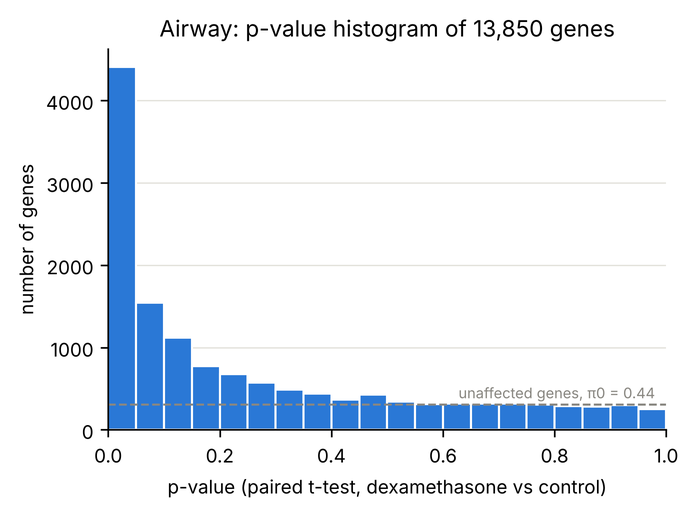

# Day 025 · 假设检验、p 值与多重检验（FDR）

> 📅 2026-11-28（周六）· 阶段 1「基础补齐」· 第 4 周 · ⏱️ 约 90 分钟
>
> [📅 课程表](../../SYLLABUS.md) · [🗺️ 路线图](../../ROADMAP.md) · 上一篇：[Day 024](../2026-11/day024-2026-11-27.md) · 下一篇：（明天更新）

## 🎯 今日目标

1. 说清假设检验的逻辑：原假设、检验统计量、零分布、p 值，以及两类错误和检验功效；知道 p 值“不是什么”。
2. 理解多重检验问题，会用 Bonferroni 控制族错误率（FWER），会手写 Benjamini–Hochberg（BH）方法控制错误发现率（FDR）。
3. 会画并解读 p 值直方图，能识别“先聚类、再检验”这类重复使用数据的陷阱。

## 📖 核心概念

### 1. 假设检验的逻辑

以 airway 数据为例，对每个基因都要问：地塞米松有没有改变它的表达？

- **原假设**（null hypothesis，$H_0$）：没有改变。**备择假设**：有改变。
- **检验统计量**：例如配对 t 统计量，即 4 个细胞系中“处理 − 对照”差值的均值除以它的标准误。
- **零分布**：原假设成立时检验统计量的分布，可以来自理论（t 分布），也可以由置换得到。
- **p 值**：原假设成立时，得到至少和观测值一样极端的统计量的概率。Day 023 练习 1 中“40 条读段有 29 条来自 alt”的 0.0032，就是一个单侧 p 值。

p 值小于事先定好的显著性水平 $\alpha$（常取 0.05）时拒绝原假设。原假设其实为真却被拒绝，是**第一类错误**（假阳性）；原假设其实为假却没被拒绝，是**第二类错误**（假阴性）。真有差异时能检出它的概率叫**检验功效**（power）。

### 2. p 值不是什么

美国统计协会的声明（Wasserstein & Lazar 2016，[The American Statistician](https://doi.org/10.1080/00031305.2016.1154108)）总结了几种常见误解：

- **p 值不是原假设为真的概率**。p 值是 $P(\text{数据这么极端}\mid H_0)$，不是 $P(H_0\mid\text{数据})$，这又是 Day 022 讲的把条件概率弄反。
- **p 值不衡量效应大小**。噪声足够小时，微小的变化也能得到很小的 p 值：练习 3 中 p 值最小的基因只上调了约 12%。
- **p > 0.05 不等于没有差异**，可能只是检验功效不够。

一个有用的事实：如果检验的前提假设成立，原假设为真时 p 值服从 0 到 1 的**均匀分布**（练习 1）。

### 3. 多重检验

同时做 $m$ 个检验，假阳性会累积起来：2 万个基因即使全都没有变化，在 0.05 水平下也预期有约 1000 个“显著”。设 $V$ 是假阳性的个数，$R$ 是判为显著的总数，有两种控制目标：

| | 定义 | 常用方法 | 适用场景 |
|---|---|---|---|
| 族错误率（family-wise error rate，FWER） | $P(V\ge 1)$，至少出现一个假阳性的概率 | Bonferroni：阈值取 $\alpha/m$ | 一个假阳性都代价很高，如 GWAS、临床确证 |
| 错误发现率（false discovery rate，FDR） | $E[V/\max(R,1)]$，发现中假阳性所占比例的期望 | Benjamini–Hochberg | 探索性筛选，如差异表达、CRISPR 筛选 |

GWAS 常用的全基因组显著性阈值 $5\times10^{-8}$，大致相当于对约 100 万个独立检验做 Bonferroni 校正。Bonferroni 的代价是检验功效很低。

### 4. Benjamini–Hochberg 方法

Benjamini & Hochberg 1995（[JRSS B](https://doi.org/10.1111/j.2517-6161.1995.tb02031.x)）的步骤很简单：把 p 值从小到大排成 $p_{(1)}\le\dots\le p_{(m)}$，找到满足 $p_{(k)}\le kq/m$ 的最大的 $k$，拒绝前 $k$ 个原假设。各检验相互独立（或正相关）时，这样做能保证 $\text{FDR}\le q$。也可以把每个 p 值换成 BH 校正后的 p 值（adjusted p-value）。DESeq2 结果中的 `padj` 就是它，“padj < 0.05”的意思是把 FDR 控制在 5%。

FDR 与 Day 022 的阳性预测值是同一件事的两面：一组发现的 FDR 约等于 1 − PPV。绝大多数基因不变时（相当于“患病率”很低），未经校正的“显著”结果中假阳性会占很大比例。

### 5. p 值直方图：先看图，再下结论

MSMB 第 6 章强调，做完成千上万个检验后，第一件事是画 p 值直方图。理想的直方图由两部分组成：原假设为真的基因形成平坦的“底座”，真正变化的基因在 0 附近形成高峰。底座的高度可以用来估计未受影响基因的比例 $\pi_0$。如果直方图在中间鼓起，或在 1 附近堆积，往往说明检验的前提有问题，比如数据是离散的、样本不独立，或者零分布用错了。

### 6. 常见陷阱

- **重复使用数据**（double dipping）：用同一份数据先定义分组、再检验组间差异，p 值会严重偏小。单细胞分析中“先聚类、再找聚类之间的差异基因”就是典型例子（练习 4）。计数拆分（count splitting，Neufeld et al. 2022，[arXiv](https://arxiv.org/abs/2207.00554)，后发表于 Biostatistics）把每个计数随机拆成两份，一份用来聚类，另一份用来检验。
- **p-hacking**：反复尝试不同的分析方案，只报告显著的那一个。
- **只报告 p 值**：还应报告效应大小（如 log2 倍数变化）及其不确定性。
- **按结果筛选再校正**：检验前去掉低表达基因可以减少 $m$、提高功效（DESeq2 的独立过滤会自动这样做），但筛选标准必须与原假设下的检验结果无关，比如平均表达量；不能先按 p 值或倍数变化筛一遍再做校正。

## 📚 今日资源

| # | 资源 | 学什么 | 建议时长 |
|---|---|---|---|
| 1 | [MSMB 第 6 章 Testing](https://www.huber.embl.de/msmb/06-chap.html) | 从抛硬币的例子讲假设检验的逻辑和两类错误，再讲多重检验、错误发现率和 Benjamini–Hochberg 方法，以及 p 值直方图等诊断图。书中代码是 R，读懂思路即可 | 45 分钟 |
| 2 | [ISLP](https://www.statlearning.com/) 第 13 章 Multiple Testing 的 13.1–13.4 节 | 假设检验回顾、多重检验的挑战、FWER（Bonferroni、Holm）与 FDR（Benjamini–Hochberg）。13.5 节用重抽样得到 p 值，可选读 | 25 分钟 |
| 3 | ISLP 第 13 章 Python 实验：[Ch13-multiple-lab.ipynb](https://colab.research.google.com/github/intro-stat-learning/ISLP_labs/blob/v2.2.1/Ch13-multiple-lab.ipynb)（在 Colab 中打开） | 用 statsmodels 的 `multipletests` 对基金经理数据（Fund）和肿瘤基因表达数据（Khan）做 Bonferroni、Holm 和 BH 校正，最后用重抽样方法计算 p 值。运行前先执行 `!pip install ISLP` | 20 分钟 |

## 🛠️ 动手练习

在 Colab 中依次运行。需要 NumPy、SciPy（1.11 及以上版本）、pandas、matplotlib 和 scikit-learn，Colab 都已预装。

**练习 1 · 原假设为真时，p 值服从均匀分布**

```python
import numpy as np
from scipy import stats

rng = np.random.default_rng(25)
m, n = 10_000, 4                                   # 1 万个“基因”，每组 4 个样本
a = rng.normal(size=(m, n))
b = rng.normal(size=(m, n))                        # 两组来自同一个分布：所有原假设都为真
p_null = stats.ttest_ind(a, b, axis=1).pvalue
print(f"fraction p < 0.05: {np.mean(p_null < 0.05):.4f}; fraction p < 0.01: {np.mean(p_null < 0.01):.4f}")
print("counts in 10 equal bins:", np.histogram(p_null, bins=10, range=(0, 1))[0])
```

期望输出：

```text
fraction p < 0.05: 0.0479; fraction p < 0.01: 0.0092
counts in 10 equal bins: [ 990 1033  995 1016 1006  989 1020 1034  969  948]
```

1 万个基因没有一个真的变化，却有约 5% 的 p 值小于 0.05。10 个区间里各有约 1000 个 p 值，这就是均匀分布。

**练习 2 · Bonferroni 与 BH：手写 BH，再比较三种规则**

```python
def bh_adjust(p):
    """Benjamini–Hochberg 校正后的 p 值，即 DESeq2 结果中的 padj。"""
    p = np.asarray(p)
    m = len(p)
    order = np.argsort(p)                                   # 从小到大排序
    scaled = p[order] * m / np.arange(1, m + 1)             # 第 i 小的 p 值乘以 m / i
    adj = np.minimum.accumulate(scaled[::-1])[::-1]         # 从后往前取累积最小值，保证单调
    out = np.empty(m)
    out[order] = np.minimum(adj, 1)
    return out

m, m1, n = 10_000, 1_000, 6                         # 1 万个基因，其中 1000 个真有差异；每组 6 个样本
is_de = np.arange(m) < m1
a = rng.normal(size=(m, n))
b = rng.normal(loc=np.where(is_de, 2.5, 0.0)[:, None], size=(m, n))   # 差异基因的均值相差 2.5 个标准差
p = stats.ttest_ind(a, b, axis=1).pvalue
padj = bh_adjust(p)
print(f"max |by hand - scipy| = {np.abs(padj - stats.false_discovery_control(p)).max():.1e}")

print(f"{'rule':<14}{'found':>6}{'false':>7}{'FDP':>7}{'power':>7}")
for name, hit in [("p < 0.05", p < 0.05), ("Bonferroni", p < 0.05 / m), ("BH q = 0.05", padj < 0.05)]:
    false = np.sum(hit & ~is_de)                    # 判为显著、其实没有差异的基因
    print(f"{name:<14}{hit.sum():>6}{false:>7}{false / max(hit.sum(), 1):>7.3f}{np.sum(hit & is_de) / m1:>7.3f}")
```

期望输出：

```text
max |by hand - scipy| = 2.2e-16
rule           found  false    FDP  power
p < 0.05        1383    413  0.299  0.970
Bonferroni        24      0  0.000  0.024
BH q = 0.05      696     21  0.030  0.675
```

FDP 是这一次模拟中“发现里假阳性所占的比例”，FDR 是它的期望。不做校正时，约三成的“发现”是假的；Bonferroni 没有一个假阳性，却只找回了 2.4% 的真实差异；BH 把假阳性比例压到 3%，同时找回了约 68% 的真实差异。BH 保证的上限其实是 $\pi_0 q = 0.9 \times 0.05 = 0.045$。

**练习 3 · 真实数据：airway 的 p 值直方图**

沿用 Day 014 的过滤方法和配对 t 检验，这次关注全部 p 值的分布。

```python
import pandas as pd
import matplotlib.pyplot as plt

BASE = ("https://raw.githubusercontent.com/bioconnector/workshops/"
        "68ff3e4868b0e5673a1c4399828a3e0adc72f8e4/data")      # 与 Day 014 相同
counts = pd.read_csv(f"{BASE}/airway_scaledcounts.csv", index_col="ensgene")
meta = pd.read_csv(f"{BASE}/airway_metadata.csv", index_col="id")

cpm = counts / counts.sum() * 1e6                   # 与 Day 014 相同的过滤和 log2(CPM + 1)
keep = (cpm >= 1).sum(axis=1) >= 4
logcpm = np.log2(cpm[keep] + 1)
ctrl = meta[meta["dex"] == "control"].sort_values("celltype").index
trt = meta[meta["dex"] == "treated"].sort_values("celltype").index      # 两者按细胞系一一配对
diff = logcpm[trt].to_numpy() - logcpm[ctrl].to_numpy()                 # 每个细胞系内“处理 − 对照”
p = stats.ttest_rel(logcpm[trt].to_numpy(), logcpm[ctrl].to_numpy(), axis=1).pvalue
m = len(p)
padj = stats.false_discovery_control(p)
pi0 = min(1.0, np.mean(p > 0.5) / 0.5)              # Storey 法：p > 0.5 的部分几乎都来自未受影响的基因
print(f"genes tested: {m}")
print(f"p < 0.05: {np.sum(p < 0.05)} (about {0.05 * pi0 * m:.0f} expected from unaffected genes)")
print(f"Bonferroni (p < {0.05 / m:.1e}): {np.sum(p < 0.05 / m)}")
print(f"BH FDR < 0.05: {np.sum(padj < 0.05)}; FDR < 0.10: {np.sum(padj < 0.10)}")
print(f"estimated share of unaffected genes pi0 = {pi0:.2f}")
top = np.argmin(p)
print(f"smallest p = {p[top]:.1e} ({logcpm.index[top]}); log2 fold changes in the 4 cell lines: {diff[top].round(2)}")
lfc = diff.mean(axis=1)
print(f"FDR < 0.05 but |log2FC| < 0.5: {np.sum((padj < 0.05) & (np.abs(lfc) < 0.5))} of {np.sum(padj < 0.05)} genes")

BLUE, INK_MUTED = "#2a78d6", "#898781"
plt.rcParams.update({
    "figure.dpi": 120, "savefig.dpi": 300, "savefig.bbox": "tight", "font.size": 9,
    "axes.spines.top": False, "axes.spines.right": False,
    "axes.grid": True, "grid.color": "#e1e0d9", "grid.linewidth": 0.6, "axes.axisbelow": True,
})
fig, ax = plt.subplots(figsize=(4.8, 3.3))
ax.hist(p, bins=20, range=(0, 1), color=BLUE, edgecolor="white", linewidth=1)
null_level = pi0 * m / 20                            # 每根宽 0.05 的柱子中，来自未受影响基因的期望个数
ax.axhline(null_level, color=INK_MUTED, lw=1, ls="--")
ax.text(0.98, null_level * 1.12, f"unaffected genes, π0 = {pi0:.2f}",
        ha="right", va="bottom", fontsize=7, color=INK_MUTED)
ax.set(xlabel="p-value (paired t-test, dexamethasone vs control)", ylabel="number of genes",
       xlim=(0, 1), title=f"Airway: p-value histogram of {m:,} genes")
ax.grid(axis="x", visible=False)
fig.savefig("pvalue_histogram.png")
```

期望输出：

```text
genes tested: 13850
p < 0.05: 4406 (about 304 expected from unaffected genes)
Bonferroni (p < 3.6e-06): 1
BH FDR < 0.05: 650; FDR < 0.10: 2582
estimated share of unaffected genes pi0 = 0.44
smallest p = 1.2e-06 (ENSG00000265354); log2 fold changes in the 4 cell lines: [0.16 0.16 0.17 0.17]
FDR < 0.05 but |log2FC| < 0.5: 203 of 650 genes
```

图应该和下面一致：



直方图形状健康：右侧接近平坦，0 附近有很高的峰。从底座估计 $\pi_0 \approx 0.44$：按这个估计，一半以上的基因在处理前后出现了可检测的变化，其中不少变化很小，也可能混有技术因素（见进阶 2）。4406 个 p < 0.05 的基因中，按 $\pi_0$ 估计只有约 300 个来自未受影响的基因，所以大多数是真实变化，但我们不知道是哪 300 个，这正是需要 FDR 的原因。Bonferroni 只留下 1 个基因：t 检验只有 3 个自由度，p 值很难小到 $3.6\times10^{-6}$。BH 在 FDR 5% 下找到 650 个。

再看两行警示：p 值最小的基因（注释表中为 TIMM23）在 4 个细胞系中都只上调了约 12%，因为 4 个差值几乎完全一样，t 检验的标准误小得异常，p 值就极小。BH 选出的 650 个基因中，有 203 个的变化不到 1.4 倍（$|\log_2 FC| < 0.5$）。统计显著不等于生物学上重要。DESeq2、limma 这类方法会跨基因“借用”方差信息，避免被这种碰巧很小的方差欺骗，Day 024 的离散度收缩就是一例。

**练习 4 · 陷阱：先聚类、再检验**

模拟 300 个细胞、200 个基因的 UMI 计数，所有细胞来自同一个群体，没有任何真实的细胞类型。先用 k-means 把细胞分成两群，再检验两群之间的差异基因：

```python
from sklearn.cluster import KMeans

n_cells, n_genes = 300, 200
lam = np.exp(rng.uniform(0, 2, n_genes))            # 每个基因的平均表达量：1 到 7.4 个 UMI
X = rng.poisson(lam, size=(n_cells, n_genes))       # 所有细胞服从同一个分布

def cluster_then_test(X_cluster, X_test):
    """在 X_cluster 上聚成两群，再在 X_test 上逐个基因做 Welch t 检验。"""
    labels = KMeans(n_clusters=2, n_init=10, random_state=0).fit_predict(np.log1p(X_cluster))
    Z = np.log1p(X_test)
    p = stats.ttest_ind(Z[labels == 0], Z[labels == 1], axis=0, equal_var=False).pvalue
    return labels, p

labels, p_dd = cluster_then_test(X, X)              # 用同一份数据聚类和检验
print(f"double dipping: cluster sizes {np.bincount(labels)}, p < 0.05 for {np.mean(p_dd < 0.05):.0%} of genes, "
      f"BH discoveries {np.sum(stats.false_discovery_control(p_dd) < 0.05)}")

X_train = rng.binomial(X, 0.5)                      # 计数拆分：每个 UMI 以 1/2 的概率分到训练集
X_test = X - X_train                                # 对泊松数据，两份彼此独立
labels, p_cs = cluster_then_test(X_train, X_test)
print(f"count splitting: cluster sizes {np.bincount(labels)}, p < 0.05 for {np.mean(p_cs < 0.05):.0%} of genes, "
      f"BH discoveries {np.sum(stats.false_discovery_control(p_cs) < 0.05)}")
```

期望输出（具体数字可能因 scikit-learn 版本略有不同）：

```text
double dipping: cluster sizes [143 157], p < 0.05 for 28% of genes, BH discoveries 28
count splitting: cluster sizes [128 172], p < 0.05 for 4% of genes, BH discoveries 0
```

数据里明明没有细胞类型，k-means 仍然会把细胞切成两群，而且切分方式恰好让两群在某些基因上差别最大。在同一份数据上检验，近三成的基因 p < 0.05，BH 还给出了 28 个“差异基因”。计数拆分后，聚类和检验用的是彼此独立的两份数据，p < 0.05 的比例回到 5% 左右，BH 一个也没发现。

**进阶**：

1. **小样本的置换检验有多粗糙**：配对设计下，原假设成立时每对样本的“处理 / 对照”标签可以互换，相当于随机翻转每个差值的正负号。4 对样本只有 $2^4 = 16$ 种翻转方式：

   ```python
   import itertools

   d = diff[top]                                                          # 练习 3 中 p 值最小的基因
   signs = np.array(list(itertools.product([1, -1], repeat=len(d))))     # 16 种正负号组合
   null = np.abs((signs * d).mean(axis=1))                                # 置换得到的零分布
   print(f"sign-flip permutation p = {np.mean(null >= abs(d.mean())):.3f} (smallest possible: {2 / len(signs):.3f})")
   ```

   输出 `sign-flip permutation p = 0.125 (smallest possible: 0.125)`。只有 4 对样本时，置换检验的 p 值最小也是 0.125，不可能通过任何多重检验校正。小样本研究只能依靠分布假设（t 分布、负二项分布）来获得更小的 p 值，所以更要检查这些假设是否成立。
2. **归一化与组成偏差**：练习 3 用的是 CPM。改用 Day 023 的中位数比值法归一化，比较两种方法下所有基因 log2 倍数变化的中位数、$\pi_0$ 和 BH 发现数：

   ```python
   X = counts[keep]
   log_X = np.log(X[(X > 0).all(axis=1)])
   sf = np.exp(log_X.sub(log_X.mean(axis=1), axis=0).median())          # 中位数比值法（Day 023）
   for name, L in [("CPM", logcpm), ("median-of-ratios", np.log2(X / sf + 1))]:
       d2 = L[trt].to_numpy() - L[ctrl].to_numpy()
       p2 = stats.ttest_rel(L[trt].to_numpy(), L[ctrl].to_numpy(), axis=1).pvalue
       print(f"{name:>16}: median log2FC = {np.median(d2.mean(axis=1)):+.3f}, pi0 = {np.mean(p2 > 0.5) / 0.5:.2f}, "
             f"FDR < 0.05: {np.sum(stats.false_discovery_control(p2) < 0.05)}")
   ```

   用 CPM 时，所有基因的 log2 倍数变化中位数约为 −0.075：少数高表达基因被强烈上调后，占去了更多读段，其余基因的 CPM 就被整体拉低了。中位数比值法基本消除了这个偏移（约 −0.009），BH 发现数也随之从 650 变为 547。

## ✅ 自测题

1. 一项研究报告某基因“p = 0.03”。下面哪些解读是错的，为什么？(a) 原假设为真的概率是 3%；(b) 如果原假设为真，得到至少这么极端结果的概率是 3%；(c) 这个基因的变化很大；(d) 重复实验有 97% 的把握再次得到显著结果。
2. 原假设为真时，p 值服从什么分布？这个性质怎样帮助我们解读 p 值直方图、估计 $\pi_0$？
3. 2 万个基因都没有变化，在 0.05 水平下预期会有多少个“显著”？Bonferroni 的阈值是多少？为什么 Bonferroni 在差异表达分析中常常太保守？
4. 10 个检验的 p 值从小到大为：0.001、0.008、0.039、0.041、0.042、0.06、0.074、0.205、0.212、0.216。在 0.05 水平下，不校正、Bonferroni 和 BH 分别判定几个显著？请手算 BH。
5. 为什么“先聚类、再在聚类之间做差异检验”会产生大量假阳性？计数拆分是怎样解决这个问题的？

<details>
<summary>参考答案</summary>

1. (a) 错：p 值是 $P(\text{数据这么极端}\mid H_0)$，不是 $P(H_0\mid\text{数据})$；后者还取决于先验，即这类基因中真正变化的比例（Day 022）。(b) 对，这就是 p 值的定义。(c) 错：p 值不衡量效应大小，变化很小但噪声更小、或样本量很大时，p 值也可以很小（练习 3 的 TIMM23）。(d) 错：重复实验得到显著结果的概率取决于真实效应和检验功效，p = 0.03 时这个概率往往远低于 97%。
2. 均匀分布：$P(p < t) = t$。真实数据的 p 值是“均匀的底座（原假设为真的基因）+ 0 附近的高峰（真正变化的基因）”。远离 0 的区域（例如 p > 0.5）几乎全是原假设为真的基因，它们在 $[0.5, 1]$ 上均匀分布，所以 $\pi_0 \approx \#\{p > 0.5\} / (0.5m)$。如果直方图不是这个形状，比如在 1 附近堆积或中间鼓起，就要怀疑检验的前提出了问题。
3. 预期 $20000 \times 0.05 = 1000$ 个。Bonferroni 的阈值是 $0.05 / 20000 = 2.5\times10^{-6}$。它控制的是“至少出现一个假阳性”的概率，在差异表达这类探索性筛选中，这个要求太严：样本少时，p 值很难小到这种程度（练习 3 中只剩 1 个基因），大量真实变化会被漏掉。筛选研究更关心发现中有多少比例是假的，所以用 FDR。
4. 不校正：p < 0.05 的有 5 个（0.001、0.008、0.039、0.041、0.042）。Bonferroni：阈值 $0.05/10 = 0.005$，只有 1 个（0.001）。BH：第 $k$ 个 p 值的阈值是 $0.005k$，依次为 0.005、0.010、0.015、…、0.050。$p_{(1)} = 0.001 \le 0.005$，$p_{(2)} = 0.008 \le 0.010$；从第 3 个起，$p_{(3)} = 0.039 > 0.015$，后面的也都超过各自的阈值。满足条件的最大 $k$ 是 2，所以 BH 判定 2 个显著（对应的 BH 校正 p 值为 0.01 和 0.04）。
5. 聚类算法会主动寻找让两群差别最大的切分方式，即使数据中根本没有真实的群体。在同一份数据上检验，检验的就是聚类算法自己“制造”出来的差异，零分布不再成立，p 值系统性偏小（练习 4 中近三成的基因 p < 0.05）。计数拆分把每个 UMI 计数随机分成两份，对泊松数据来说两份彼此独立：在一份上聚类，在另一份上检验，检验数据没有参与定义分组，p 值就恢复了应有的分布。

</details>

## 🔭 今日前沿

- **ESM 3.5.0 发布（11 月 18 日）**：Biohub 的 ESM 软件包新版本为 ESMFold2 加入了“big”内存模式：用速度换更低的 GPU 显存峰值，让更大的复合物也能折叠；在多块 GPU 上运行时，还能把 $N \times N$ 的配对表示按行拆分到各块 GPU 上。官方示例折叠了一个 3,350 个残基的输入。软件包以 MIT 许可开源。来源：[GitHub](https://github.com/Biohub/esm/releases/tag/v3.5.0) · [PyPI](https://pypi.org/project/esm/3.5.0/)

## 📝 学习打卡

- [ ] 读完 MSMB 第 6 章
- [ ] 读完 ISLP 第 13.1–13.4 节，并在 Colab 中跑一遍第 13 章的实验
- [ ] 跑通练习 1–4，输出与示例基本一致
- [ ] 能手算 BH，并说清 FWER 与 FDR 的区别
- [ ] 进阶：理解为什么 4 对样本的置换检验 p 值不可能小于 0.125，或比较两种归一化方法
- 今日笔记 / 疑问：
